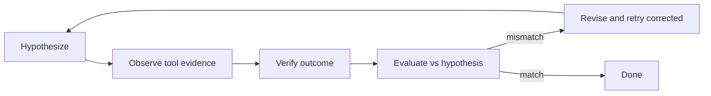
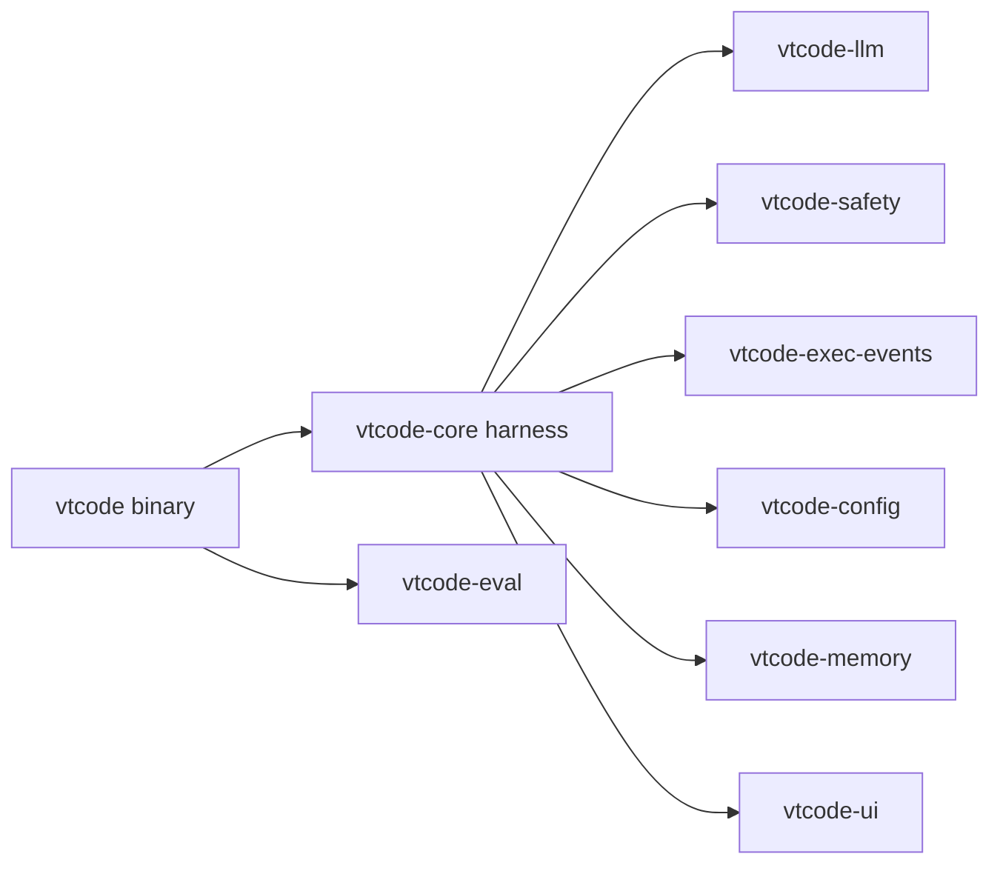

# VT Code

<div align="center">


**An open-source coding agent for your terminal.**

Plan, build, and review with hosted or local models, sandboxed tools, and resumable sessions.

[](https://github.com/vinhnx/VTCode/releases)
[](https://github.com/vinhnx/VTCode)
[](#license)

[](https://agentskills.io/)
[](./docs/guides/zed-acp.md)
[](./docs/guides/mcp-integration.md)
[](./docs/guides/agent-plugins.md)
<a href="https://deepwiki.com/vinhnx/vtcode"></a>

<!-- markdownlint-disable-next-line MD013 -->

</div>

## Contents

- [Overview](#overview)
- [Quick start](#quick-start)
- [Usage](#usage)
- [Documentation](#documentation)
- [Development](#development)
- [Contributing](#contributing)
- [Security](#security)
- [Community and support](#community-and-support)
- [License](#license)

## Overview

VT Code runs in your terminal and works on your repository: explore, plan, edit, and verify with the model you
choose. It owns context, tool calls, and execution policy, so long tasks stay auditable and resumable.

| At a glance      | What you get                                                                         |
| ---------------- | ------------------------------------------------------------------------------------ |
| **Planning**     | [Plan read-only](./docs/guides/planning-workflow.md), then review turn diffs.        |
| **Safety**       | [Auditable command policy](./docs/security/SECURITY_MODEL.md) and sandboxing.        |
| **Self-correct** | [HOVER loop](./docs/development/hypothesis-revision-validation.md) on tool mismatch. |
| **Long runs**    | [Headless exec](./docs/user-guide/exec-mode.md) with compaction and resumption.      |
| **Integrations** | [MCP](./docs/guides/mcp-integration.md), Skills, plugins, and editor bridges.        |
| **Models**       | [Hosted or local providers](./docs/README.md#provider-index) per task.               |



Every loop states the expected outcome, gathers bounded evidence, and revises only when the evidence disagrees.
See the [HOVER acceptance table](./docs/development/hypothesis-revision-validation.md) for the full contract.

## Quick start

Requirements: macOS, Linux, or Windows/WSL. Building from source needs Rust 1.98.1+ (edition 2024).

### 1. Install

```bash
# Review the installer script before running it: https://github.com/vinhnx/VTCode/blob/main/scripts/install.sh
curl -fsSL https://raw.githubusercontent.com/vinhnx/VTCode/main/scripts/install.sh | bash
```

The installer also attempts to add the optional `ripgrep` and `ast-grep` search tools. To manage installation
yourself, use Homebrew or Cargo:

```bash
brew trust vinhnx/tap
brew install vinhnx/tap/vtcode

# Or install from crates.io
cargo install vtcode
```

On Windows, install with PowerShell; Windows artifacts are best-effort and may lag behind macOS/Linux:

```powershell
irm https://raw.githubusercontent.com/vinhnx/VTCode/main/scripts/install.ps1 | iex
```

Run `vtcode --version` to verify the installation. The [installation guide](./docs/installation/README.md) covers
prerequisites, other install methods, and optional search tools.

### 2. Configure your project

In your project directory, scaffold the configuration and agent instructions, then add credentials for your provider.
For example, to use OpenAI:

```bash
cd path/to/your/project
vtcode init                # scaffolds config + AGENTS.md; review before committing
vtcode secret add openai   # stores your OpenAI API key in secure storage
```

Replace `openai` with your provider. `vtcode secret add` uses secure storage (OS keyring or encrypted file). You can
also set credentials in environment variables or a workspace `.env` file, or use `vtcode login` if your provider has a
supported login flow. See
[Getting started](./docs/user-guide/getting-started.md) and [Provider guides](./docs/providers/PROVIDER_GUIDES.md) for
provider-specific instructions.

> [!NOTE]
> ChatGPT OAuth reuses the Codex CLI's public client identity via an unofficial compatibility flow; prefer your
> own OpenAI API key. GitHub Copilot uses the official `copilot` CLI. See
> [OAuth authentication](./docs/guides/oauth-authentication.md).

<!-- -->

> [!CAUTION]
> Keep API keys out of Git and `vtcode.toml`. If you use a workspace `.env` file, make sure it is not committed.

### 3. Run your first task

```bash
vtcode   # open the interactive TUI in your project
```

Ask a focused question, such as "Explain how this project handles authentication," and review proposed changes and
test results before committing. For automation and session commands, see [Usage](#usage); for a guided walkthrough,
see the [getting started guide](./docs/user-guide/getting-started.md).

## Usage

Common commands:

| Goal                    | Command                                             |
| ----------------------- | --------------------------------------------------- |
| Start the TUI           | `vtcode`                                            |
| Ask without tools       | `vtcode ask "explain Rc vs Arc"`                    |
| Run a task headlessly   | `vtcode exec "refactor main.rs"`                    |
| Review pending changes  | `vtcode review`                                     |
| Schedule recurring work | `vtcode schedule create --prompt "..." --every 1h`  |
| Resume the last session | `vtcode continue`                                   |
| Inspect a run log       | `vtcode trajectory`                                 |

### Interactive

Use `vtcode` to explore, plan, and implement changes in the TUI. For larger tasks, start with
[read-only planning](./docs/guides/planning-workflow.md) and review the
[turn diff](./docs/development/diff-preview.md) before committing. `/explain` then summarizes the outcome,
changes, decisions, and verification without another model call; see the
[explanation options](./docs/user-guide/commands.md#execution-explanations) and the
[interactive guide](./docs/user-guide/interactive-mode.md) for controls.

### Headless

`ask` is tool-free, `exec` runs the full tool loop, and `review` inspects uncommitted changes:

```bash
vtcode ask "explain Rc vs Arc"
vtcode exec "refactor main.rs"
vtcode review
```

### Automation

`exec` runs the full tool loop and requires `[automation.full_auto]` plus `full_auto` workspace trust. Interactive
terminals prompt for trust. Non-TTY runs require `VTCODE_TRUST_WORKSPACE=full-auto`; tool allow-lists, explicit denies,
and execution policy still apply. See [exec mode](./docs/user-guide/exec-mode.md) and
[full automation](./docs/guides/full-automation.md) for configuration and output details.

Recurring work uses [scheduled tasks](./docs/user-guide/scheduled-tasks.md), durable prompt jobs on the same exec
runtime:

```bash
# Weekly dependency audit (Mondays 09:00)
vtcode schedule create --name "weekly-dep-audit" \
  --cron "0 9 * * 1" \
  --prompt "Check for outdated dependencies and report known vulnerabilities"
```

### Sessions

Resume or inspect earlier work:

```bash
# Resume the most recent interactive session
vtcode continue

# Continue the last headless run with a follow-up prompt
vtcode exec resume --last "continue the refactor"

# Inspect the execution log
vtcode trajectory
```

Use `vtcode continue --session-id <id>` to fork an earlier session.

## Documentation

Guides grouped by task. The full catalog lives in the [documentation index](./docs/INDEX.md), the
[docs overview](./docs/README.md), and the [Wiki](https://github.com/vinhnx/VTCode/wiki). Integrations are optional;
none are required for the quick start.

<!-- markdownlint-disable MD060 -->

| Goal                 | Guides                                                                                                                                                                                                                                                           |
| -------------------- | ---------------------------------------------------------------------------------------------------------------------------------------------------------------------------------------------------------------------------------------------------------------- |
| Get started          | [Installation](./docs/installation/README.md) · [Getting started](./docs/user-guide/getting-started.md) · [Providers](./docs/providers/PROVIDER_GUIDES.md) · [OAuth login](./docs/guides/oauth-authentication.md) · [FAQ](./docs/FAQ.md) · [Compatibility](./docs/COMPATIBILITY.md) |
| Work in the TUI      | [TUI](./docs/user-guide/interactive-mode.md) · [Command reference](./docs/user-guide/commands.md) · [Planning](./docs/guides/planning-workflow.md) · [Turn diffs](./docs/development/diff-preview.md) · [Configuration](./docs/config/CONFIG_FIELD_REFERENCE.md) · [Safety](./docs/security/SECURITY_MODEL.md) |
| Automate             | [Full automation](./docs/guides/full-automation.md) · [Decisions probe](./docs/guides/decisions-probe.md) · [Scheduled tasks](./docs/user-guide/scheduled-tasks.md) · [Hooks](./docs/guides/hooks-guide.md)                                   |
| Extend and integrate | [Skills](./docs/skills/SKILLS_GUIDE.md) · [Plugins](./docs/guides/agent-plugins.md) · [MCP](./docs/guides/mcp-integration.md) · [Editors (ACP)](./docs/guides/zed-acp.md) · [WebMCP](./docs/user-guide/webmcp.md) · [Companion (experimental)](./docs/user-guide/vtcode-companion.md) · [Memcode](./docs/guides/memcode-mcp.md) · [WebMCP deployment](./docs/reference/webmcp.md) |
| Develop and evaluate | [Development](./docs/development/README.md) · [Testing](./docs/development/testing.md) · [Evals](./docs/guides/eval.md) · [Architecture](./docs/ARCHITECTURE.md) · [HOVER](./docs/development/hypothesis-revision-validation.md) · [Protocols](./docs/protocols/OPEN_RESPONSES.md) · [Loop engineering](./docs/project/PLAN-loop-engineering.md) |

<!-- markdownlint-enable MD060 -->

Elsewhere: [WebMCP app](https://vtcode.vinhnx.chatgpt.site/) · [mirror](https://vinhnx.github.io/VTCode/) ·
[Memcode write-up](https://memcode.in/blogs/vt-code-memory-across-threads).

## Development



Build with Rust 1.98.1+ (edition 2024) and install `cargo-nextest` to run tests. Context handling separates session
history from provider request projections; see [context architecture](./docs/ARCHITECTURE.md#request-projection-and-context-budgets)
and the [compaction guide](./docs/development/compaction.md). The [architecture guide](./docs/ARCHITECTURE.md) maps all
23 crates.

```bash
git clone https://github.com/vinhnx/VTCode.git
cd VTCode
./scripts/run-debug.sh     # build and launch a debug binary
./scripts/check-dev.sh     # fast gate: clippy, fmt, check
cargo nextest run          # tests (requires cargo-nextest)
```

CI builds with `--locked` and `RUSTFLAGS="-D warnings"`; match locally with
`RUSTFLAGS="-D warnings" cargo check --locked`. Setup and checks are documented in the
[development overview](./docs/development/README.md) and the [testing guide](./docs/development/testing.md).

Release binaries and notes: [GitHub releases](https://github.com/vinhnx/VTCode/releases).

## Contributing

Contributions are welcome: code, docs, [evals](./docs/guides/eval.md), and bug reports (include `vtcode trajectory`
output when possible). Before a PR, read the [contribution guide](./docs/CONTRIBUTING.md) for Conventional Commits,
the local gates, and diff expectations.

## Security

Report vulnerabilities privately via
[GitHub private vulnerability reporting](https://github.com/vinhnx/VTCode/security/advisories/new); never open a public
issue. Details: [security policy](./docs/SECURITY.md).

## Community and support

VT Code is created and maintained by [@vinhnx](https://github.com/vinhnx), with help from everyone in the grid below.
Whether you write code, fix docs, or just try a release and tell me what broke, you are welcome here.

- [Report a bug](https://github.com/vinhnx/VTCode/issues/new?template=bug_report.md) - something looks off? Tell me,
  and include `vtcode trajectory` output if you can.
- [Request a feature](https://github.com/vinhnx/VTCode/issues/new?template=feature_request.md) - describe the workflow
  you wish worked better.
- [Ask a question or share feedback](https://github.com/vinhnx/VTCode/discussions) - no question is too small.
- [Good first issues](https://github.com/vinhnx/VTCode/labels/good%20first%20issue) - friendly, self-contained places
  to start.
- [Help wanted](https://github.com/vinhnx/VTCode/labels/help%20wanted) - bigger items where a second pair of hands
  would genuinely help.
- [Contributing guide](./docs/CONTRIBUTING.md) - setup, checks, and commit conventions.

New to open source or to Rust? That is completely fine. Pick a good first issue or a docs fix, leave a comment, and I
will help you scope it and land it. The [Code of Conduct](./docs/CODE_OF_CONDUCT.md) keeps review kind and
constructive.

Partnerships and private matters: `vinhnguyen2308 [at] gmail [dot] com`.

Thank you to everyone below - you are the reason this project keeps moving.

<details>
<!-- CONTRIBUTORS-COUNT:START --><summary>View all contributors (28)</summary><!-- CONTRIBUTORS-COUNT:END -->

<!-- CONTRIBUTORS:START -->

<!-- markdownlint-disable MD013 -->

### Security Advisors

<a href="https://github.com/glmgbj233"></a>&nbsp;
<a href="https://github.com/nnfrog"></a>&nbsp;

### Main Contributor

<a href="https://github.com/kernitus"></a>&nbsp;

### Core Contributors

<a href="https://github.com/7jrxt42BxFZo4iAnN4CX"></a>&nbsp;
<a href="https://github.com/ct-jaryn"></a>&nbsp;
<a href="https://github.com/oiwn"></a>&nbsp;
<a href="https://github.com/Sachin-Bhat"></a>&nbsp;
<a href="https://github.com/chenrui333"></a>&nbsp;
<a href="https://github.com/xcrong"></a>&nbsp;
<a href="https://github.com/netbrah"></a>&nbsp;
<a href="https://github.com/leonj1"></a>&nbsp;
<a href="https://github.com/gzsombor"></a>&nbsp;

### Contributors

<a href="https://github.com/vivekgupta-memcode"></a>&nbsp;
<a href="https://github.com/S2thend"></a>&nbsp;
<a href="https://github.com/uiYzzi"></a>&nbsp;
<a href="https://github.com/TuanLe-bk18"></a>&nbsp;
<a href="https://github.com/shouryamaanjain"></a>&nbsp;
<a href="https://github.com/Sanjays2402"></a>&nbsp;
<a href="https://github.com/rs545837"></a>&nbsp;
<a href="https://github.com/RobertBorg"></a>&nbsp;
<a href="https://github.com/raphamorim"></a>&nbsp;
<a href="https://github.com/poelzi"></a>&nbsp;
<a href="https://github.com/morler"></a>&nbsp;
<a href="https://github.com/georgeatparallel"></a>&nbsp;
<a href="https://github.com/ForrestThump"></a>&nbsp;
<a href="https://github.com/EvoLinkAI"></a>&nbsp;
<a href="https://github.com/ericcurtin"></a>&nbsp;
<a href="https://github.com/diegosouzapw"></a>&nbsp;

<!-- markdownlint-enable MD013 -->

<!-- CONTRIBUTORS:END -->

</details>

Want to see your avatar here? Every bit counts - a one-line fix, a bug report, or a thoughtful comment. Not sure where
to begin? Say hello on a [good first issue](https://github.com/vinhnx/VTCode/labels/good%20first%20issue) and we will
figure it out together.

### Resources

- [Building VT Code, a year in](https://huggingface.co/blog/vinhnx90/building-vtcode-a-year-in): harness design,
  evals, security, and lessons learned.
- [Podcast](https://www.youtube.com/watch?v=XLoswcd5rH0) · [Video](https://www.youtube.com/watch?v=PvL_kPjgU6o)

### Share VT Code

If VT Code helped you ship something, spread the word:

- [Share on X](https://twitter.com/intent/tweet?text=VT%20Code%20is%20an%20open-source%20coding%20agent%20for%20your%20terminal&url=https%3A%2F%2Fgithub.com%2Fvinhnx%2FVTCode)
- [Share on Hacker News](https://news.ycombinator.com/submitlink?u=https%3A%2F%2Fgithub.com%2Fvinhnx%2FVTCode&t=VT%20Code%20%E2%80%93%20Open-source%20coding%20agent%20for%20your%20terminal)
- [Share on LinkedIn](https://www.linkedin.com/sharing/share-offsite/?url=https%3A%2F%2Fgithub.com%2Fvinhnx%2FVTCode)
- [Share via Email](mailto:?subject=VT%20Code%3A%20open-source%20coding%20agent%20for%20your%20terminal&body=Check%20out%20VT%20Code%2C%20an%20open-source%20coding%20agent%20for%20your%20terminal%3A%20https%3A%2F%2Fgithub.com%2Fvinhnx%2FVTCode)
- [Share via SMS](sms:?&body=Check%20out%20VT%20Code%2C%20an%20open-source%20coding%20agent%20for%20your%20terminal%3A%20https%3A%2F%2Fgithub.com%2Fvinhnx%2FVTCode)

### Sponsorship

VT Code is maintained in spare time; a [sponsorship](https://github.com/sponsors/vinhnx) keeps it independent.

<div align="center">

[](https://github.com/dnhn)&nbsp;
[](https://github.com/codemod)&nbsp;
[](https://github.com/coderabbitai)&nbsp;
[](https://github.com/KhaiRyth)

<!-- markdownlint-disable-next-line MD013 -->

[](https://github.com/sponsors/vinhnx)
[](https://buymeacoffee.com/vinhnx)

</div>

## License

First-party code is **MIT OR Apache-2.0** under [LICENSE](LICENSE). Third-party code keeps its original licenses,
listed in [THIRD-PARTY-NOTICES](THIRD-PARTY-NOTICES).
