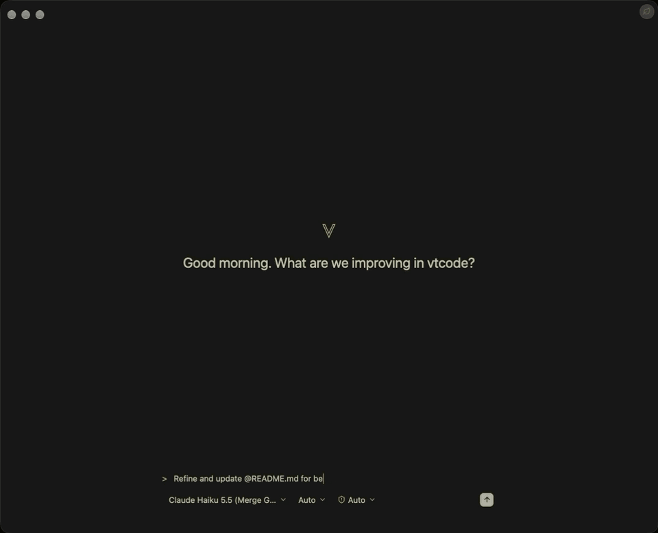
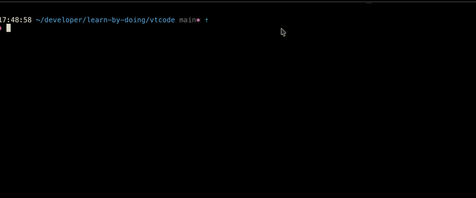
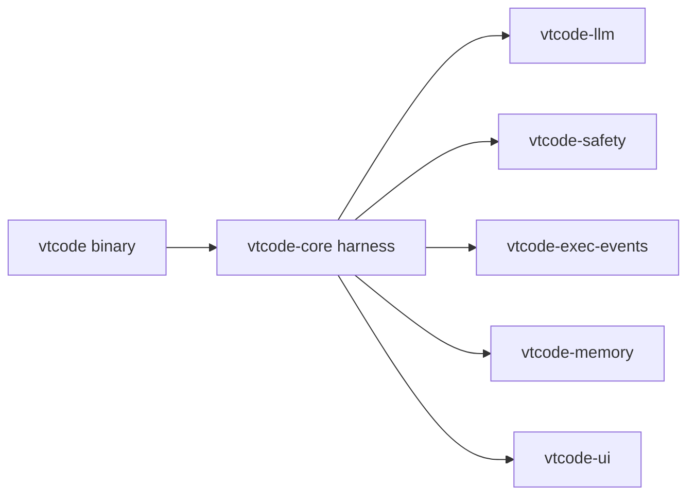

<!-- markdownlint-disable-next-line MD041 -->
<div align="center">


<p>
  <sub>Terminal-first coding agent. Desktop-ready on macOS.</sub><br />
  <sub>Explore, plan, edit, and verify with your model of choice.</sub>
</p>

[](https://github.com/vinhnx/vtcode)
[](#license)
[](https://github.com/vinhnx/vtcode/releases)
[](https://github.com/vinhnx/vtcode)
[](https://github.com/vinhnx/vtcode/forks)

<!-- NB: not https://deepwiki.com/badge.svg — that route is behind a Vercel bot
  challenge, so GitHub's camo proxy gets 429 and renders the alt text instead.
  This shields.io URL reproduces the same 109x20 badge, logo, and colors. -->
<!-- markdownlint-disable-next-line MD013 -->

[](https://deepwiki.com/vinhnx/vtcode)
[](#desktop-app)
[](#desktop-app)

<p>
  
  <sub>Desktop app</sub>
</p>

<p>
  <br />
  <sub>Terminal TUI</sub>
</p>

</div>

## Overview

VT Code is a terminal-first coding agent for your repo, in the CLI and native macOS app.
Context, tool calls, and execution policy stay auditable and resumable across long tasks.

VT Code is open source under **MIT OR Apache-2.0**. You are welcome to fork it, use it, copy it, modify it,
and build on it, and contribute improvements back upstream. See [Contributing](#contributing) and
[License](#license).

| At a glance      | What you get                                                                                                        |
| ---------------- | ------------------------------------------------------------------------------------------------------------------- |
| **Planning**     | [Plan read-only](./docs/guides/planning-workflow.md), then review [turn diffs](./docs/development/diff-preview.md). |
| **Safety**       | [Auditable command policy](./docs/security/SECURITY_MODEL.md) with sandboxing.                                      |
| **Self-correct** | [HOVER loop](./docs/development/hypothesis-revision-validation.md) revises on mismatch.                             |
| **Long runs**    | [Headless exec](./docs/user-guide/exec-mode.md) with resume and compaction; [snapshots](./docs/user-guide/commands.md) roll back workspace state. |
| **Subagents**    | Spawn [subagents](./docs/user-guide/subagents.md) for parallel exploration and delegated work.                       |
| **Integrations** | [MCP](./docs/guides/mcp-integration.md), [skills](./docs/skills/SKILLS_GUIDE.md), [plugins](./docs/guides/agent-plugins.md), [hooks](./docs/guides/hooks-guide.md), editor bridges. |
| **Protocols**    | [A2A](./docs/a2a/README.md), [ACP](./docs/guides/zed-acp.md), [WebMCP](./docs/user-guide/webmcp.md), and [Companion](./docs/user-guide/vtcode-companion.md). |
| **Quality**      | [Evals](./docs/guides/eval.md) measure agent behavior before release.                                               |
| **Models**       | [Hosted or local providers](./docs/providers/PROVIDER_GUIDES.md) per task.                                          |

## Quick start

Three steps on macOS, Linux, or Windows/WSL. Source builds need Rust 1.99.1+ (edition 2024). VT Code is
self-contained: it ships its own search engine and needs no external search binaries. (The legacy
`vtcode dependencies install search-tools` step is deprecated — native search has replaced it; see the
[installation guide](./docs/installation/README.md) for prerequisites.)

### 1. Install

```bash
# Review the installer script before running it: https://github.com/vinhnx/vtcode/blob/main/scripts/install.sh
curl -fsSL https://raw.githubusercontent.com/vinhnx/vtcode/main/scripts/install.sh | bash
```

Or install with Homebrew or Cargo (desktop cask: [Desktop app](#desktop-app)):

```bash
brew trust vinhnx/tap && brew install vinhnx/tap/vtcode

# Or install from crates.io (published; see the installation guide)
cargo install vtcode
```

On Windows (best-effort artifacts; may lag behind macOS/Linux):

```powershell
irm https://raw.githubusercontent.com/vinhnx/vtcode/main/scripts/install.ps1 | iex
```

Verify with `vtcode --version`. Windows artifacts are best-effort and may not appear in every release. The
[installation guide](./docs/installation/README.md) covers remaining methods and desktop flags.

### 2. Configure your project

In your project directory, scaffold config and add credentials:

```bash
cd path/to/your/project
vtcode init                # scaffolds config + AGENTS.md; review before committing
vtcode secret add openai   # stores your OpenAI API key in secure storage
```

Replace `openai` with your provider. Keys use secure storage (OS keyring or encrypted file); environment
variables, a workspace `.env` file, or `vtcode login` work where supported. See
[getting started](./docs/user-guide/getting-started.md) and the [provider guides](./docs/providers/PROVIDER_GUIDES.md).

> **Note:** ChatGPT users can also run `vtcode login openai` for in-process OAuth (or reuse the Codex CLI
> login with `vtcode login openai --from-codex`); GitHub Copilot uses the official `copilot` CLI. See
> [OAuth authentication](./docs/guides/oauth-authentication.md).
>
> **Caution:** Keep API keys out of Git and `vtcode.toml`; never commit a workspace `.env` file.

### 3. Run your first task

```bash
vtcode   # open the interactive TUI
```

Ask one focused question, review the proposed changes and test results, then commit.
[Usage](#usage) covers automation and session commands.

## Usage

Common commands (full list in the [command reference](./docs/user-guide/commands.md)):

| Goal                    | Command                                            |
| ----------------------- | -------------------------------------------------- |
| Start the TUI           | `vtcode`                                           |
| Ask without tools       | `vtcode ask "explain Rc vs Arc"`                   |
| Run a task headlessly   | `vtcode exec "refactor main.rs"`                   |
| Review pending changes  | `vtcode review`                                    |
| Schedule recurring work | `vtcode schedule create --prompt "..." --every 1h` |
| Resume the last session | `vtcode continue`                                  |
| Resume a headless run   | `vtcode exec resume --last "prompt"`               |
| Roll back a snapshot    | `vtcode snapshots` / `vtcode revert`               |
| Inspect a run log       | `vtcode trajectory`                                |

For larger tasks, start read-only, review the turn diff before committing, and use `/explain` for a
summary without another model call. See the [interactive guide](./docs/user-guide/interactive-mode.md).

### Modes

- **`ask`** is tool-free: it prints one reply and exits.
- **`exec`** runs the full tool loop and needs explicit workspace trust: approve the TTY prompt or set
  `VTCODE_TRUST_WORKSPACE=full-auto` for non-TTY runs (plus `[automation.full_auto]` where configured).
  Allow-lists, denies, and execution policy still apply.
- **`review`** inspects uncommitted changes.

Scheduled work reuses the same exec runtime. Resume or fork with `vtcode continue` (or `--session-id <id>`),
and resume headless runs with `vtcode exec resume --last "<prompt>"`. See [exec
mode](./docs/user-guide/exec-mode.md) and [full automation](./docs/guides/full-automation.md).

## Desktop app

The native macOS app shares the CLI runloop, providers, tool policy, sandboxing, sessions, configuration, and
credentials. Configure a provider first (see [Quick start](#quick-start)).

### Install (macOS 15+)

On Apple Silicon macOS 15+, install it with Homebrew (update with `brew upgrade --cask vinhnx/tap/vtcode-desktop`):

```bash
brew trust vinhnx/tap
brew install --cask vinhnx/tap/vtcode-desktop
```

Without Homebrew, download it from the [latest release](https://github.com/vinhnx/vtcode/releases/latest) or run
`vtcode desktop --install`. Launch it with `vtcode desktop` or from Finder. Hosts without a published asset
build from source.

> [!WARNING]
> **First launch needs a one-time macOS security approval.** Ad hoc-signed builds are blocked on first launch
> (Homebrew cask installs included): open the app once, click **Open Anyway** in **System Settings › Privacy &
> Security**, then open it again. The button shows for about an hour after a block. Notarized releases skip this step.

See the [desktop workspace guide](./docs/development/desktop-workspace.md) for requirements, source builds, and
troubleshooting.

## Documentation

Start from the [documentation index](./docs/INDEX.md) or [Wiki](https://github.com/vinhnx/vtcode/wiki).
Curated entry points by task:

### Start

- [Installation](./docs/installation/README.md) and [getting started](./docs/user-guide/getting-started.md)
- [Providers](./docs/providers/PROVIDER_GUIDES.md) and [OAuth login](./docs/guides/oauth-authentication.md)
- [FAQ](./docs/FAQ.md) and [compatibility](./docs/COMPATIBILITY.md)

### Use

- [Interactive mode](./docs/user-guide/interactive-mode.md) and [command reference](./docs/user-guide/commands.md)
- [Read-only planning](./docs/guides/planning-workflow.md) and [turn diffs](./docs/development/diff-preview.md)
- [Configuration](./docs/config/CONFIG_FIELD_REFERENCE.md) and [security model](./docs/security/SECURITY_MODEL.md)
- [Subagents](./docs/user-guide/subagents.md) and [snapshots](./docs/user-guide/commands.md#snapshots--revert)

### Automate

- [Full automation](./docs/guides/full-automation.md) and [decisions probe](./docs/guides/decisions-probe.md)
- [Scheduled tasks](./docs/user-guide/scheduled-tasks.md) and [hooks](./docs/guides/hooks-guide.md)

### Extend

- [Skills](./docs/skills/SKILLS_GUIDE.md), [plugins](./docs/guides/agent-plugins.md),
  [MCP](./docs/guides/mcp-integration.md)
- [Editors (ACP)](./docs/guides/zed-acp.md), [WebMCP](./docs/user-guide/webmcp.md), and
  [MCP interop](./docs/guides/mcp-interop.md)
- [A2A protocol](./docs/a2a/README.md), [WebMCP deployment](./docs/reference/webmcp.md), and
  [Companion](./docs/user-guide/vtcode-companion.md)

### Develop

- [Development](./docs/development/README.md), [testing](./docs/development/testing.md), and
  [evals](./docs/guides/eval.md)
- [Architecture](./docs/ARCHITECTURE.md), [HOVER](./docs/development/hypothesis-revision-validation.md),
  and [protocols](./docs/protocols/OPEN_RESPONSES.md)
- [Desktop app](./docs/development/desktop-workspace.md) and [loop engineering](./docs/project/PLAN-loop-engineering.md)

## Development

Simplified map (the [architecture guide](./docs/ARCHITECTURE.md) covers the full workspace crate list):



Build with Rust 1.99.1+ (edition 2024).

```bash
git clone https://github.com/vinhnx/vtcode.git
cd vtcode
./scripts/run-debug.sh     # build and launch a debug binary
./scripts/check-dev.sh     # fast gate: clippy, fmt, check (add --test for tests)
cargo nextest run          # tests via nextest (see testing guide)
```

CI builds with `--locked` and `RUSTFLAGS="-D warnings"`; match locally with
`RUSTFLAGS="-D warnings" cargo check --locked`. See the [development overview](./docs/development/README.md) and
[testing guide](./docs/development/testing.md).

Release binaries and notes live on [GitHub releases](https://github.com/vinhnx/vtcode/releases).

## Contributing

VT Code is open source and community-driven. Forking, modifying, and contributing are all welcome.

- **Fork and modify:** fork the repo, copy or use the code, and adapt it to your own workflow, stack, or
  product. You can keep changes in your fork or send them back as a pull request, both are encouraged.
- **Contribute upstream:** code, docs, [evals](./docs/guides/eval.md), bug fixes, and feature work are
  welcome. Bug reports should include `vtcode trajectory` output where possible.
- **Start small:** pick a [good first issue](https://github.com/vinhnx/vtcode/labels/good%20first%20issue) or
  [help wanted](https://github.com/vinhnx/vtcode/labels/help%20wanted) item, or open a discussion with your idea.
- **Before you open a PR:** read the [contribution guide](./docs/CONTRIBUTING.md) and keep changes focused,
  tested, and documented.

If you fork and ship your own variant, keep the license and third-party notices intact (see [License](#license)).

## Security

Report vulnerabilities privately via [GitHub private vulnerability
reporting](https://github.com/vinhnx/vtcode/security/advisories/new). See the [security policy](./docs/SECURITY.md).

## Community

- [Report a bug](https://github.com/vinhnx/vtcode/issues/new?template=bug_report.md) ·
  [Request a feature](https://github.com/vinhnx/vtcode/issues/new?template=feature_request.md) ·
  [Discussions](https://github.com/vinhnx/vtcode/discussions)
- [Good first issues](https://github.com/vinhnx/vtcode/labels/good%20first%20issue) · [Help wanted](https://github.com/vinhnx/vtcode/labels/help%20wanted)
- [Fork the repo](https://github.com/vinhnx/vtcode/forks)

The [Code of Conduct](./docs/CODE_OF_CONDUCT.md) keeps review constructive.
Contact: `vinhnguyen2308 [at] gmail [dot] com`.

## Thanks to our contributors

Thank you to everyone below. You are the reason this project keeps moving.

<details open>
<!-- CONTRIBUTORS-COUNT:START --><summary>View all contributors (31)</summary><!-- CONTRIBUTORS-COUNT:END -->

<!-- CONTRIBUTORS:START -->

<!-- markdownlint-disable MD013 -->

<div align="center">

### Security Advisors

<a href="https://github.com/glmgbj233"></a>&nbsp;
<a href="https://github.com/nnfrog"></a>&nbsp;

### Main Contributor

<a href="https://github.com/kernitus"></a>&nbsp;

### Core Contributors

<a href="https://github.com/ct-jaryn"></a>&nbsp;
<a href="https://github.com/7jrxt42BxFZo4iAnN4CX"></a>&nbsp;
<a href="https://github.com/xcrong"></a>&nbsp;
<a href="https://github.com/netbrah"></a>&nbsp;
<a href="https://github.com/Sachin-Bhat"></a>&nbsp;
<a href="https://github.com/gzsombor"></a>&nbsp;
<a href="https://github.com/leonj1"></a>&nbsp;
<a href="https://github.com/chenrui333"></a>&nbsp;
<a href="https://github.com/oiwn"></a>&nbsp;

### Contributors

<a href="https://github.com/apewithllm"></a>&nbsp;
<a href="https://github.com/pawurb"></a>&nbsp;
<a href="https://github.com/f-o-x11"></a>&nbsp;
<a href="https://github.com/shouryamaanjain"></a>&nbsp;
<a href="https://github.com/rs545837"></a>&nbsp;
<a href="https://github.com/georgeatparallel"></a>&nbsp;
<a href="https://github.com/S2thend"></a>&nbsp;
<a href="https://github.com/vivekgupta-memcode"></a>&nbsp;
<a href="https://github.com/ericcurtin"></a>&nbsp;
<a href="https://github.com/Sanjays2402"></a>&nbsp;
<a href="https://github.com/diegosouzapw"></a>&nbsp;
<a href="https://github.com/raphamorim"></a>&nbsp;
<a href="https://github.com/TuanLe-bk18"></a>&nbsp;
<a href="https://github.com/ForrestThump"></a>&nbsp;
<a href="https://github.com/RobertBorg"></a>&nbsp;
<a href="https://github.com/EvoLinkAI"></a>&nbsp;
<a href="https://github.com/uiYzzi"></a>&nbsp;
<a href="https://github.com/poelzi"></a>&nbsp;
<a href="https://github.com/morler"></a>&nbsp;

</div>

<!-- markdownlint-enable MD013 -->

<!-- CONTRIBUTORS:END -->

</details>

Want to see your avatar here? Every bit counts: a one-line fix, a bug report, or a thoughtful comment. Not sure where
to begin? Say hello on a [good first issue](https://github.com/vinhnx/vtcode/labels/good%20first%20issue) and we will
figure it out together.

## Resources

- [Building VT Code, a year in](https://huggingface.co/blog/vinhnx90/building-vtcode-a-year-in) ·
  [podcast](https://www.youtube.com/watch?v=XLoswcd5rH0) · [video](https://www.youtube.com/watch?v=PvL_kPjgU6o)

## Support VT Code

<div align="center">

**Current sponsors: [Codemod](https://codemod.com/) and [CodeRabbit](https://www.coderabbit.ai/).**

[](https://github.com/codemod)&nbsp;
[](https://github.com/coderabbitai)&nbsp;

[](https://github.com/sponsors/vinhnx)

If you like VT Code, please star the repo and share it with others. Starring helps the project get discovered,
and sharing brings in new users, contributors, and sponsors. Thank you for growing the community.

## Thank you

<a
  href="https://www.star-history.com/?repos=vinhnx%2Fvtcode&type=timeline&legend=top-left">
<picture>

   <source media="(prefers-color-scheme: dark)"
     srcset="https://api.star-history.com/chart?repos=vinhnx/vtcode&type=timeline&theme=dark&legend=top-left" />
   <source media="(prefers-color-scheme: light)"
     srcset="https://api.star-history.com/chart?repos=vinhnx/vtcode&type=timeline&legend=top-left" />
   
 </picture>
</a>

</div>

## License

First-party code is **MIT OR Apache-2.0**, available under either [LICENSE-MIT](LICENSE-MIT) or
[LICENSE](LICENSE) (Apache-2.0). You are welcome to fork, use, copy, modify, merge, publish, distribute,
sublicense, and sell copies of the code, for personal or commercial use, under either license. Keep the
license and copyright notices when you distribute copies. Third-party code keeps its original licenses,
listed in [THIRD-PARTY-NOTICES](THIRD-PARTY-NOTICES).
