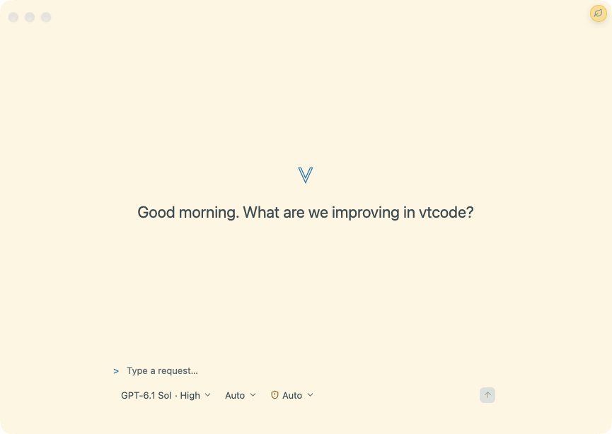
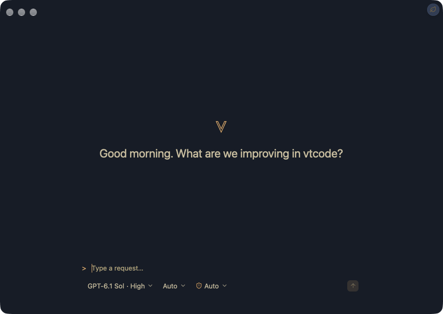
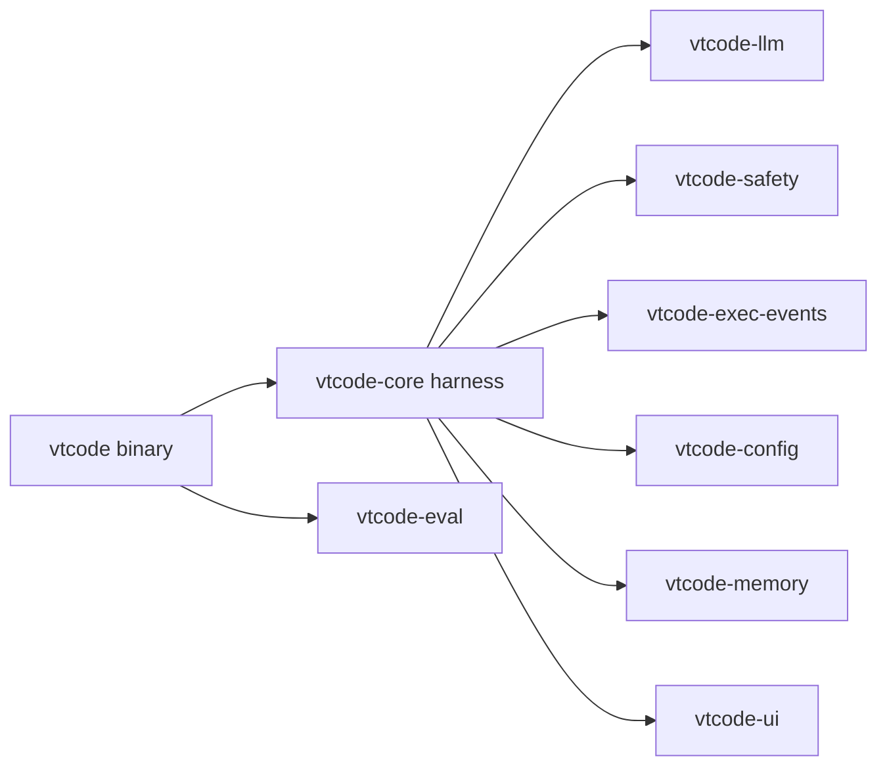

<div align="center">


<p>
  <sub>Terminal-first. Desktop-ready.</sub><br />
  <sub>Explore, plan, edit, and verify; all with the model you choose.</sub>
</p>

[](https://github.com/vinhnx/VTCode)
[](#license)
[](https://github.com/vinhnx/VTCode/releases)
[](https://deepwiki.com/vinhnx/vtcode)
[](#desktop-app)
[](#desktop-app)

> **Native macOS app:** the full engine behind a desktop interface — see the [desktop app](#desktop-app).

<p>
  <!-- markdownlint-disable MD033 -->
  <video src="./resources/gif/demo-desktop.mov" width="100%" autoplay loop muted playsinline controls
    poster="./resources/screenshots/vtcode-desktop-light.png"
    aria-label="VT Code Desktop app demo">
    <a href="./resources/gif/demo-desktop.mov">Open the demo video</a>
  </video>
  <!-- markdownlint-enable MD033 -->
</p>
<sub>Desktop app demo (video; open it directly if playback is unavailable).</sub>

<p>
  
  <br />
  <sub>Terminal TUI &nbsp;·&nbsp; One-shot ask</sub>
</p>

</div>

## Overview

VT Code works on your repository from the terminal or its native macOS app. It owns context, tool calls, and
execution policy, so long tasks stay auditable and resumable.

| At a glance      | What you get                                                                         |
| ---------------- | ------------------------------------------------------------------------------------ |
| **Planning**     | [Plan read-only](./docs/guides/planning-workflow.md), then review turn diffs.        |
| **Safety**       | [Auditable command policy](./docs/security/SECURITY_MODEL.md) and sandboxing.        |
| **Self-correct** | [HOVER loop](./docs/development/hypothesis-revision-validation.md) on tool mismatch. |
| **Long runs**    | [Headless exec](./docs/user-guide/exec-mode.md) with compaction and resumption.      |
| **Integrations** | [MCP](./docs/guides/mcp-integration.md), Skills, plugins, and editor bridges.        |
| **Models**       | [Hosted or local providers](./docs/README.md#provider-index) per task.               |

## Quick start

Requirements: macOS, Linux, or Windows/WSL. Building from source needs Rust 1.99.1+ (edition 2024).

### 1. Install

```bash
# Review the installer script before running it: https://github.com/vinhnx/VTCode/blob/main/scripts/install.sh
curl -fsSL https://raw.githubusercontent.com/vinhnx/VTCode/main/scripts/install.sh | bash
```

To manage installation yourself, use Homebrew or Cargo:

```bash
brew trust vinhnx/tap
brew install vinhnx/tap/vtcode

# Or install from crates.io
cargo install vtcode
```

On Windows, install with PowerShell (artifacts are best-effort and may lag behind macOS/Linux):

```powershell
irm https://raw.githubusercontent.com/vinhnx/VTCode/main/scripts/install.ps1 | iex
```

Run `vtcode --version` to verify the installation. The [installation guide](./docs/installation/README.md)
covers prerequisites, other install methods, desktop flags, and optional search tools.

### 2. Configure your project

In your project directory, scaffold the configuration and add credentials for your provider:

```bash
cd path/to/your/project
vtcode init                # scaffolds config + AGENTS.md; review before committing
vtcode secret add openai   # stores your OpenAI API key in secure storage
```

Replace `openai` with your provider. Keys use secure storage (OS keyring or encrypted file); alternatives include
environment variables, a workspace `.env` file, or `vtcode login` where supported. See
[Getting started](./docs/user-guide/getting-started.md) and [Provider guides](./docs/providers/PROVIDER_GUIDES.md).

> **Note:** ChatGPT OAuth reuses the Codex CLI's public client identity via an unofficial compatibility flow;
> prefer your own OpenAI API key. GitHub Copilot uses the official `copilot` CLI. See
> [OAuth authentication](./docs/guides/oauth-authentication.md).
>
> **Caution:** Keep API keys out of Git and `vtcode.toml`; never commit a workspace `.env` file.

### 3. Run your first task

```bash
vtcode   # open the interactive TUI in your project
```

Ask a focused question, review proposed changes and test results before committing, and see [Usage](#usage) for
automation and session commands.

## Usage

Common commands:

| Goal                    | Command                                            |
| ----------------------- | -------------------------------------------------- |
| Start the TUI           | `vtcode`                                           |
| Ask without tools       | `vtcode ask "explain Rc vs Arc"`                   |
| Run a task headlessly   | `vtcode exec "refactor main.rs"`                   |
| Review pending changes  | `vtcode review`                                    |
| Schedule recurring work | `vtcode schedule create --prompt "..." --every 1h` |
| Resume the last session | `vtcode continue`                                  |
| Inspect a run log       | `vtcode trajectory`                                |

Use `vtcode` to explore, plan, and implement changes in the TUI. For larger tasks, begin with
[read-only planning](./docs/guides/planning-workflow.md), then review the
[turn diff](./docs/development/diff-preview.md) before committing. Run `/explain` to summarize the outcome
without another model call; see the [interactive guide](./docs/user-guide/interactive-mode.md) for controls.

### Modes

- **`ask`** is tool-free: it prints one reply and exits.
- **`exec`** runs the full tool loop. It requires `[automation.full_auto]` and `full_auto` workspace trust.
  Interactive terminals prompt for trust; non-TTY runs need `VTCODE_TRUST_WORKSPACE=full-auto`. Tool allow-lists,
  explicit denies, and execution policy still apply.
- **`review`** inspects uncommitted changes.

Recurring work uses [scheduled tasks](./docs/user-guide/scheduled-tasks.md), durable prompt jobs on the same exec
runtime. Resume or fork earlier work with `vtcode continue` (or `--session-id <id>`), continue a headless run with
`vtcode exec resume --last`, and inspect logs with `vtcode trajectory`. See [exec mode](./docs/user-guide/exec-mode.md)
and [full automation](./docs/guides/full-automation.md) for configuration details.

## Desktop app

<div align="center">

### The full VT Code engine in a native Mac app

[](./docs/development/desktop-workspace.md)
[](./docs/development/desktop-workspace.md)

<p>
  <sub>Everything the CLI does: providers, tool policy, sandboxing, sessions, behind a native interface.</sub>
</p>

</div>

The GUI talks to a matching local service binary while the unified runloop still owns providers, tool policy,
sandboxing, and sessions. Desktop reuses your CLI configuration, provider credentials, workspace trust, and sandbox
policy. Configure a provider from Terminal first, for example with `vtcode secret add openai`.

<p>
  
  
</p>
<p align="center"><sub>Light and dark appearances</sub></p>

### Install (macOS 15+)

On Apple Silicon, download the app from the [latest release](https://github.com/vinhnx/VTCode/releases/latest) or
install it with `vtcode desktop --install`. Intel Macs can build the app from source. Launch an installed app with
`vtcode desktop`. See the
[desktop workspace guide](./docs/development/desktop-workspace.md) for system requirements, source builds,
Gatekeeper approval, and troubleshooting.

## Documentation

Guides grouped by task. The full catalog lives in the [documentation index](./docs/INDEX.md), the
[docs overview](./docs/README.md), and the [Wiki](https://github.com/vinhnx/VTCode/wiki). Integrations are optional;
none are required for the quick start.

### Get started

- [Installation](./docs/installation/README.md) and [getting started](./docs/user-guide/getting-started.md)
- [Desktop app](./docs/development/desktop-workspace.md) for the native macOS GUI
- [Providers](./docs/providers/PROVIDER_GUIDES.md) and [OAuth login](./docs/guides/oauth-authentication.md)
- [FAQ](./docs/FAQ.md) and [compatibility](./docs/COMPATIBILITY.md)

### Work in the TUI

- [Interactive mode](./docs/user-guide/interactive-mode.md) and [command reference](./docs/user-guide/commands.md)
- [Read-only planning](./docs/guides/planning-workflow.md) and [turn diffs](./docs/development/diff-preview.md)
- [Configuration](./docs/config/CONFIG_FIELD_REFERENCE.md) and [security model](./docs/security/SECURITY_MODEL.md)

### Automate

- [Full automation](./docs/guides/full-automation.md) and [decisions probe](./docs/guides/decisions-probe.md)
- [Scheduled tasks](./docs/user-guide/scheduled-tasks.md) and [hooks](./docs/guides/hooks-guide.md)

### Extend and integrate

- [Skills](./docs/skills/SKILLS_GUIDE.md), [plugins](./docs/guides/agent-plugins.md), and [MCP](./docs/guides/mcp-integration.md)
- [MCP interop for client and server maintainers](./docs/guides/mcp-interop.md)
- [Editors (ACP)](./docs/guides/zed-acp.md), [WebMCP](./docs/user-guide/webmcp.md), and [WebMCP deployment](./docs/reference/webmcp.md)
- [Companion (experimental)](./docs/user-guide/vtcode-companion.md) and [Memcode](./docs/guides/memcode-mcp.md)

### Develop and evaluate

- [Development](./docs/development/README.md), [testing](./docs/development/testing.md), and [evals](./docs/guides/eval.md)
- [Architecture](./docs/ARCHITECTURE.md), [HOVER](./docs/development/hypothesis-revision-validation.md), and [protocols](./docs/protocols/OPEN_RESPONSES.md)
- [Loop engineering](./docs/project/PLAN-loop-engineering.md)

## Development



Build with Rust 1.99.1+ (edition 2024) and install `cargo-nextest` to run tests. The
[architecture guide](./docs/ARCHITECTURE.md) maps all 25 crates, including the context and compaction design.

```bash
git clone https://github.com/vinhnx/VTCode.git
cd VTCode
./scripts/run-debug.sh     # build and launch a debug binary
./scripts/check-dev.sh     # fast gate: clippy, fmt, check
cargo nextest run          # tests (requires cargo-nextest)
```

CI builds with `--locked` and `RUSTFLAGS="-D warnings"`; match locally with
`RUSTFLAGS="-D warnings" cargo check --locked`. Setup and checks are documented in the
[development overview](./docs/development/README.md) and the [testing guide](./docs/development/testing.md).

Release binaries and notes: [GitHub releases](https://github.com/vinhnx/VTCode/releases).

## Contributing

Contributions are welcome: code, docs, [evals](./docs/guides/eval.md), and bug reports (include `vtcode trajectory`
output when possible). Before a PR, read the [contribution guide](./docs/CONTRIBUTING.md). MCP maintainers: see the
[interop guide](./docs/guides/mcp-interop.md) for client and server integration.

## Security

Report vulnerabilities privately via
[GitHub private vulnerability reporting](https://github.com/vinhnx/VTCode/security/advisories/new); never open a public
issue. Details: [security policy](./docs/SECURITY.md).

## Community

- [Report a bug](https://github.com/vinhnx/VTCode/issues/new?template=bug_report.md) - something looks off? Tell us,
  and include `vtcode trajectory` output if you can.
- [Request a feature](https://github.com/vinhnx/VTCode/issues/new?template=feature_request.md) - describe the workflow
  you wish worked better.
- [Ask a question or share feedback](https://github.com/vinhnx/VTCode/discussions) - no question is too small.
- [Good first issues](https://github.com/vinhnx/VTCode/labels/good%20first%20issue) - friendly, self-contained places
  to start.
- [Help wanted](https://github.com/vinhnx/VTCode/labels/help%20wanted) - bigger items where a second pair of hands
  would genuinely help.
- [Contributing guide](./docs/CONTRIBUTING.md) - setup, checks, and commit conventions.

New to open source or Rust? Pick a good first issue or docs fix and we will help scope it. The
[Code of Conduct](./docs/CODE_OF_CONDUCT.md) keeps review kind and constructive.

Partnerships and private matters: `vinhnguyen2308 [at] gmail [dot] com`.

## Thanks to our contributors

Thank you to everyone below. You are the reason this project keeps moving.

<details>
<!-- CONTRIBUTORS-COUNT:START --><summary>View all contributors (30)</summary><!-- CONTRIBUTORS-COUNT:END -->

<!-- CONTRIBUTORS:START -->

<!-- markdownlint-disable MD013 -->

### Security Advisors

<a href="https://github.com/glmgbj233"></a>&nbsp;
<a href="https://github.com/nnfrog"></a>&nbsp;

### Main Contributor

<a href="https://github.com/kernitus"></a>&nbsp;

### Core Contributors

<a href="https://github.com/7jrxt42BxFZo4iAnN4CX"></a>&nbsp;
<a href="https://github.com/ct-jaryn"></a>&nbsp;
<a href="https://github.com/oiwn"></a>&nbsp;
<a href="https://github.com/Sachin-Bhat"></a>&nbsp;
<a href="https://github.com/chenrui333"></a>&nbsp;
<a href="https://github.com/xcrong"></a>&nbsp;
<a href="https://github.com/netbrah"></a>&nbsp;
<a href="https://github.com/leonj1"></a>&nbsp;
<a href="https://github.com/gzsombor"></a>&nbsp;

### Contributors

<a href="https://github.com/vivekgupta-memcode"></a>&nbsp;
<a href="https://github.com/S2thend"></a>&nbsp;
<a href="https://github.com/uiYzzi"></a>&nbsp;
<a href="https://github.com/TuanLe-bk18"></a>&nbsp;
<a href="https://github.com/shouryamaanjain"></a>&nbsp;
<a href="https://github.com/Sanjays2402"></a>&nbsp;
<a href="https://github.com/rs545837"></a>&nbsp;
<a href="https://github.com/RobertBorg"></a>&nbsp;
<a href="https://github.com/raphamorim"></a>&nbsp;
<a href="https://github.com/poelzi"></a>&nbsp;
<a href="https://github.com/pawurb"></a>&nbsp;
<a href="https://github.com/morler"></a>&nbsp;
<a href="https://github.com/georgeatparallel"></a>&nbsp;
<a href="https://github.com/ForrestThump"></a>&nbsp;
<a href="https://github.com/f-o-x11"></a>&nbsp;
<a href="https://github.com/EvoLinkAI"></a>&nbsp;
<a href="https://github.com/ericcurtin"></a>&nbsp;
<a href="https://github.com/diegosouzapw"></a>&nbsp;

<!-- markdownlint-enable MD013 -->

<!-- CONTRIBUTORS:END -->

</details>

Want to see your avatar here? Every bit counts: a one-line fix, a bug report, or a thoughtful comment. Not sure where
to begin? Say hello on a [good first issue](https://github.com/vinhnx/VTCode/labels/good%20first%20issue) and we will
figure it out together.

### Resources

- [Building VT Code, a year in](https://huggingface.co/blog/vinhnx90/building-vtcode-a-year-in): harness design,
  evals, security, and lessons learned.
- [Podcast](https://www.youtube.com/watch?v=XLoswcd5rH0) · [Video](https://www.youtube.com/watch?v=PvL_kPjgU6o)

## Support VT Code

<div align="center">

**Special thanks to current sponsors: [Codemod](https://codemod.com/) and [CodeRabbit](https://www.coderabbit.ai/) for ongoing support.**

[](https://github.com/codemod)&nbsp;
[](https://github.com/coderabbitai)&nbsp;

[](https://github.com/sponsors/vinhnx)

## Thank you

<a
  href="https://www.star-history.com/?repos=vinhnx%2FVTCode&type=timeline&legend=top-left">
<picture>

   <source media="(prefers-color-scheme: dark)"
     srcset="https://api.star-history.com/chart?repos=vinhnx/VTCode&type=timeline&theme=dark&legend=top-left" />
   <source media="(prefers-color-scheme: light)"
     srcset="https://api.star-history.com/chart?repos=vinhnx/VTCode&type=timeline&legend=top-left" />
   
 </picture>
</a>

</div>

## License

First-party code is **MIT OR Apache-2.0**, available under either [LICENSE-MIT](LICENSE-MIT) or
[LICENSE](LICENSE) (Apache-2.0). Third-party code keeps its original licenses, listed in
[THIRD-PARTY-NOTICES](THIRD-PARTY-NOTICES).
