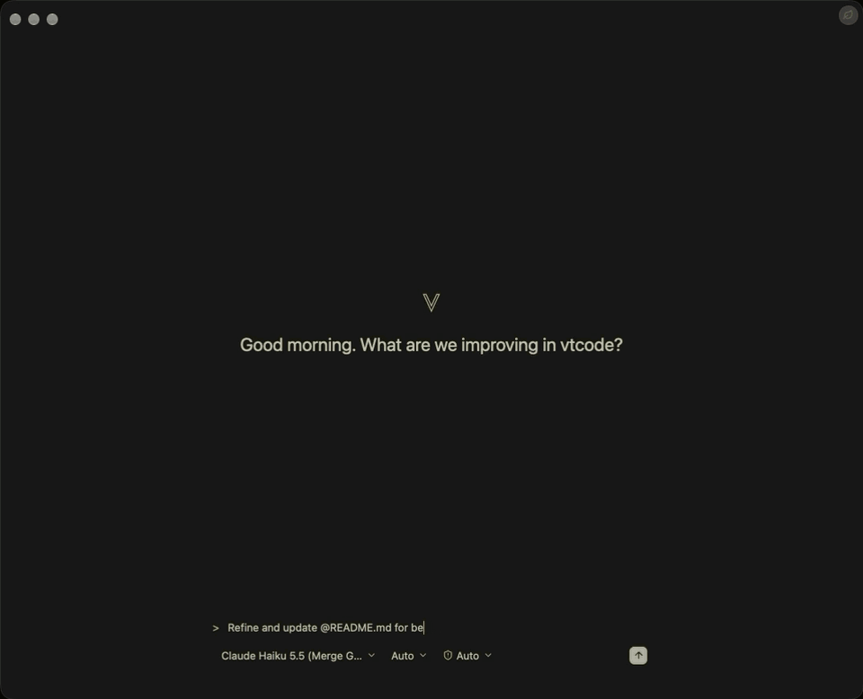
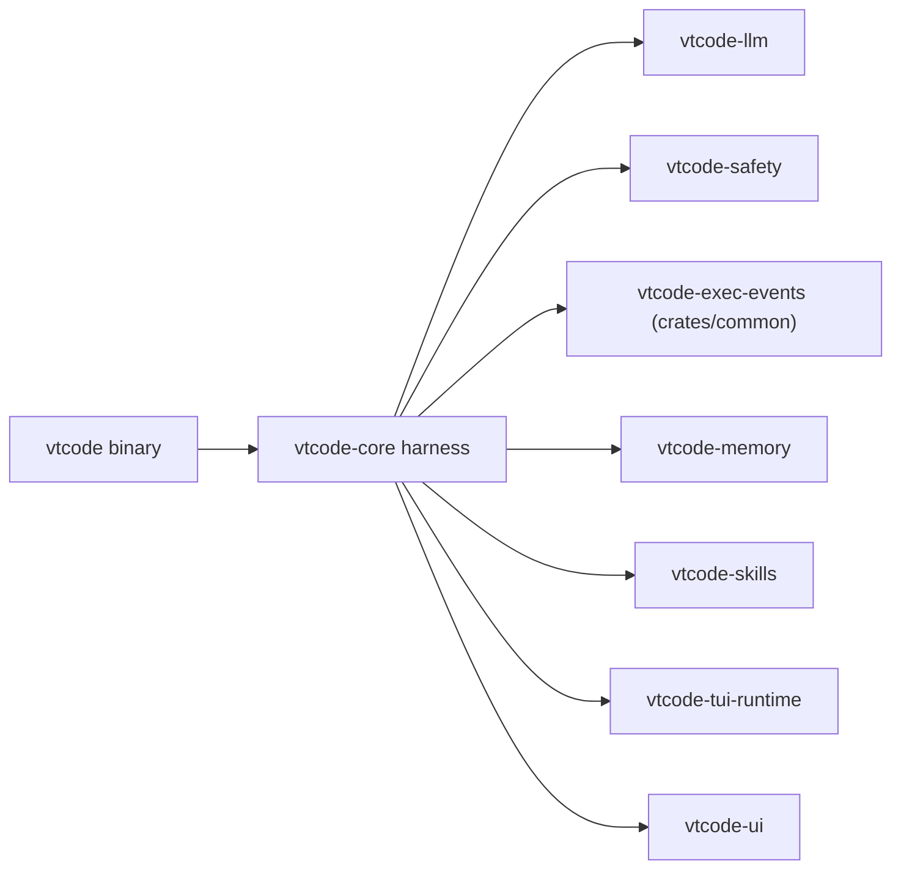

<!-- markdownlint-disable-next-line MD041 -->
<div align="center">


<p>
  <sub>VT Code is an open-source coding agent for everyone.</sub>
</p>

[](https://github.com/vinhnx/vtcode)
[](#license)
[](https://github.com/vinhnx/vtcode/releases)
[](https://deepwiki.com/vinhnx/vtcode)
[](#desktop-app)
[](#desktop-app)

<p>
  
  <br />
  <sub>Desktop app demo — see also the <a href="./resources/screenshots/vtcode-cli-tui.gif">terminal TUI demo</a></sub>
</p>

</div>

## Overview

VT Code is an open-source coding agent: one shared runloop powers the terminal TUI and the
native macOS app. It is open source under **MIT OR Apache-2.0** (see [License](#license)).
Start with [Quick start](#quick-start); the full map is in [Documentation](#documentation).

<!-- markdownlint-disable MD060 -- compact table; keep pipes unpadded -->

| At a glance   | What you get                                                                                                                                                               |
| ------------- | -------------------------------------------------------------------------------------------------------------------------------------------------------------------------- |
| **Plan**      | Read-only [planning](./docs/guides/planning-workflow.md); review [turn diffs](./docs/development/diff-preview.md).                                                         |
| **Safety**    | Sandboxed, [auditable command policy](./docs/security/security_model.md).                                                                                                  |
| **Long runs** | Resumable [headless exec](./docs/user-guide/exec-mode.md) with [snapshots](./docs/user-guide/commands.md) and [subagents](./docs/user-guide/subagents.md).                 |
| **Extend**    | [MCP](./docs/guides/mcp-integration.md) ([interop](./docs/guides/mcp-interop.md)), [skills](./docs/skills/skills_guide.md), and [plugins](./docs/guides/agent-plugins.md). |
| **Models**    | Per-task [hosted or local providers](./docs/providers/provider_guides.md).                                                                                                 |

<!-- markdownlint-enable MD060 -->

## Quick start

Install on macOS, Linux, or Windows/WSL, configure once, and run. Source builds need Rust 1.100.0+
(edition 2024); the [installation guide](./docs/installation/README.md) covers every method.

### 1. Install

```bash
# Review the installer script before running it: https://github.com/vinhnx/vtcode/blob/main/scripts/install.sh
curl -fsSL https://raw.githubusercontent.com/vinhnx/vtcode/main/scripts/install.sh | bash
vtcode --version
```

Alternatives in the [installation guide](./docs/installation/README.md): `brew install vinhnx/tap/vtcode`,
`cargo install vtcode`, [Desktop app](#desktop-app), or the Windows `install.ps1` script.

### 2. Configure your project

From your project directory:

```bash
cd path/to/your/project
# Scaffolds vtcode.toml, .vtcode/, and AGENTS.md; review before committing.
vtcode init
```

Choose an authentication method for your provider:

- **API key:** `vtcode secret add openai` (replace `openai` with your provider). Keys stay in secure storage
  (OS keyring or encrypted file); environment variables or a workspace `.env` also work where supported.
- **ChatGPT subscription:** `vtcode login openai` — no API key needed.
- **Reuse an existing Codex login:** `vtcode login openai --from-codex` (requires an authenticated Codex CLI).

See [getting started](./docs/user-guide/getting-started.md) and
[provider guides](./docs/providers/provider_guides.md) for details. Copilot uses the official `copilot` CLI — see
[OAuth authentication](./docs/guides/oauth-authentication.md).

> **Caution:** Keep API keys out of Git and `vtcode.toml`, and never commit a workspace `.env` file.
> Run `vtcode secret add` or `vtcode login` before your first task.

### 3. Run your first task

```bash
vtcode # opens the interactive TUI
```

Ask one focused question, review the proposed changes and test results, then commit.
If `vtcode` is not found, reopen your shell so `PATH` picks up the install, then rerun `vtcode --version`.
See [Usage](#usage) for automation commands.

## Usage

Common commands (full list in [command reference](./docs/user-guide/commands.md)):

| Goal                    | Command                                            |
| ----------------------- | -------------------------------------------------- |
| Start the TUI           | `vtcode`                                           |
| Ask without tools       | `vtcode ask "explain Rc vs Arc"`                   |
| Run a task headlessly   | `vtcode exec "refactor main.rs"`                   |
| Review pending changes  | `vtcode review`                                    |
| Schedule recurring work | `vtcode schedule create --prompt "..." --every 1h` |
| Resume the last session | `vtcode continue`                                  |
| Resume a headless run   | `vtcode exec resume --last "prompt"`               |
| Roll back a snapshot    | `vtcode snapshots` / `vtcode revert`               |
| Inspect a run log       | `vtcode trajectory`                                |

Trust levels: `ask` never runs tools, `review` inspects uncommitted changes without the agent loop, and only
`exec` runs the full tool loop. `exec` needs workspace trust: approve the TTY prompt, or set
`VTCODE_TRUST_WORKSPACE=full-auto` for non-TTY runs (`deny` refuses instead). For larger tasks, start read-only,
review the turn diff, and use `/explain` without another model call. See [interactive mode](./docs/user-guide/interactive-mode.md),
[exec mode](./docs/user-guide/exec-mode.md), and [full automation](./docs/guides/full-automation.md).

## Desktop app

Native macOS app (macOS 15+) sharing the CLI runloop, providers, tool policy, sandboxing, sessions,
config, and credentials. Configure a provider first ([Quick start](#quick-start)).

### Install (macOS 15+)

```bash
brew install --cask vinhnx/tap/vtcode-desktop
```

Update cask installs with `brew upgrade --cask vinhnx/tap/vtcode-desktop`. Without Homebrew, download the
[latest release](https://github.com/vinhnx/vtcode/releases/latest) or run `vtcode desktop --install`,
then launch with `vtcode desktop` or from Finder. The cask ships Apple Silicon builds; Intel Macs install
from source with `vtcode desktop --install`. Full options are in the [installation guide](./docs/installation/README.md).

> [!WARNING]
> **First launch needs one-time approval** for ad hoc-signed builds (Homebrew cask included): open the app
> once from Applications, click **Open Anyway** in **System Settings › Privacy & Security**, then reopen
> it. The button expires about an hour after a blocked launch; reopen the app to bring it back.
> Notarized releases skip this. See [desktop workspace](./docs/development/desktop-workspace.md).

## Documentation

Start from the canonical [documentation index](./docs/index.md) or [Wiki](https://github.com/vinhnx/vtcode/wiki).
This section keeps one link per task.

### Start

- [Installation](./docs/installation/README.md) and [getting started](./docs/user-guide/getting-started.md)
- [Providers](./docs/providers/provider_guides.md) and [OAuth login](./docs/guides/oauth-authentication.md)
- [FAQ](./docs/faq.md) and [compatibility](./docs/compatibility.md)

### Use

- [Interactive mode](./docs/user-guide/interactive-mode.md) and [command reference](./docs/user-guide/commands.md)
- [Configuration](./docs/config/config_field_reference.md) and [security model](./docs/security/security_model.md)
- [Computer Use](./docs/user-guide/computer-use.md): isolated offline browser preview with per-turn approval

### Automate

- [Full automation](./docs/guides/full-automation.md) and [scheduled tasks](./docs/user-guide/scheduled-tasks.md)
- [Hooks](./docs/guides/hooks-guide.md) and [decisions probe](./docs/guides/decisions-probe.md)

### Extend

- [Skills](./docs/skills/skills_guide.md), [plugins](./docs/guides/agent-plugins.md), and
  [MCP](./docs/guides/mcp-integration.md)
- [Editors (ACP)](./docs/guides/zed-acp.md), [WebMCP](./docs/user-guide/webmcp.md),
  [A2A](./docs/a2a/README.md), and [Companion](./docs/user-guide/vtcode-companion.md)

### Develop

- [Development](./docs/development/README.md), [testing](./docs/development/testing.md), and
  [evals](./docs/guides/eval.md)
- [Architecture](./docs/architecture.md), [desktop workspace](./docs/development/desktop-workspace.md),
  [loop engineering](./docs/loop-engineering.md), and [protocols](./docs/protocols/open_responses.md)

## Development

27-crate workspace at version 0.185.0 (full list in the [architecture guide](./docs/architecture.md)).
The default build covers the root binary plus `vtcode-core`, `vtcode-skills`, `vtcode-tui-runtime`,
and `vtcode-ui`. The sketch below shows the core harness path, not every crate:



Build with Rust 1.100.0+ (edition 2024; workspace version 0.185.0):

```bash
git clone https://github.com/vinhnx/vtcode.git
cd vtcode
./scripts/run-debug.sh     # build and launch a debug binary
./scripts/check-dev.sh     # fast gate: clippy, fmt, check (add --test for tests)
cargo nextest run          # tests via nextest (see testing guide)
```

CI uses `--locked` and `RUSTFLAGS="-D warnings"`; match locally with
`RUSTFLAGS="-D warnings" cargo check --locked`. See [development](./docs/development/README.md) and [testing](./docs/development/testing.md).

Release binaries and notes live on [GitHub releases](https://github.com/vinhnx/vtcode/releases).

## Contributing

VT Code is open source and community-driven. Code, docs, [evals](./docs/guides/eval.md), and fixes are
welcome — include `vtcode trajectory` output in bug reports where possible. Before a PR, read
[contributing](./docs/CONTRIBUTING.md) and pick a
[good first issue](https://github.com/vinhnx/vtcode/labels/good%20first%20issue) or
[help wanted](https://github.com/vinhnx/vtcode/labels/help%20wanted) item. Forks: keep license and
third-party notices intact (see [License](#license)).

## Security

Report vulnerabilities privately via
[GitHub private vulnerability reporting](https://github.com/vinhnx/vtcode/security/advisories/new).
See the [security policy](./docs/SECURITY.md).

## Community

- [Report a bug](https://github.com/vinhnx/vtcode/issues/new?template=bug_report.md) ·
  [Request a feature](https://github.com/vinhnx/vtcode/issues/new?template=feature_request.md) ·
  [Discussions](https://github.com/vinhnx/vtcode/discussions)
- Elsewhere: [building VT Code, a year in](https://huggingface.co/blog/vinhnx90/building-vtcode-a-year-in) ·
  [podcast](https://www.youtube.com/watch?v=XLoswcd5rH0) ·
  [video](https://www.youtube.com/watch?v=PvL_kPjgU6o)

The [Code of Conduct](./docs/CODE_OF_CONDUCT.md) keeps review constructive.
Contact: `vinhnguyen2308 [at] gmail [dot] com`.

## Thanks to our contributors

Thank you to everyone below. You are the reason this project keeps moving.

<details open> <!-- NOTE: keep open by default. DO NOT CLOSE this -->
<!-- CONTRIBUTORS-COUNT:START --><summary>View all contributors (31)</summary><!-- CONTRIBUTORS-COUNT:END -->

<!-- CONTRIBUTORS:START -->

<!-- markdownlint-disable MD013 -->

<div align="center">

### Security Advisors

<a href="https://github.com/glmgbj233"></a>&nbsp;
<a href="https://github.com/nnfrog"></a>&nbsp;

### Main Contributor

<a href="https://github.com/kernitus"></a>&nbsp;

### Core Contributors

<a href="https://github.com/ct-jaryn"></a>&nbsp;
<a href="https://github.com/7jrxt42BxFZo4iAnN4CX"></a>&nbsp;
<a href="https://github.com/xcrong"></a>&nbsp;
<a href="https://github.com/netbrah"></a>&nbsp;
<a href="https://github.com/Sachin-Bhat"></a>&nbsp;
<a href="https://github.com/gzsombor"></a>&nbsp;
<a href="https://github.com/leonj1"></a>&nbsp;
<a href="https://github.com/chenrui333"></a>&nbsp;
<a href="https://github.com/oiwn"></a>&nbsp;

### Contributors

<a href="https://github.com/apewithllm"></a>&nbsp;
<a href="https://github.com/pawurb"></a>&nbsp;
<a href="https://github.com/f-o-x11"></a>&nbsp;
<a href="https://github.com/shouryamaanjain"></a>&nbsp;
<a href="https://github.com/rs545837"></a>&nbsp;
<a href="https://github.com/georgeatparallel"></a>&nbsp;
<a href="https://github.com/S2thend"></a>&nbsp;
<a href="https://github.com/vivekgupta-memcode"></a>&nbsp;
<a href="https://github.com/ericcurtin"></a>&nbsp;
<a href="https://github.com/Sanjays2402"></a>&nbsp;
<a href="https://github.com/diegosouzapw"></a>&nbsp;
<a href="https://github.com/raphamorim"></a>&nbsp;
<a href="https://github.com/TuanLe-bk18"></a>&nbsp;
<a href="https://github.com/ForrestThump"></a>&nbsp;
<a href="https://github.com/RobertBorg"></a>&nbsp;
<a href="https://github.com/EvoLinkAI"></a>&nbsp;
<a href="https://github.com/uiYzzi"></a>&nbsp;
<a href="https://github.com/poelzi"></a>&nbsp;
<a href="https://github.com/morler"></a>&nbsp;

</div>

<!-- markdownlint-enable MD013 -->

<!-- CONTRIBUTORS:END -->

</details>

## Support VT Code

<div align="center">

**Current sponsors: [Codemod](https://codemod.com/) and [CodeRabbit](https://www.coderabbit.ai/).**

[](https://github.com/codemod)&nbsp;
[](https://github.com/coderabbitai)&nbsp;

[](https://github.com/sponsors/vinhnx)

If you like VT Code, please star the repo and share it — starring helps discovery and brings in new users,
contributors, and sponsors. Thank you for growing the community.

## Star History

<a href="https://star-history.com/#vinhnx/vtcode&Date">
 <picture>
   <source media="(prefers-color-scheme: dark)"
     srcset="https://api.star-history.com/svg?repos=vinhnx/vtcode&type=Date&theme=dark" />
   <source media="(prefers-color-scheme: light)"
     srcset="https://api.star-history.com/svg?repos=vinhnx/vtcode&type=Date" />
   
 </picture>
</a>

</div>

## License

First-party code is **MIT OR Apache-2.0**, available under either [LICENSE-MIT](LICENSE-MIT) or
[LICENSE](LICENSE) (Apache-2.0). You are welcome to fork, use, copy, modify, merge, publish, distribute,
sublicense, and sell copies of the code, for personal or commercial use, under either license. Keep the
license and copyright notices when you distribute copies. Third-party code keeps its original licenses,
listed in [THIRD-PARTY-NOTICES](THIRD-PARTY-NOTICES).
