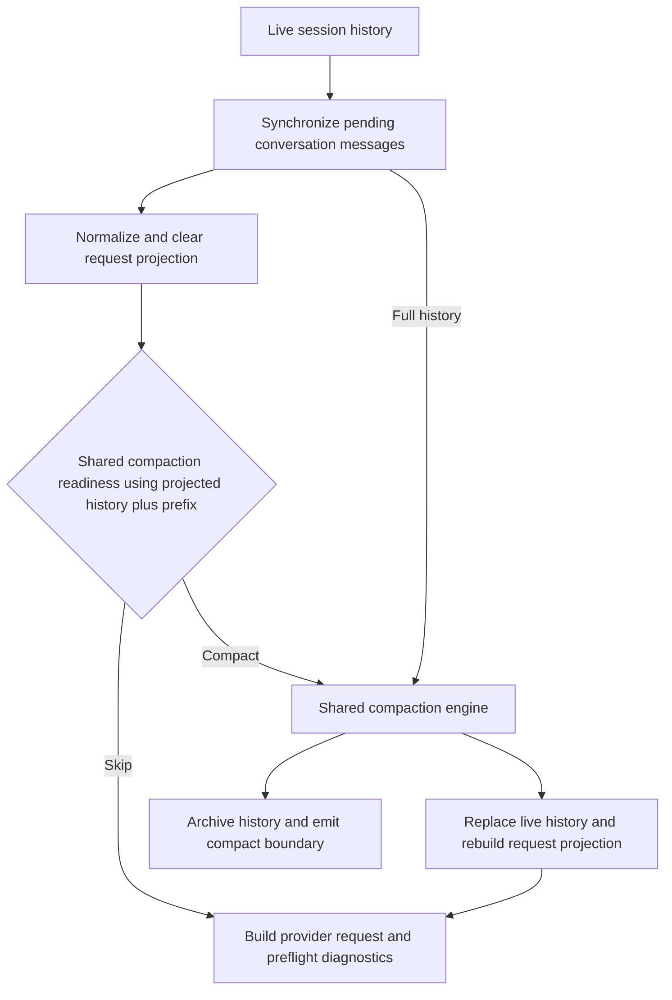

# VT Code Architecture Guide

## Overview

VT Code follows a modular architecture designed for maintainability, extensibility, and performance. Internally, VT Code
uses Rust traits for runtime composition. Externally, VT Code prefers protocol- and manifest-driven extension seams such
as MCP, skills, plugin manifests, and `[[custom_providers]]` so third-party integrations do not need to land new Rust
impls in the core workspace. This is deliberate: Rust coherence and orphan-rule constraints make public trait APIs a
poor default extension boundary for an ecosystem-style project.

For internal composition, prefer explicit provider selection over "clever" trait resolution when a boundary starts
depending on many overlapping impls, associated types, or context-specific behavior. In practice, VT Code treats
`HasComponent<Name>::Provider` as an elaborated dictionary: the context chooses the provider once, and blanket consumer
traits delegate through that explicit selection. See `crates/codegen/vtcode-core/src/components.rs` and
`crates/codegen/vtcode-core/src/llm/cgp.rs`.

## Model + Harness

VT Code treats the model as the reasoning engine and the harness as the runtime that makes that reasoning useful. Phase
1 of the exec/full-auto runtime is built around that split rather than around a separate agent subsystem.

> **Capability is a composition.** The model is one of seven reinforcing subsystems (model · harness · context · tools ·
> evals · sandbox · state) whose job is to keep the agent making _monotonic progress_ on long-horizon tasks. See
> [`docs/guides/agent-capability-composition.md`](guides/agent-capability-composition.md) for the full mapping.

Harness primitives in VT Code map to the runtime like this:

- **Instruction memory**: AGENTS.md loading, project docs, prompt assembly, onboarding guidance, and session bootstrap
  live in `crates/codegen/vtcode-core/src/prompts/`, `crates/codegen/vtcode-core/src/core/agent/`, and the workspace
  instruction loaders.
- **Tools**: `crates/codegen/vtcode-core/src/tools/`, MCP integration, slash commands, and the tool registry expose
  shell execution, stdin continuation, patch editing, bounded syntactic code search, and protocol-backed capabilities to
  the model.
- **Sandbox / execution environment**: `vtcode-bash-runner/`, `vtcode-safety/` (command safety, exec policy,
  sandboxing), workspace trust, command policies, and tool allow-lists define where generated code runs and what it can
  touch.
- **Dynamic context**: context assembly, instruction merging, task tracker state, history, plan sidecars, and spooled
  tool outputs let VT Code rehydrate long-running work without keeping every token in the live window. The persisted
  `SessionMemoryEnvelope` is the harness working-memory artifact: it summarizes objective, constraints, touched files,
  grounded facts, verification status, verification TODOs, and delegated findings for resume and summarized-fork
  handoff.
- **Compaction / offloading**: split tool results, spool files, archive transcripts, and provider-aware auto-compaction
  reduce context rot while preserving recoverable state on disk. On VT Code's local compaction path, older repeated
  single-file reads are deduplicated before summarization so the summary prompt keeps the newest copy and avoids
  re-injecting stale file payloads.
- **Hooks / middleware**: lifecycle hooks, tool middleware, guard rails, duplicate-call protection, and
  planning-workflow enforcement add deterministic control around the model loop.
- **Continuation**: exec/full-auto now uses a harness-managed continuation controller that accepts completion only when
  tracker state is complete and verification commands pass.
- **Scheduling**: session-scoped reminders live on the interactive runtime, while durable `vtcode schedule` jobs persist
  definitions under the VT Code config/data directories and launch fresh `vtcode exec` runs through a local daemon.
- **Traces / archives**: thread events, session archives, checkpoints, Open Responses emission, ATIF trajectory export,
  and optional harness event logs capture what happened for resume, audit, and downstream tooling. The
  [ATIF](https://www.harborframework.com/docs/agents/trajectory-format) exporter (`vtcode-exec-events::atif`) converts
  live `ThreadEvent` streams into the standardized Agent Trajectory Interchange Format for SFT/RL pipelines, debugging,
  and visualization.

`vtcode-exec-events::ThreadEvent` is the authoritative runtime event contract across exec mode, harness logs, and
interactive lifecycle emission. Item lifecycle events come from the shared runtime/event builders, while outer
`TurnStarted` / `TurnCompleted` / `TurnFailed` events remain wrapper-owned submission boundaries. Follow-up inputs are
queued in the runtime and injected one-at-a-time only after a turn reaches an idle boundary.

### Prompt guidance boundaries

VT Code separates universal runtime behavior from project-specific developer instructions:

- The compiled, cache-stable guidance in `crates/codegen/vtcode-core/src/prompts/runtime_guidance.rs` applies to every
  user and every static prompt profile. It contains only concise user-facing behavior and is capped before prompt
  assembly.
- `AGENTS.md`, `CLAUDE.md`, and `.vtcode/rules/` remain dynamically loaded project/user instruction maps. Their
  precedence, path scoping, exclusions, and active-directory behavior are preserved by the instruction loader.
- Workspace instruction content is user-controlled context, not a security boundary. It cannot replace command policy,
  sandbox checks, approvals, or correctness-critical validation implemented in code, schemas, tests, and lints.
  Instruction files are not compiled into the runtime or release archives.

For the public loop semantics and the Agent SDK concept mapping, see
[Agent Loop Contract](./guides/agent-loop-contract.md).

The harness configuration is intentionally split across three existing surfaces instead of a new top-level subsystem:

- `agent.harness` controls continuation, event logging, and per-turn safety limits.
- `automation.full_auto` controls autonomous execution and turn limits.
- `context.dynamic` controls how much state and history are reintroduced on each turn.

That split keeps VT Code aligned with the current runtime while making the harness explicit enough to evolve.

### HOVER self-correction loop

VT Code's HOVER model is **Hypothesize → Observe → Verify → Evaluate → Revise → Repeat**. Compiled guidance
permits repetition only after a mismatch, within existing limits, and stops after required checks pass.
The mismatch contract is Hypothesis → Observation → Mismatch → Inspect evidence → Revise hypothesis.
Guidance and bounded diagnosis feedback encourage this behavior; they do not prove compliance.

- Pure classification lives in `crates/codegen/vtcode-core/src/core/agent/hypothesis.rs`: `MismatchEvidence`,
  `classify_mismatch` (patch mismatch first, repeated evidence last), and `revision_guidance` per
  `MismatchKind` (`NonZeroExit`, `EmptySearch`, `PatchMismatch`, `VerifierFailed`, `RepeatedEvidence`).
- Deterministic failure diagnosis in `src/agent/runloop/unified/turn/tool_outcomes/execution_result/` appends
  that framing to the bounded `next_action`; policy rejection and cancellation keep their safe actions.
- `LoopTracker` in `src/agent/runloop/unified/turn/tool_outcomes/helpers/loop_tracker.rs` supplies one-shot
  verifier-failed and repeated-evidence notices; successful verification clears pending failure feedback.
  Native Copilot ACP replies consume the same notices in the tool reply because they bypass history flushing.
- `score_hypothesis_revision` in `crates/codegen/vtcode-core/src/core/agent/evaluator.rs` is a count-based
  heuristic only: rereads alone can score 1.0 and zero mismatches are inconclusive. Acceptance needs an
  observed mismatch, an evidence-supported corrective action, and an independent outcome check.
- Already-visible, current evidence can be sufficient; fresh targeted context or a spool page is required when
  evidence is stale or insufficient. Rereading alone is not revision.

See [Agent Loop Contract](./guides/agent-loop-contract.md) for model-visible ordering, the
[validation](./development/hypothesis-revision-validation.md) acceptance table and deterministic checks, and
[runtime guidance](./development/runtime-guidance.md) for the compiled prompt bullet.

### Request projection and context budgets

The runtime keeps three related surfaces with distinct ownership:

| Surface | Owner and behavior |
| --- | --- |
| Canonical events | `vtcode-exec-events::ThreadEvent` records runtime history for persistence and replay. |
| Live session history | `AgentSessionState.messages` is shared through `Arc<Vec<Message>>`; actual compaction replaces this working history and preserves a recoverable history artifact. |
| Request projection | Normalization repairs tool pairing and order; local clearing replaces eligible old results only in the provider-facing copy. Original outputs remain in session history and events. |

Both interactive request assembly and headless execution use the clearing helpers in
`crates/codegen/vtcode-core/src/core/agent/state.rs`. The trigger resolves the provider/session capacity, reserves
system/tool-schema overhead and output, and caps the configured threshold at 60% of the remaining history budget.
Recent retention expands from individual results to their complete originating assistant tool-call batches.
Interactive Anthropic requests carrying native context edits use that provider path; headless requests attach no native
context edits and use the local fallback when clearing is enabled.

The headless request path stages clearing before deciding whether to summarize:



`core/agent/runner/execute.rs` owns synchronization, projection-based pressure estimates, and rebuilding after compaction.
`core/agent/runner/summarize.rs` delegates to `compaction::auto_compact_messages`, checking its shared readiness predicate
before requesting copy-on-write access. Disabled, suppressed, unknown-budget, and below-threshold passes therefore keep
shared history intact. Preflight uses the same projected history plus prompt overhead; its warning remains advisory.
Failed or unchanged compaction passes keep the existing projection; the archive and replacement steps describe a
successful pass.

The compaction engine owns provider strategy selection, local summary bounds, continuity tails, and memory envelopes.
Local summary forks reserve the frozen parent prefix and any explicit summary output limit, then validate the aggregate
bounded history before dispatch. Both hierarchical bands are validated before either call. Provider-native returned
windows remain canonical and retain their opaque replay state.

See the [Compaction Engine](./development/compaction.md) for formulas and source ownership, the
[Agent Loop Contract](./guides/agent-loop-contract.md#unified-auto-compaction) for lifecycle behavior, and the
[configuration reference](./config/CONFIG_FIELD_REFERENCE.md) for clearing controls.

When `agent.harness.orchestration_mode = "plan_build_evaluate"` is enabled for `exec/full-auto`, VT Code adds a
lightweight planner/evaluator loop on top of the single-agent runtime instead of introducing a separate always-on agent
subsystem:

- The planner writes `.vtcode/tasks/current_spec.md` and `.vtcode/tasks/current_contract.md`, then seeds
  `current_task.md`.
- The generator still runs on the main session, but it is constrained by those artifacts plus tracker completion and
  verification.
- The evaluator performs a skeptical post-build pass over the spec, contract, tracker, verification results, warnings,
  and changed files, then writes `.vtcode/tasks/current_evaluation.md`.
- Failed evaluation triggers bounded revision rounds rather than silent acceptance, and the artifacts survive blocked
  handoff, resume, and local compaction.

Broader multi-agent orchestration, dynamic tool assembly, and harness self-analysis remain follow-on work after this
single-threaded plan/build/evaluate path is stable.

### Explicit Delegation Model

VT Code treats delegation like explicit thread spawning rather than ambient background concurrency.

- The main session stays responsible for the current control flow, user-visible plan, and final integration.
- Child agents are for bounded sidecar work: focused exploration, isolated verification, or disjoint implementation
  slices.
- If the next local action depends on a result, the main session should usually do that work itself instead of
  delegating and waiting.
- Child output is advisory until the parent thread reads it, validates it, and folds it back into the main task state.
- Completed child results are merged back into the parent `SessionMemoryEnvelope` at turn boundaries, so delegated
  facts, touched files, open questions, and verification follow-ups survive resume and summarized forks.

### Rig Alignment Boundary

VT Code borrows selected request-shaping patterns from the Rig ecosystem without delegating runtime control to
`rig-core` agents.

- Rig-backed usage in VT Code is limited to provider/model validation and provider-specific reasoning payload shaping.
- The VT Code harness remains the execution engine for turns, tool routing, continuation, compaction, and resume flows.
- Session continuity stays on VT Code primitives: `.vtcode/history/` artifacts, local/server compaction, and prompt-side
  memory injection.
- This keeps VT Code’s existing tool registry, sandboxing, and resume semantics intact while still adopting Rig’s
  provider-facing patterns where they reduce duplication.

### CLI Architecture

The command-line interface is built on specific principles for robustness and interoperability:

1. **Strict Output Separation**: Data goes to `stdout`, diagnostics/logs go to `stderr`. This enables clean piping of
   machine-readable output.
2. **Standard Argument Parsing**: Uses `clap` for POSIX/GNU compliance, supporting standard flags and behavior.
3. **Command Isolation**: Each sub-command (`ask`, `exec`, `chat`) is handled by a dedicated module in `src/cli/`,
   sharing core logic via `vtcode-core`.
4. **Signal Handling**: Graceful handling of `SIGINT`/`SIGTERM` to ensure resource cleanup (e.g., restoring terminal
   state). See [Signal Handling Architecture](signal_handling.md) for details.

## Core Architecture

### Workspace crates

The workspace has 23 crates: the root `vtcode` binary plus 22 library crates under `crates/codegen/` (runtime) and
`crates/common/` (shared contracts and utilities). `default-members` build only the root, `vtcode-core`, and `vtcode-ui`.
New reusable logic belongs in an existing small crate (or a new one) rather than in `vtcode-core` by default.

| Crate                       | Role                                                                                        |
| --------------------------- | ------------------------------------------------------------------------------------------- |
| `vtcode` (root `src/`)      | Binary, CLI, session bootstrap.                                                             |
| `vtcode-core`               | Agent loop, tools, prompts, LLM orchestration, UI.                                          |
| `vtcode-ui`                 | Unified UI: design system, theme registry, TUI framework.                                   |
| `vtcode-config`             | Config loading and schema.                                                                  |
| `vtcode-bash-runner`        | Shell execution sandbox.                                                                    |
| `vtcode-acp`                | Agent Client Protocol (Zed).                                                                |
| `vtcode-auth`               | OAuth and credential storage.                                                               |
| `vtcode-indexer`            | Code indexing and search.                                                                   |
| `vtcode-exec-events`        | `ThreadEvent` contract and ATIF export.                                                     |
| `vtcode-diff`               | Bounded structured diffs and renderer-neutral preview rows.                                 |
| `vtcode-webmcp`             | Authenticated browser editor bridge, pairing, event replay, and bounded workspace adapter.  |
| `vtcode-commons`            | Shared utilities.                                                                           |
| `vtcode-macros`             | Procedural macros.                                                                          |
| `vtcode-utility-tool-specs` | JSON schemas for utility, file, and collaboration/HITL tools.                               |
| `vtcode-agent-plugins`      | Agent Plugins manifest parsing, validation, and discovery.                                  |
| `vtcode-llm`                | LLM provider abstraction, client implementations, streaming.                                |
| `vtcode-skills`             | Skill types, discovery, loading, and validation.                                            |
| `vtcode-memory`             | Per-session append-only `ThreadEvent` store, derived views, retention, cross-session query. |
| `vtcode-eval`               | Agent evaluation framework: pass@k/pass^k metrics and outcome verification.                 |
| `vtcode-safety`             | Command safety detection, execution policies, sandboxing.                                   |
| `vtcode-a2a`                | Agent2Agent (A2A) protocol client and server.                                               |
| `vtcode-mcp`                | Model Context Protocol client, connection pooling, tool discovery.                          |
| `xtask`                     | Release packaging automation.                                                               |

### TUI Architecture

The terminal UI now has a dedicated crate boundary:

- `vtcode-ui`: public UI-facing API surface for downstream consumers (TUI, design, theme)
- `vtcode-core::ui::tui`: canonical runtime type surface for VT Code internals

This separation allows external code to import TUI types and session APIs from `vtcode-ui` while keeping host-specific
integrations inside `vtcode-core`.

`vtcode-ui` now exposes standalone launch primitives (`SessionOptions`, `SessionSurface`, `KeyboardProtocolSettings`)
plus host adapters (`host::HostAdapter`) so downstream projects can start sessions without importing
`vtcode_core::config` types directly.

The full TUI source tree is now located in:

- `crates/codegen/vtcode-ui/src/tui/core_tui/`

`crates/codegen/vtcode-core/src/ui/tui.rs` is a compatibility shim that compiles this migrated source tree to preserve
existing `vtcode_core::ui::tui` paths.

The TUI runner is organized into focused modules:

```text
crates/codegen/vtcode-ui/src/tui/core_tui/runner/
 mod.rs           # Orchestration entrypoint (`run_tui`)
 drive.rs         # Main terminal/event loop drive logic
 events.rs        # Async event stream + tick scheduling
 signal.rs        # SIGINT/SIGTERM cleanup guard
 surface.rs       # Inline vs alternate screen detection
 terminal_io.rs   # Cursor/screen prep + drain helpers
 terminal_modes.rs# Raw/mouse/focus/keyboard mode management
```

### Modular Tools System

```text
tools/
 mod.rs              # Module coordination & exports
 traits.rs           # Core composability traits
 types.rs            # Common types & structures
 cache.rs            # Enhanced caching system
 grep_file.rs        # Ripgrep-backed search manager (internal)
 grep_backend.rs     # Ripgrep execution backend & streaming literal search (internal)
 file_ops.rs         # File operations (internal)
 command.rs          # Command execution (internal)
 outline_search.rs   # Internal bounded declaration discovery used by code_search
 registry/
   builtins.rs       # Tool registration and declarations
   executors/        # Built-in executors for exec_command, write_stdin, apply_patch, and code_search
   tool_intent.rs    # Argument normalization and action inference
```

### Core Traits

```rust
// Base tool interface
pub trait Tool: Send + Sync {
    async fn execute(&self, args: Value) -> Result<Value>;
    fn name(&self) -> &'static str;
    fn description(&self) -> &'static str;
}

// Multi-mode execution
pub trait ModeTool: Tool {
    fn supported_modes(&self) -> Vec<&'static str>;
    async fn execute_mode(&self, mode: &str, args: Value) -> Result<Value>;
}

// Intelligent caching
pub trait CacheableTool: Tool {
    fn cache_key(&self, args: &Value) -> String;
    fn should_cache(&self, args: &Value) -> bool;
}
```

## Tool Implementations

### Default Tool Surface

- `exec_command`: canonical public shell tool. Commands run through the active shell profile, command policy,
  sandboxing, approvals, and output caps.
- `write_stdin`: canonical public continuation tool for live sessions started by `exec_command`.
- `apply_patch`: canonical public patch-editing tool with workspace-boundary checks.

### Advanced Code Search (`code_search`)

- Advanced-profile public tool with one required literal `query` and optional `path`, `file_types`, `result_types`, and
  `max_results`.
- Combines recognised definitions, exact syntactic usages, literal text, and matching paths behind typed internal
  components.
- Usage classification is syntactic and does not resolve references.
- Each component is bounded. Results merge deterministically, truncate once, and never claim an exact repository-wide
  total.
- Independent structural-pattern commands and skills remain separate from the public tool contract.

## Design Principles

1. **Internal Traits, External Protocols** - Keep Rust traits as internal composition seams; prefer config, manifests,
   and protocols for third-party extension points so external integrations do not depend on compile-time impl slots in
   VT Code
2. **Prefer Explicit Provider Dictionaries** - When internal Rust abstractions become coherence-sensitive, move behavior
   behind context-selected providers instead of adding more blanket impl magic
3. **Mode-based Execution** - Single tools support multiple execution modes
4. **Simplicity First** - Prefer simple algorithms and control flow until real workload data justifies more complexity
5. **Data-Oriented Design** - Choose data structures and boundaries so the right algorithm is obvious
6. **Backward Compatibility** - All existing APIs remain functional
7. **Measured Optimization** - Profile and benchmark before keeping performance-motivated complexity
8. **Clear Separation** - Each module has single responsibility
9. **Handle/Context Before Clever Ownership** - When modeling complex Rust state, start with explicit handles/IDs and an
   owning context. Reach for self-referential layouts, raw pointers, lifetime-branding tricks, or custom `Send`/`Sync`
   only when a simpler handle-based design is demonstrably insufficient, and document the invariant at the boundary

## Adding New Tools

```rust
use super::traits::{Tool, ModeTool};
use async_trait::async_trait;

pub struct MyTool;

#[async_trait]
impl Tool for MyTool {
    async fn execute(&self, args: Value) -> Result<Value> {
        // Implementation
    }

    fn name(&self) -> &'static str { "my_tool" }
    fn description(&self) -> &'static str { "My custom tool" }
}

#[async_trait]
impl ModeTool for MyTool {
    fn supported_modes(&self) -> Vec<&'static str> {
        vec!["mode1", "mode2"]
    }

    async fn execute_mode(&self, mode: &str, args: Value) -> Result<Value> {
        match mode {
            "mode1" => self.execute_mode1(args).await,
            "mode2" => self.execute_mode2(args).await,
            _ => Err(anyhow::anyhow!("Unsupported mode: {}", mode))
        }
    }
}
```

## Benefits

- **77% complexity reduction** from monolithic structure
- **Enhanced functionality** through mode-based execution
- **100% backward compatibility** maintained
- **Protocol-friendly extension model** for external development
- **Performance optimized** with intelligent caching

## Training & Evaluation Alignment

To operationalize the staged training paradigm introduced in `docs/research/kimi_dev_agentless_training.md`, VT Code
couples its modular runtime with a data and evaluation strategy designed for agentless skill priors:

- **Dual Roles** – Prompt templates for `BugFixer` and `TestWriter` share the same tool registry, enabling deterministic
  skill acquisition before agentic orchestration.
- **Execution Telemetry** – Command and sandbox outputs are captured through the existing `bash_runner` and PTY
  subsystems, allowing outcome-based rewards for RL without extra instrumentation. The ATIF trajectory exporter provides
  standardized per-step metrics (token usage, costs, logprobs) directly consumable by SFT and RL training pipelines.
- **Self-Play Hooks** – The tool layer exposes high-signal search, diff, and patching capabilities that feed directly
  into the multi-rollout evaluation loop defined in the training roadmap.
- **Context Capacity** – Long-context support in the LLM provider abstraction ensures that multi-turn reasoning traces
  and aggregated rollouts remain accessible during both SFT and inference.

See the research note for the full pipeline (mid-training data curation, SFT cold start, RL curriculum, and test-time
self-play).
