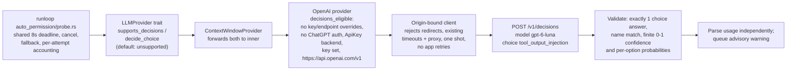

# Experimental Decisions Probe

`permissions.auto.use_decisions_probe` defaults to `false`. The
[full-automation guide](../guides/full-automation.md#experimental-decisions-probe) describes eligibility, billing,
evidence bounds, deadlines, fallback, and the advisory warning. The setting uses the ordinary configuration layers,
schema, `/settings` persistence, and reload flow.

Enable it through `/settings` → **Approvals & Security** in an ordinary interactive TUI session. Both Build and Auto
are eligible without a full-auto flag or acknowledgement profile. The `/model` picker also offers an OpenAI-only
follow-up after selecting a direct OpenAI API-key model at the standard endpoint while the toggle is off: `yes` enables,
`no` keeps it disabled, and `skip` leaves the value unchanged. The picker mirrors the same eligibility gate as
`supports_decisions()` (OpenAI enum, no ChatGPT subscription auth, parsed standard endpoint) without credential lookup
or dispatch, and persists the choice with the model selection. Existing enabled settings activate this path after
upgrade. Manual approvals and tool permissions keep their existing behavior; the output classifier is advisory.
The picker resolves the configured OpenAI auth preference before reporting the credential source or offering this
follow-up. Generic API-key discovery must not mark an `auto`/ChatGPT runtime as Decisions-eligible. Explicit
`api_key` preference also checks stored API keys when generic discovery finds an OAuth session first.

## Implementation Boundaries

`vtcode-llm::LLMProvider` exposes default-unsupported `supports_decisions` and `decide_choice` methods.
`ContextWindowProvider` forwards them. Only the built-in OpenAI provider advertises support, after checking API-key
authentication and a parsed standard HTTPS origin and `/v1` base path. Custom providers and gateways remain unsupported;
the capability check does not look up credentials or send requests.

`LLMProvider::generate_auxiliary` defaults to ordinary generation for stateless providers and is forwarded by the
context-window wrapper and custom-provider router. OpenAI overrides it to use HTTP (SSE when required), preserving
the main WebSocket lane and continuation even on timeout. The Decisions fallback allows 256 output tokens and low
reasoning when accepted by the selected route; the old effective 16-token allowance could be entirely consumed by
reasoning without a verdict.
The ordinary generation-only probe's eight-token request is unchanged. Both paths retain the existing shared deadline.
Decisions instructions describe the classification alone; typed answers do not need free-text formatting instructions.

`provider/decisions.rs` owns typed text choice requests, answer validation, and the shared
`is_standard_decisions_endpoint` predicate used by both the runtime eligibility gate and the picker mirror. OpenAI's
`provider/decisions.rs` transport uses an origin-bound client with the existing timeout and platform proxy policy and
API key. It rejects redirects without resending evidence, fails closed if client construction fails, performs one request
without application retries, bounds the answer body, and never incorporates evidence or error bodies into diagnostics. Refusal,
missing/duplicate answers, wrong names/types/categories, or non-finite/out-of-range probabilities are inconclusive.
Usage parses independently, so an inconclusive answer can still be accounted.

The runloop's `auto_permission/probe.rs` owns the shared deadline, cancellation, route fallback, and immediate per-attempt
accounting. Session usage includes auxiliary tokens and both attempts' costs; auxiliary requests do not feed prompt-cache
health. A failed/timed-out/cancelled attempt without usage leaves the complete session cost unknown. Decisions pricing
is endpoint-specific; ordinary `gpt-6-luna` generation keeps the model catalog's generation rates.
The shared OpenAI Responses builder raises sub-16 output-token allowances to the API minimum of 16, including
the generation-only probe's eight-token request. Omitted limits and subscription request shaping remain unchanged.

Admission reevaluates the current provider and loaded configuration for each tool result. Outside full-auto, probing
requires inline interactive UI, the enabled toggle, and `supports_decisions()`. Disabled/unsupported, subscription,
gateway, custom-endpoint, and headless sessions send no additional requests and spend no dispatch budget. In both paths,
planning, empty evidence, cancellation, and the existing three-dispatch per-turn budget still gate admission. Full-auto
retains its generation behavior when Decisions is disabled or unsupported.

TUI probes display **Checking tool output...** through the existing transient progress phase for the entire dispatch,
including fallback, while retaining configured footer context. Sequential probes own a spinner guard; parallel results
borrow the batch spinner and restore its prior message in place. The progress phase restores only its original operation.
Every completion restores the previous status; cancellation and exit stop the owner and clear
activity without reviving stale status. Privacy-safe attempt logs inherit session/turn identifiers and `full_auto`
from the dispatch span and record endpoint, outcome, elapsed milliseconds, and whether usage is known. No evidence,
credentials, or response bodies are logged.
Attempt records are INFO level. Config-based tracing applies its level separately to every selected target and includes
`vtcode_llm` by default, so provider rejection/fallback diagnostics remain visible after the provider crate extraction.

The idle input loop reevaluates live capability and planning after provider/settings changes. A
session-statistics latch allows one informational suggestion, only on the interactive idle surface while disabled.
There is no request, modal, automatic enablement, or model-facing instruction/tool schema change.



## Validation

Focused regressions cover defaults/serialization, settings persistence and reload, provider switches, wrapper forwarding,
deceptive endpoints, unsupported zero-request paths, `SAFE`/`SUSPECT`, refusal/malformed answers, HTTP errors, unknown usage,
advisory queuing, three-dispatch admission, evidence truncation, one fallback, shared deadlines, and cancellation.
Normal TUI admission, rejected admission retaining its budget, live provider/settings eligibility, transient status
restoration, borrowed batch ownership, and cancellation/exit cleanup have focused regressions.

```sh
cargo nextest run --locked -p vtcode-llm -p vtcode-config -p vtcode -E 'test(decisions) | test(auto_permission) | test(probe_reviews)'
```

The deterministic provider fixtures verify dispatch behavior, not real model classification quality or speed. Do not
report them as evidence of fewer false warnings, fewer missed attacks, lower cost, or lower latency.

## Labeled Comparison

The independent runner `scripts/evals/decisions_probe.py` compares an ordinary generation call with Decisions plus its
single generation fallback on identical bounded inputs. The checked-in corpus includes benign output, requested
instructions, quoted attacks, direct/quoted instruction hijacks, and attacks on both sides of the truncation boundary.
It alternates backend order and reports missed injections, false warnings, inconclusive outcomes, fallback frequency,
median latency, and combined base cost. Costs remain unknown if any attempt lacks usage. Reports contain case IDs and
outcomes, not evidence or keys. This is a small smoke corpus; broader adoption requires a larger labeled calibration set.

```sh
# No network or credential lookup:
python3 scripts/evals/decisions_probe.py --dry-run

# Bills the account identified by an explicitly supplied OPENAI_API_KEY:
python3 scripts/evals/decisions_probe.py --repeat 3
```

The generation baseline uses `gpt-6-luna` by default; to compare another configured probe model, supply
`--generation-model`, `--input-rate`, and `--output-rate` with that model's per-million rates. The runner uses direct
Responses HTTP with the API's minimum allowance of 16 output tokens and a single baseline request; its Decisions
fallback allows 256 output tokens and low reasoning for the default Luna model. Other evaluator models omit reasoning
because the runner has no capability catalog. See the [Responses request contract](https://developers.openai.com/api/reference/python/resources/responses/methods/create).
It does not reproduce provider transport retries or the ordinary
lightweight-to-main fallback. Runtime request limits and fallback route selection are covered by the Rust regressions.
Generation costs use conservative uncached input rates; regional/long-context premiums are excluded. See
[OpenAI Decisions pricing](https://developers.openai.com/api/docs/guides/decisions#pricing-and-availability).
Selecting another generation model requires both rates; the runner rejects incomplete pricing before any request.
Interrupted or truncated HTTP response bodies are inconclusive and leave that attempt's cost unknown. Invalid or
oversized token counts and non-finite cost estimates also remain unknown; malformed confidence values are rejected.
Each request uses an absolute deadline across connection setup and response reads. The caller stops waiting on a slow
resolver at the deadline; its worker closes without dispatching if resolution completes too late. Timed-out response
reads are interrupted, and no late response can suppress fallback or extend its shared deadline.

An attack entirely beyond the 2,400-character evidence window is a known blind spot of both backends. Its original
malicious label stays in the missed-injection count, and `visible_expected` records that the bounded evidence is benign.
Keep both labels when interpreting comparisons; a classifier cannot identify instructions it never receives.

Earlier live attempts were blocked by an unavailable key or an archived OpenAI project. On 2026-10-12, a rebuilt
interactive Build-mode session executed one requested `printf feature_probe_ok` tool call. Its Decisions probe returned
`SAFE` in 3,432 ms with known usage; both main Sol responses reported `ultrafast`, with one WebSocket connection.
Two separate benign Decisions checks returned `SAFE` in 3,532 and 733 ms using the same HTTP client.
These bounded smoke checks establish dispatch and transport behavior, not classification accuracy or cost savings.
Classification error rates, real fallback frequency, and a billed cost comparison remain unmeasured. Keep support
default-off and experimental until labeled live evidence establishes benefits without a classification regression.
