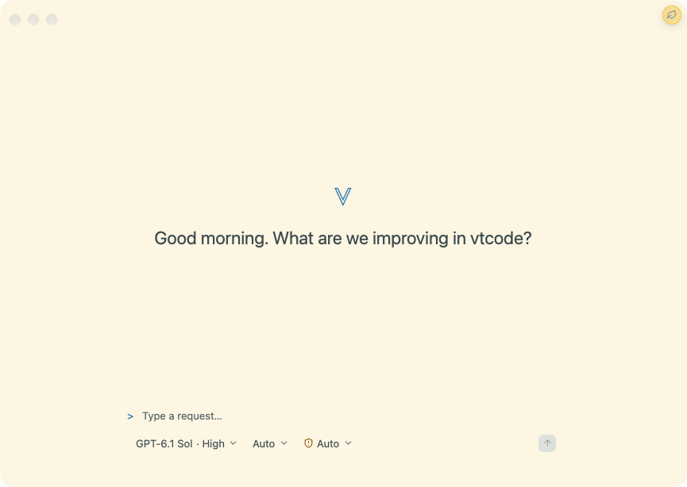
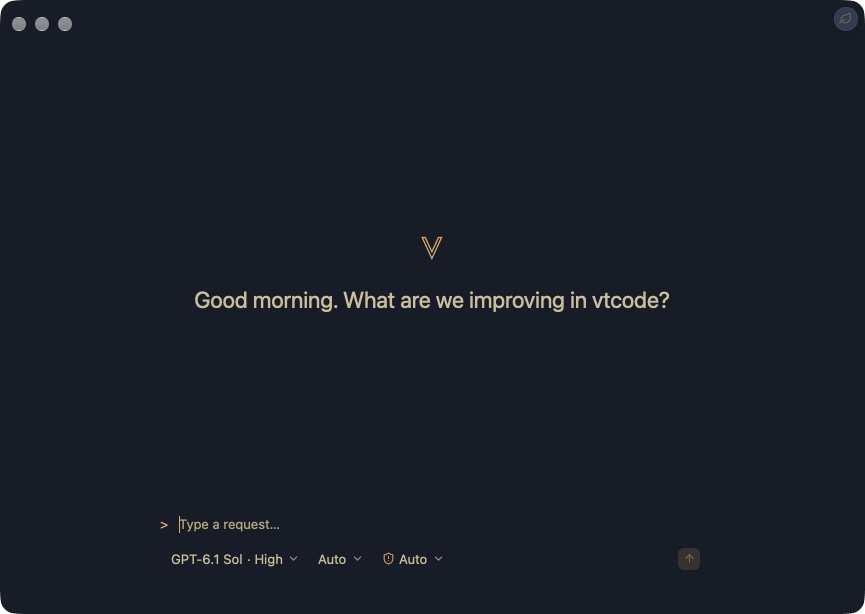

# VT Code Desktop Workspace

VT Code Desktop is a macOS 15+ GPUI Kit application backed by the matching local `vtcode desktop-server` executable. The
GUI sends typed JSON-RPC commands; the existing unified runloop remains responsible for provider calls, tool policy,
verification, cancellation, and durable session events. The desktop service does not initialize a terminal or emit
terminal presentation output to its protocol stream.

The [GPUI Kit guide review](desktop-gpui-kit-review.md) records coverage of all 41 main guide topics,
the applicable ownership/lifecycle improvements, and verification boundaries.

<!-- markdownlint-disable MD033 -->

<!-- NB: <video> needs absolute raw URLs; GitHub only rewrites relative src on , not <video>. -->
<video src="https://raw.githubusercontent.com/vinhnx/VTCode/main/resources/gif/demo-desktop.mov" width="100%" autoplay loop muted playsinline controls
  poster="https://raw.githubusercontent.com/vinhnx/VTCode/main/resources/screenshots/vtcode-desktop-light.png"
  aria-label="VT Code Desktop app demo">
<a href="https://github.com/vinhnx/VTCode/blob/main/resources/gif/demo-desktop.mov">Open the demo video</a>
</video>

<!-- markdownlint-enable MD033 -->

<p>
  
  
</p>
<p align="center"><sub>Light and dark appearances</sub></p>

## System requirements

To run the app:

- macOS 15 or newer, on Apple Silicon or Intel.
- One-time Gatekeeper approval on first launch: builds are ad hoc signed (no Developer ID, no notarization)
  unless the release notes say otherwise, so right-click the app and choose Open, or allow it once in
  System Settings > Privacy & Security.
- Provider credentials configured for the CLI (see below); the desktop service reuses the CLI's configuration,
  credentials, workspace trust, and sandbox policy.

To build and install from source (only needed when a release ships no prebuilt desktop asset for the host:
`scripts/install.sh` falls back to this automatically, `--without-desktop` skips it entirely, or run
`scripts/package-desktop-macos.sh` directly):

- A macOS 15+ build host (enforced by the packaging script).
- Git, when installing through `install.sh` (it clones the release tag); not needed when packaging from a checkout.
- Rust 1.99.1 or newer (the workspace MSRV).
- Xcode command line tools (`xcode-select --install`) for the linker and macOS SDK; the packaging script also
  requires `codesign`, `ditto`, `sips`, `iconutil`, and `plutil`.
- Build time: the release build compiles the GUI and its matching CLI helper from source and takes several minutes.

## Download a release build

Every release ships a prebuilt Apple Silicon app on
[GitHub Releases](https://github.com/vinhnx/VTCode/releases/latest) (expand **Assets**). The easiest install is
`vtcode desktop --install`, which downloads the same prebuilt asset automatically (`scripts/install.sh` and
`vtcode update` offer it too, asking between `~/Applications` and `/Applications` for fresh installs, while
`--install`/`--with-desktop` use `~/Applications` without asking). To install by hand, download
`vtcode-desktop-<version>-aarch64-apple-darwin.zip`, unzip, and drag **VT Code.app** to `~/Applications`,
verifying with the matching `.sha256` sidecar or `checksums.txt`. Only hosts without a published asset fall back
to a from-source build, or package from a checkout as below.

Launching the CLI without the app installed shows a reminder at most once per day; mute it permanently with
`[desktop] suggest-install = false` in vtcode.toml.

## Build and launch

For local development, build the service and launch the GUI from the workspace root:

```sh
cargo build --locked -p vtcode
cargo run --locked -p vtcode-desktop
```

The workspace dev profile optimizes GPUI rendering, layout, and text dependencies
for a responsive desktop preview while keeping application code debuggable. The
first build of those optimized dependencies can take longer.

Choose a workspace folder in the app. The desktop client starts `vtcode desktop-server` with an absolute workspace path
and uses the existing VT Code configuration, provider credentials, workspace trust, and sandbox policy. If startup
reports missing credentials, the service still boots so the app stays connected: configure the provider from Terminal
with the command shown by the app (or switch to an authenticated provider), then choose Reload CLI settings in
Settings → VT Code to reconnect. No app restart is needed.
Credential entry and OAuth onboarding are not part of this version.

To make a local application bundle on macOS 15 or newer:

```sh
scripts/package-desktop-macos.sh
```

The optional first argument selects the output `.app` path. The script builds the release GUI and matching service,
places the service in `Contents/Helpers`, signs both executables before signing the app, and verifies the bundle. The
default output is `dist/VT Code.app`; the script refuses to overwrite an existing bundle unless `--force` (or
`VTCODE_PACKAGE_FORCE=1`) is given, in which case the old bundle is replaced only after the new one is signed and
verified. `--skip-build` reuses the binaries already in the release directory, and `--no-assets` skips the Liquid Glass
`Assets.car` catalog (the icns fallback still ships). Ad hoc signatures support local development only. They do not
establish Developer ID trust or notarize a downloaded app; see [Apple Developer ID](https://developer.apple.com/developer-id/).
Every package writes Gatekeeper first-launch steps next to the bundle (`FIRST-LAUNCH.txt`): right-click the app and
choose Open, or allow it once in System Settings > Privacy & Security.
The packaged GUI uses only its bundled `Contents/Helpers/vtcode`; if that helper is missing, it asks you to rebuild or
reinstall instead of starting an unrelated workspace binary. Development runs prefer an adjacent `vtcode` binary, then
check the workspace `target/release` and `target/debug` outputs.

Launch a packaged build by its exact path with `scripts/open-desktop-macos.sh "dist/VT Code.app"`. The launcher asks
macOS to open a new instance of that bundle; this avoids selecting a different local copy when several development apps
share the same display name or bundle identifier. From any terminal, `vtcode desktop [APP_PATH]` opens the GUI the same
way on macOS: it checks the explicit path, then `VTCODE_DESKTOP_APP`, then `~/Applications` and `/Applications`.
`vtcode desktop --install` downloads and installs the app from the prebuilt release asset instead (updates install in
place; fresh installs go to `~/Applications`).

The GUI accepts a startup link, `--session <id> --workspace <path>` (either order; `--flag=value` also works),
sent by CLI `/desktop` via `open --args`. It selects the workspace and loads the thread through the same
pending-navigation path as back/forward history, so an unknown session reports the standard thread-unavailable
notice and an unreadable workspace stays on welcome with the invalid-folder notice. Unknown
arguments (including the `-psn_*` tokens Finder injects) are ignored.

The fast path is a `vtcode://session/<id>?workspace=<path>` URL (scheme claimed in the bundle plist,
contract in `vtcode-desktop-protocol::handoff_url`), delivered to the running app through `on_open_urls` —
no new process, no backend reboot, no handshake replay. Measured on the backend half with the debug binary
(spawn + initialize + full discovery + load-answer vs a single load round trip on a warm backend, warm page
cache, 3 runs each): 53 ms median cold vs 0.076 ms median warm, ~690x. Full GUI cold boot adds further
cold-side-only cost (process launch, UI init, first render); end-to-end GUI timing needs a scheme-registered
bundle installed. Events arriving before init finish queue in a small
inbox and drain after the window opens. Same-workspace links load directly through the UI entry (running-turn
confirm included); other workspaces navigate through the pending path. Either way the CLI falls back to the
argv launch when no bundle claims the scheme.

The GUI crate is non-publishable and outside Cargo's default members. It uses the pinned [`gpui-kit` 0.8.1 setup](https://gpui-kit.com/docs/installation/).

## Runtime and session behavior

The app owns one selected workspace, one local service process, and at most one active turn. Workspace or session changes
wait for active work to cancel and its runloop to clean up. Closing the app or disconnecting the protocol also cancels
owned work and pending interactions.

Session history is discovered from VT Code's existing durable stores. The recent-thread sidebar virtualizes its bounded
session list and retains a themed scrollbar as history grows. The sidebar and Activity tab reuse their fixed-row geometry
until row count or height changes; row content still renders only in the visible range. Selecting a previous session
explicitly loads its bounded text projection and resume state. A restart does not replay a submitted prompt or an approval
automatically.
Until the archive persists its first-prompt preview, the sidebar names a new session from the first submitted prompt and
keeps that name across session-list refreshes. The session list reloads whenever a turn ends. A Close button deselects
the current session through `session/close` without starting a replacement.
The transcript follows new output while it is at the latest position and preserves the reader's position after they
scroll upward.

New Thread immediately shows a transition while the previous session closes, and the draft remains editable; a
replacement runtime starts only when the first prompt is submitted. Attached sources remain available throughout.
Session creation, loading, closing, and model changes run one at a time. While a transition is pending, submission,
attachments, and further session/model/workspace changes wait for its response; WebMCP turns are rejected until it
completes. A first message waits for confirmed
session creation before any turn is sent. Failed creation or submission leaves the original content recoverable;
an empty prompt does not create a session.
The Connections panel refreshes WebMCP availability after session and turn changes. A status response superseded by
a newer change is discarded and refreshed; a failed refresh is shown as unavailable rather than as a ready session.
Pending CLI questions and approvals also block new desktop or WebMCP turns and session changes until answered.
If a new thread's first prompt is explicitly rejected because a startup question is pending, Desktop waits for the
acknowledged decision and retries that same prompt once. The user can keep it as an unsent draft instead; uncertain
delivery is never retried automatically.
Early runtime notifications remain in the bounded event queue while restored history is prepared, then are applied to
the selected session in order.
If a first prompt reaches the runtime before a startup question is displayed, the shared runloop retains the prompt
and its attachments until the question is answered or dismissed.

When the main window is inactive, a completed or failed/blocked run, or a request waiting for a decision, posts a
system notification through GPUI Kit. Notifications contain only generic status text; the transcript and interaction
state remain authoritative in the app. Clicking a Kit notification activates its originating window. OS permission,
focus modes, and notification settings may suppress delivery. On macOS, verify delivery from a trusted bundled `.app`;
`cargo run` does not post to Notification Center.

## UI quick reference

The window opens with a compact navigation rail and the conversation. The project/thread sidebar and
context inspector start collapsed on each launch; stored pane widths are retained.

| Action                                                                                                                                                                                                                                      | Behavior                                                                                                                                                                                                                                                                                                                                                                                                                                                                                                                                                                                                                                                                                                                                                                                                                                                                                                                                                                                                                                                                                                                                                                                                                                                                                                                                                                                                                                                                                                                                                                                                                                                                                                                                                                 |
| ------------------------------------------------------------------------------------------------------------------------------------------------------------------------------------------------------------------------------------------- | ------------------------------------------------------------------------------------------------------------------------------------------------------------------------------------------------------------------------------------------------------------------------------------------------------------------------------------------------------------------------------------------------------------------------------------------------------------------------------------------------------------------------------------------------------------------------------------------------------------------------------------------------------------------------------------------------------------------------------------------------------------------------------------------------------------------------------------------------------------------------------------------------------------------------------------------------------------------------------------------------------------------------------------------------------------------------------------------------------------------------------------------------------------------------------------------------------------------------------------------------------------------------------------------------------------------------------------------------------------------------------------------------------------------------------------------------------------------------------------------------------------------------------------------------------------------------------------------------------------------------------------------------------------------------------------------------------------------------------------------------------------------------ |
| Reopen the app                                                                                                                                                                                                                              | Dock or Finder relaunch activates the existing window. If the last window was closed, it opens a new window and restores the most recent existing workspace.                                                                                                                                                                                                                                                                                                                                                                                                                                                                                                                                                                                                                                                                                                                                                                                                                                                                                                                                                                                                                                                                                                                                                                                                                                                                                                                                                                                                                                                                                                                                                                                                             |
| Launch maximized                                                                                                                                                                                                                            | The main window opens zoomed (full-size) by default; unzooming persists, so the next launch restores the saved zoomed or windowed state.                                                                                                                                                                                                                                                                                                                                                                                                                                                                                                                                                                                                                                                                                                                                                                                                                                                                                                                                                                                                                                                                                                                                                                                                                                                                                                                                                                                                                                                                                                                                                                                                                                 |
| Connect to a workspace                                                                                                                                                                                                                      | Initialization validates the negotiated protocol before configuration and session discovery. Session commands and Send wait for this handshake; incompatible helpers disconnect with the initialization error preserved.                                                                                                                                                                                                                                                                                                                                                                                                                                                                                                                                                                                                                                                                                                                                                                                                                                                                                                                                                                                                                                                                                                                                                                                                                                                                                                                                                                                                                                                                                                                                                 |
| Recover a disconnected service                                                                                                                                                                                                              | Startup failures and unexpected local-service exits announce an accessible error and direct you to Settings → VT Code → Reload CLI settings. Pending interactions are dismissed when the service exits, so they cannot block recovery or carry answers into a later question. Repair provider credentials in Terminal when requested. If delivery was uncertain, restore or dismiss the retained message first; it is never resent automatically.                                                                                                                                                                                                                                                                                                                                                                                                                                                                                                                                                                                                                                                                                                                                                                                                                                                                                                                                                                                                                                                                                                                                                                                                                                                                                                                        |
| Use native menus                                                                                                                                                                                                                            | File, Edit, View, and Window menus dispatch the same typed actions as keyboard controls. The application menu adds About VT Code — a themed in-app dialog with the app icon, version chip, an Acknowledgments shortcut into Settings → VT Code, and a repository link — and Settings; the View menu adds Toggle Sidebar and Enter Full Screen (⌃⌘F) — the item reads Exit Full Screen while full screen is active; the Help menu opens the project repository. Session commands disable while unavailable; Edit targets the focused text field. ⌘W closes the window, ⌘M minimizes, ⌘Q quits, and ⌘⇧N shows or reopens the main window.                                                                                                                                                                                                                                                                                                                                                                                                                                                                                                                                                                                                                                                                                                                                                                                                                                                                                                                                                                                                                                                                                                                                  |
| Use touch on a Mac                                                                                                                                                                                                                          | Touch-display Macs and Sidecar iPads work through the system's touch-to-mouse emulation, so no setup is needed: tap clicks, touch-and-drag drags panes, one-finger pan scrolls, and touch-and-hold opens the right-click menu. Pinch and rotate are not delivered to the app today. Pane resize handles have arrow-key equivalents (arrows move ±10, Shift+arrows ±50), so every touch path keeps a keyboard fallback.                                                                                                                                                                                                                                                                                                                                                                                                                                                                                                                                                                                                                                                                                                                                                                                                                                                                                                                                                                                                                                                                                                                                                                                                                                                                                                                                                   |
| Navigate back or forward                                                                                                                                                                                                                    | Header arrows, ⌘[ / ⌘], trackpad swipe, and mouse back/forward buttons move through recent workspace/thread history. A sustained two-finger horizontal scroll navigates with or without the macOS “Swipe between pages” gesture; the matching arrow lights up mid-swipe, and swipe direction follows the system Scroll Direction setting. While a navigation is in flight, the active arrow shows a loading spinner and a “Navigating back/forward…” status appears above the conversation. Cross-workspace navigation waits for the local service to reconnect before restoring the destination thread. If a saved thread is no longer available, Desktop keeps the destination workspace open without selecting a thread.                                                                                                                                                                                                                                                                                                                                                                                                                                                                                                                                                                                                                                                                                                                                                                                                                                                                                                                                                                                                                                                                                                                                                                                                         |
| Open Utilities                                                                                                                                                                                                                              | The Utilities inspector tab summarizes session changes, recent tool activity, and draft source attachments, with actions into Changes, Activity, Files, and previews. Press ⌘⇧U or use the navigation rail button to open it.                                                                                                                                                                                                                                                                                                                                                                                                                                                                                                                                                                                                                                                                                                                                                                                                                                                                                                                                                                                                                                                                                                                                                                                                                                                                                                                                                                                                                                                                                                                                            |
| Inspect tool activity                                                                                                                                                                                                                       | Expand a consecutive tool-action summary, then open an action for its bounded output excerpt. Copy full output from that action when you need its complete captured text. Running and failed counts remain visible while collapsed.                                                                                                                                                                                                                                                                                                                                                                                                                                                                                                                                                                                                                                                                                                                                                                                                                                                                                                                                                                                                                                                                                                                                                                                                                                                                                                                                                                                                                                                                                                                                      |
| Receive a background notice                                                                                                                                                                                                                 | Run completion/failure/blocking, permission prompts, questions needing input, an unexpected service exit, or a newly available app update posts a system notification. Settings → Notifications controls delivery: turn-completion timing (always, only when unfocused, never) plus permission, question, and update toggles behind a master switch. A focused window shows update announcements as an in-app toast instead. Each release version announces once; intentional service restarts never banner. App state remains available if OS notification delivery is suppressed.                                                                                                                                                                                                                                                                                                                                                                                                                                                                                                                                                                                                                                                                                                                                                                                                                                                                                                                                                                                                                                                                                                                                                                                      |
| Read streamed output                                                                                                                                                                                                                        | GPUI measures variable-height rows and follows the bottom of the newest message, including a message taller than the viewport.                                                                                                                                                                                                                                                                                                                                                                                                                                                                                                                                                                                                                                                                                                                                                                                                                                                                                                                                                                                                                                                                                                                                                                                                                                                                                                                                                                                                                                                                                                                                                                                                                                           |
| Read the conversation                                                                                                                                                                                                                       | User messages use trailing, filled neutral bubbles; agent prose has no visible speaker label or avatar. Speaker identity remains available to assistive technology. Compact tool summaries stay between the agent messages that surround them; expanded tools keep their title and disclosure together, with status text reserved for active, failed, or archived activity. Restored conversations omit model-only context while retaining ordinary system notices.                                                                                                                                                                                                                                                                                                                                                                                                                                                                                                                                                                                                                                                                                                                                                                                                                                                                                                                                                                                                                                                                                                                                                                                                                                                                                                      |
| Scroll upward                                                                                                                                                                                                                               | Tail following pauses; returning to the bottom resumes it. Older rows evicted by the history bound preserve the remaining reader anchor.                                                                                                                                                                                                                                                                                                                                                                                                                                                                                                                                                                                                                                                                                                                                                                                                                                                                                                                                                                                                                                                                                                                                                                                                                                                                                                                                                                                                                                                                                                                                                                                                                                 |
| Send a prompt                                                                                                                                                                                                                               | Enter submits the composer draft; Shift+Enter inserts a newline. Send creates a session automatically when none is selected, then submits the exact captured prompt and attachments. A newer draft typed while creation is pending stays in the composer.                                                                                                                                                                                                                                                                                                                                                                                                                                                                                                                                                                                                                                                                                                                                                                                                                                                                                                                                                                                                                                                                                                                                                                                                                                                                                                                                                                                                                                                                                                                |
| Use CLI composer completions                                                                                                                                                                                                                | Typing `@` at a token boundary opens filtered workspace-file mentions; selecting one inserts `@path` into the draft and leaves file loading to the shared runtime. A leading `/` opens commands from the CLI's visible slash-command catalog. Up/Down changes the highlighted command, Tab completes without submitting, and Enter completes the selected command and sends it through the normal desktop turn path. Email addresses and package-manager scopes such as `npm install @types/node` do not open file mentions.                                                                                                                                                                                                                                                                                                                                                                                                                                                                                                                                                                                                                                                                                                                                                                                                                                                                                                                                                                                                                                                                                                                                                                                                                                             |
| Run CLI slash commands                                                                                                                                                                                                                      | Desktop uses VT Code's shared slash-command dispatcher for runtime, workspace, safety, integration, history, and auth commands. Exact native equivalents route `/new`, `/exit`, `/stop`, `/files [filter]`, `/history`, `/model`, `/fast`, `/mode`, `/theme`, `/config`, `/splash`, and `/help` into desktop session controls, palettes, or settings. Matching mirrors the CLI dispatcher: the command token is case-insensitive (`/NEW`), and the argument-less commands (`/new`, `/exit`, `/stop`, `/model`) route natively even with trailing text. `/config` opens the dedicated configuration page, and `/config <group or path>` deep-links into it while anything else becomes a search query. The runtime-owned `/config` sections (`reset`, `clear`, `checkup`, `doctor`, `memory`, `tasks`, `jobs`, `log`, `subprocess`, `notify`) stay with the CLI runtime, as do `/settings` arguments outside the known Settings tabs. `/splash` opens Connections and refreshes WebMCP status; CLI `/splash` reports its own workspace, session, tool registry, and listener without exposing pairing codes. `/files` opens the filtered `@` file picker, and `/history` restores a recent user prompt from the selected thread without submitting it. Terminal-only commands (`/terminal-setup`, `/statusline`, `/title`, `/vim`) are omitted from Desktop suggestions. Commands without a native equivalent continue through the shared CLI runtime and its bridged choice dialogs. `/go <destination>` opens any route, palette, shortcut command, or addressable action (`settings/shortcuts`, `palette/models`, `command/zen_mode`, `action/preview-file/<path>`); bare `/go` and the command palette's Go to entry open the searchable destination palette instead. |
| Recover a submission                                                                                                                                                                                                                        | The app retains the submitted prompt and attachments until acknowledgement. A rejected request offers Restore draft, Copy prompt, and Dismiss; restoration requires an empty composer so newer work is preserved. A disconnect before acknowledgement warns that delivery is uncertain. Recovery never resends automatically.                                                                                                                                                                                                                                                                                                                                                                                                                                                                                                                                                                                                                                                                                                                                                                                                                                                                                                                                                                                                                                                                                                                                                                                                                                                                                                                                                                                                                                            |
| Attach files                                                                                                                                                                                                                                | "+ Attach" opens a native multi-select picker limited to workspace UTF-8 text files (at most 5 per prompt, 64 KiB each). Oversized files are rejected rather than silently truncated. Send waits for attachment loading. Chips above the composer remove items; the transcript echoes attached paths.                                                                                                                                                                                                                                                                                                                                                                                                                                                                                                                                                                                                                                                                                                                                                                                                                                                                                                                                                                                                                                                                                                                                                                                                                                                                                                                                                                                                                                                                    |
| Switch models                                                                                                                                                                                                                               | The composer's Model button opens a searchable kit Command picker, grouped by provider. Search names, providers, or exact IDs; rows show context token counts and preselect the current model, including configured models outside the built-in catalog. Arrow keys and Enter choose a model through `config/select`; the switch restarts the runtime under the same session id and the thread keeps its history. The selection persists to the workspace config and the inherited effort maps onto the new route's nearest supported level (CLI parity). Escape clears a nonempty query, then dismisses without changes.                                                                                                                                                                                                                                                                                                                                                                                                                                                                                                                                                                                                                                                                                                                                                                                                                                                                                                                                                                                                                                                                                                                                                                                                                                                                                        |
| Track the active agent                                                                                                                                                                                                                      | The composer mode control follows primary-agent changes from live slash commands. Its picker lists the CLI-discovered primary agents and saves the workspace default for the next session.                                                                                                                                                                                                                                                                                                                                                                                                                                                                                                                                                                                                                                                                                                                                                                                                                                                                                                                                                                                                                                                                                                                                                                                                                                                                                                                                                                                                                                                                                                                                                                               |
| Expand tool details                                                                                                                                                                                                                         | The changed row is remeasured while the reading position is preserved.                                                                                                                                                                                                                                                                                                                                                                                                                                                                                                                                                                                                                                                                                                                                                                                                                                                                                                                                                                                                                                                                                                                                                                                                                                                                                                                                                                                                                                                                                                                                                                                                                                                                                                   |
| Review file changes                                                                                                                                                                                                                         | File-change events render as a diff card: per-file kind, +/− counts, apply status, and a collapsible line-colored unified diff (mono font, bounded to 2,000 rendered lines) with copy-patch.                                                                                                                                                                                                                                                                                                                                                                                                                                                                                                                                                                                                                                                                                                                                                                                                                                                                                                                                                                                                                                                                                                                                                                                                                                                                                                                                                                                                                                                                                                                                                                             |
| Inspect changes                                                                                                                                                                                                                             | The inspector's Changes tab aggregates every change-set: per-file kind and +/− counts when complete. Runtime file paths remain listed when a diff preview is missing or incomplete; the app marks unavailable previews and omits untrustworthy line counts instead of reusing an older patch. Selectable previews open in the kit's syntax-highlighted Diff viewer with Copy patch and Open file. F7/Shift+F7 navigates changes; Option+F7/Option+Shift+F7 navigates files. These bindings are configurable.                                                                                                                                                                                                                                                                                                                                                                                                                                                                                                                                                                                                                                                                                                                                                                                                                                                                                                                                                                                                                                                                                                                                                                                                                                                             |
| Browse files                                                                                                                                                                                                                                | ⌘⇧E opens the inspector's Files tab and focuses its read-only, collapsed tree (at most 400 entries, directory traversal through depth 8, dependency/VCS/hidden directories skipped). The first scan shows a reduced-motion-aware loading skeleton; empty results explain whether a workspace is missing or contains no browseable files. Tab to Workspace files and press Enter to focus the tree; Up/Down moves selection and Left/Right collapses or expands folders. Clicking a folder also toggles it. Enter or a click opens the file in the configured destination (Settings → Appearance → Files): the read-only UTF-8 preview (64 KiB cap) by default, or directly in the chosen external editor. From the preview, Open in editor uses the macOS default text editor, and VS Code opens the file using its registered application; a missing editor or file is reported in the preview. External opening rechecks workspace containment and passes the path without a shell. Expansion and selection survive refresh. Scans and reads run off the UI thread; paths and symlinks resolving outside the workspace are rejected.                                                                                                                                                                                                                                                                                                                                                                                                                                                                                                                                                                                                                                   |
| Review current Git changes                                                                                                                                                                                                                  | ⌘⇧G or Changes → Review working tree opens a read-only snapshot viewer. Choose an optional folder and untracked-text inclusion, then Load changes; Refresh or ⌘R updates the capture.                                                                                                                                                                                                                                                                                                                                                                                                                                                                                                                                                                                                                                                                                                                                                                                                                                                                                                                                                                                                                                                                                                                                                                                                                                                                                                                                                                                                                                                                                                                                                                                    |
| Follow activity                                                                                                                                                                                                                             | The inspector's Activity tab shows an accessible, theme-colored status summary (one legend line per nonzero status) and a virtualized tool/command list, retaining the newest 300 rows in chronological order. When older actions are omitted, a status notice offers Search conversation, which uses the existing bounded history search. Rows with captured output have a keyboard-accessible action that opens that exact capture in Output. The summary's spoken label includes counts for running, completed, failed, interrupted, and unclassified activity.                                                                                                                                                                                                                                                                                                                                                                                                                                                                                                                                                                                                                                                                                                                                                                                                                                                                                                                                                                                                                                                                                                                                                                                                       |
| Watch command output                                                                                                                                                                                                                        | The inspector's Output tab shows the newest capture by default or the activity row selected from history. Choose Follow latest output to resume the live tail. Expanded activity rows show the same mono tail, capped at 1,000 lines and 128 KiB. Copy includes all output loaded so far. Restored spools load an initial 32 KiB at session restore; choose Load more captured output to fetch another bounded page. If archived activity history is incomplete, Changes, Activity, and Output show an accessible warning even when no rows were recovered. Historical unfinished work is marked interrupted.                                                                                                                                                                                                                                                                                                                                                                                                                                                                                                                                                                                                                                                                                                                                                                                                                                                                                                                                                                                                                                                                                                                                                            |
| Toggle the inspector                                                                                                                                                                                                                        | The toolbar button shows or hides the panel; the palette has the same command, and a close button trails the inspector tab rail. The panel edge drags to resize (persisted per width), with arrow-key equivalents on its splitter.                                                                                                                                                                                                                                                                                                                                                                                                                                                                                                                                                                                                                                                                                                                                                                                                                                                                                                                                                                                                                                                                                                                                                                                                                                                                                                                                                                                                                                                                                                                                                                                                                                                                                           |
| Navigate inspector tabs                                                                                                                                                                                                                     | The kit segmented TabBar exposes selected tabs. Tab focuses the inspector navigation; Left/Right cycle tabs, Home selects Changes, and End selects Utilities.                                                                                                                                                                                                                                                                                                                                                                                                                                                                                                                                                                                                                                                                                                                                                                                                                                                                                                                                                                                                                                                                                                                                                                                                                                                                                                                                                                                                                                                                                                                                                                                                            |
| Start from the welcome view                                                                                                                                                                                                                 | The kit Empty surface offers Browse files and Choose model actions. Changes, activity, and output use matching empty-state layouts until session data arrives.                                                                                                                                                                                                                                                                                                                                                                                                                                                                                                                                                                                                                                                                                                                                                                                                                                                                                                                                                                                                                                                                                                                                                                                                                                                                                                                                                                                                                                                                                                                                                                                                           |
| Open the command palette                                                                                                                                                                                                                    | ⌘K searches session commands, view toggles, all loaded sessions (up to 200), and workspace files from the bounded workspace scan (up to 400 entries), opened in the configured file destination. Rows for bound commands show their saved shortcut badge, and a Settings entry deep-links to Shortcuts settings (searchable as keyboard, shortcut, or keybinding). Use Refresh recent threads to sync sessions created by the CLI; the desktop updates the active session from runtime events instead of rescanning archives after every turn. Named accessible rows retain selection semantics; Tab stays inside. Enter confirms. Escape clears a nonempty query first, then dismisses and returns focus; a backdrop click also dismisses.                                                                                                                                                                                                                                                                                                                                                                                                                                                                                                                                                                                                                                                                                                                                                                                                                                                                                                                                                                                                                              |
| Find conversation content                                                                                                                                                                                                                   | ⌘⇧F or Command Palette → Find in conversation searches loaded user, VT Code, tool-activity text, and the bounded output preview shown in the inspector. Select a message or activity result to reveal it in the virtualized transcript; select an output result to open that capture in the Output inspector. Choose Load earlier messages at the bottom of the search panel to fetch the next bounded archive page and keep searching; search reuses the existing session-history pager and never reads the archive separately.                                                                                                                                                                                                                                                                                                                                                                                                                                                                                                                                                                                                                                                                                                                                                                                                                                                                                                                                                                                                                                                                                                                                                                                                                                         |
| Expand navigation                                                                                                                                                                                                                           | Appearance → Layout places navigation on the left or right (right by default), or hides it while keeping New Thread and Utilities in the header. The toolbar toggle or ⌘B shows/hides the rail; hover its project icon for a transient list, and leave navigation or press Escape to dismiss the peek.                                                                                                                                                                                                                                                                                                                                                                                                                                                                                                                                                                                                                                                                                                                                                                                                                                                                                                                                                                                                                                                                                                                                                                                                                                                                                                                                                                                                                                                                   |
| Browse threads                                                                                                                                                                                                                              | The rail's expand button or Command Palette → Browse threads opens the browser panel in the content slot beneath the persistent toolbar, over cached sessions grouped by workspace (current first) and sorted newest-first. Rows carry a compact recency and size lane; selecting a row loads the thread and returns to the workspace; the header also offers New thread and Close thread. The toolbar Back button, ⌘[, or Escape pops the panel (Forward reopens it); the header Close button dismisses it outright. Either way focus lands in the composer.                                                                                                                                                                                                                                                                                                                                                                                                                                                                                                                                                                                                                                                                                                                                                                                                                                                                                                                                                                                                                                                                                                                                                                                                            |
| Switch open threads                                                                                                                                                                                                                         | With more than one thread open, a tab strip above the conversation lists them in first-open order with per-tab close buttons and a New thread action. Selecting a tab loads that thread; closing the selected tab loads the nearest neighbor (next first, else previous), and a refused load keeps the tab so the selection stays reachable. Right-click a tab for Close tab, Close other tabs, or Copy thread title. With zero or one thread open, a compact header shows the thread title with a New thread action instead, for threads with content or a selection (the empty welcome state keeps no header), so a lone tab never repeats the window title.                                                                                                                                                                                                                                                                                                                                                                                                                                                                                                                                                                                                                                                                                                                                                                                                                                                                                                                                                                                                                                                                                                           |
| Use right-click menus                                                                                                                                                                                                                       | Sidebar session rows, thread-browser rows, thread tabs, config rows, and file-tree rows offer right-click menus with the relevant actions: copy thread titles, config paths/values, or file paths; close tabs; open file previews; delete threads (confirm-gated — dispatching alone sends nothing). File-tree rows also drag out: dropping one into Finder or an editor opens or copies the workspace file (directories included), with a file chip following the cursor while the drag is inside the window.                                                                                                                                                                                                                                                                                                                                                                                                                                                                                                                                                                                                                                                                                                                                                                                                                                                                                                                                                                                                                                                                                                                                                                                                                                                           |
| Focus the conversation                                                                                                                                                                                                                      | Zen mode starts active. Use the title-bar leaf toggle, the window-actions overflow menu, the command palette, or configurable Ctrl+⌘Z to toggle Zen mode. Zen hides the side panels, thread heading, full welcome view, status bar, and auxiliary composer controls while preserving the transcript, message input, model/mode/policy controls, and send/cancel action; the conversation surface spans the window edge to edge beneath the title bar (no chrome inset, square corners). Empty threads show a minimal centered brand mark with one greeting line instead of the full welcome view. One leaf toggle at the title-bar trailing edge enters and exits Zen: it keeps the same slot in both modes and only repaints, fading while Zen is active. The Zen composer is a narrower borderless prompt with roomier padding, and a quiet model, mode, and policy control cluster opposite a small send action, all on the same centered spine as the transcript. Toggles and returning chrome fade on a short theme transition that renders statically under reduced motion; the native title bar remains available for window controls.                                                                                                                                                                                                                                                                                                                                                                                                                                                                                                                                                                                                                            |
| Navigate settings                                                                                                                                                                                                                           | Settings opens as a panel in the content slot beneath the persistent toolbar, with left navigation over Appearance, Accessibility, Shortcuts, VT Code, Connections, Notifications, Storage, and CLI Configuration. The arrow keys move between pages; Home and End select the first and last. Each page scrolls independently so the title and navigation stay fixed; below 900px viewport width the sidebar collapses to its rail and the settings navigation stacks above the content. Back (toolbar button, ⌘[, or Escape) walks interior layers first — typed editor, shortcut capture, palette, config page to its tab — then pops the panel, and Forward reopens it; the header Close button dismisses the panel outright. Either way focus lands in the composer.                                                                                                                                                                                                                                                                                                                                                                                                                                                                                                                                                                                                                                                                                                                                                                                                                                                                                                                                                                                                 |
| Search settings and CLI config                                                                                                                                                                                                              | ⌘F or the Settings search control filters settings categories and the loaded, bounded CLI config catalog. Selecting a category opens that page; selecting a config path opens its existing editor. Escape returns to Settings.                                                                                                                                                                                                                                                                                                                                                                                                                                                                                                                                                                                                                                                                                                                                                                                                                                                                                                                                                                                                                                                                                                                                                                                                                                                                                                                                                                                                                                                                                                                                           |
| Configure shortcuts                                                                                                                                                                                                                         | Settings → Shortcuts lists thirty main desktop commands with descriptions and GPUI Kit `Kbd` badges, filterable by an inline search. Each row captures a new chord by pressing keys or unbinds to Unassigned; invalid, duplicate, typing-only, and reserved macOS/editing combinations are rejected. Function keys are available for review navigation. Save/Cancel persists or discards staged edits and Reset all to defaults stages the defaults (Cancel recovers), applying on restart; Import from CLI reuses the configured interrupt/model bindings. Every enabled button remains in Tab order and activates with Enter or Space; contextual item actions do not need a global chord.                                                                                                                                                                                                                                                                                                                                                                                                                                                                                                                                                                                                                                                                                                                                                                                                                                                                                                                                                                                                                                                                             |
| Use keyboard commands                                                                                                                                                                                                                       | ⌘N creates a session, ⌘⇧W closes the selected session, ⌘O chooses a workspace, ⌘L focuses the composer, ⌘⇧I toggles the inspector, ⌘⇧U opens Utilities, ⌘⇧E opens Workspace Files, ⌘⇧G reviews the working tree, ⌘R refreshes the active workspace view, and ⌘. cancels the active run. The same active-turn and cleanup guards apply as for buttons.                                                                                                                                                                                                                                                                                                                                                                                                                                                                                                                                                                                                                                                                                                                                                                                                                                                                                                                                                                                                                                                                                                                                                                                                                                                                                                                                                                                                                    |
| Dismiss an overlay                                                                                                                                                                                                                          | Escape closes the topmost layer and restores prior keyboard focus: full-access confirm, then panel-interior layers (CLI config editor, armed shortcut capture, palette, config page back to its tab), then the panel itself via the route history, then navigation peek, workspace palette, and file preview. ⌘L dismisses supported overlays and focuses the composer. Escape alone does not cancel agent work.                                                                                                                                                                                                                                                                                                                                                                                                                                                                                                                                                                                                                                                                                                                                                                                                                                                                                                                                                                                                                                                                                                                                                                                                                                                                                                                                                         |
| Read the status bar                                                                                                                                                                                                                         | Workspace name, the workspace's git branch (walked up to the repository root; detached HEAD shortened; worktree pointers followed), the sandbox policy label, Context % (last turn's usage against the model's context window, hidden while unknown), the configured provider · model, and the agent running/idle state. When enabled, a Kit Marker announces agent state and shows a compact loading spinner while work is running; its text remains visible.                                                                                                                                                                                                                                                                                                                                                                                                                                                                                                                                                                                                                                                                                                                                                                                                                                                                                                                                                                                                                                                                                                                                                                                                                                                                                                           |
| Notice a context boundary                                                                                                                                                                                                                   | Automatic or manual compaction and fresh-context resets post a transcript notice with message counts or prior pressure, and Context % hides until the next completed turn reports post-boundary usage.                                                                                                                                                                                                                                                                                                                                                                                                                                                                                                                                                                                                                                                                                                                                                                                                                                                                                                                                                                                                                                                                                                                                                                                                                                                                                                                                                                                                                                                                                                                                                                   |
| Reduce motion                                                                                                                                                                                                                               | Settings → Accessibility offers System, On, and Off. System uses the current macOS accessibility setting at launch or when selected; explicit choices persist with Desktop preferences and apply to GPUI Kit animations.                                                                                                                                                                                                                                                                                                                                                                                                                                                                                                                                                                                                                                                                                                                                                                                                                                                                                                                                                                                                                                                                                                                                                                                                                                                                                                                                                                                                                                                                                                                                                 |
| Switch workspaces                                                                                                                                                                                                                           | The sidebar's Workspaces section lists recent projects (at most 8) for one-click switching; the most recent workspace reopens on launch when it still exists.                                                                                                                                                                                                                                                                                                                                                                                                                                                                                                                                                                                                                                                                                                                                                                                                                                                                                                                                                                                                                                                                                                                                                                                                                                                                                                                                                                                                                                                                                                                                                                                                            |
| Resize panes                                                                                                                                                                                                                                | Drag the GPUI Kit splitters or Tab to one and use Left/Right; hold Shift for 50px steps. Sidebar and inspector widths clamp to 180–560px and persist.                                                                                                                                                                                                                                                                                                                                                                                                                                                                                                                                                                                                                                                                                                                                                                                                                                                                                                                                                                                                                                                                                                                                                                                                                                                                                                                                                                                                                                                                                                                                                                                                                    |
| Read with assistive technology                                                                                                                                                                                                              | Conversation messages expose readable text without Markdown markers, tool activity groups expose their expanded state, expanded output has named accessibility nodes, composer errors are announced as alerts, and visible navigation status changes are announced. Tool actions identify their tool; active workspaces/threads and current typography values are included in accessible labels.                                                                                                                                                                                                                                                                                                                                                                                                                                                                                                                                                                                                                                                                                                                                                                                                                                                                                                                                                                                                                                                                                                                                                                                                                                                                                                                                                                         |
| Copy a message or code block                                                                                                                                                                                                                | Message copy retains the original Markdown; code copy contains only the code. Markdown formatting, links, lists, and tables render through GPUI Kit.                                                                                                                                                                                                                                                                                                                                                                                                                                                                                                                                                                                                                                                                                                                                                                                                                                                                                                                                                                                                                                                                                                                                                                                                                                                                                                                                                                                                                                                                                                                                                                                                                     |
| Follow a link                                                                                                                                                                                                                               | Explicit activation opens valid, credential-free HTTP(S) URLs in the system browser. Other schemes, malformed links, and URLs with embedded credentials are blocked; images are not fetched and raw HTML is removed from rendered Markdown.                                                                                                                                                                                                                                                                                                                                                                                                                                                                                                                                                                                                                                                                                                                                                                                                                                                                                                                                                                                                                                                                                                                                                                                                                                                                                                                                                                                                                                                                                                                              |
| Choose a workspace                                                                                                                                                                                                                          | One asynchronous native picker opens at a time. Selection is rejected if a turn started or service cleanup is pending before the picker returns.                                                                                                                                                                                                                                                                                                                                                                                                                                                                                                                                                                                                                                                                                                                                                                                                                                                                                                                                                                                                                                                                                                                                                                                                                                                                                                                                                                                                                                                                                                                                                                                                                         |
| Add context                                                                                                                                                                                                                                 | ⌘⇧A opens the composer-anchored file/skill/plugin/command search. Selection adds context or invokes an existing native action; it never submits.                                                                                                                                                                                                                                                                                                                                                                                                                                                                                                                                                                                                                                                                                                                                                                                                                                                                                                                                                                                                                                                                                                                                                                                                                                                                                                                                                                                                                                                                                                                                                                                                                         |
| Change runtime options                                                                                                                                                                                                                      | Composer permission and mode controls select validated CLI options for the next session. The compact model popup shows the selected model and supported reasoning effort; Search all models opens the full catalog. Active work blocks changes. These controls stay available in the Zen composer.                                                                                                                                                                                                                                                                                                                                                                                                                                                                                                                                                                                                                                                                                                                                                                                                                                                                                                                                                                                                                                                                                                                                                                                                                                                                                                                                                                                                                                                                       |
| Toggle status bar                                                                                                                                                                                                                           | Hidden by default. Settings → Accessibility, the header menu, and ⌘⇧S share one saved visibility preference.                                                                                                                                                                                                                                                                                                                                                                                                                                                                                                                                                                                                                                                                                                                                                                                                                                                                                                                                                                                                                                                                                                                                                                                                                                                                                                                                                                                                                                                                                                                                                                                                                                                             |
| Sync theme to CLI                                                                                                                                                                                                                           | Settings → VT Code → CLI preferences or ⌘⇧T saves the selected built-in theme with the CLI's layered config writer. New CLI sessions use the saved theme; Desktop switches to following the CLI theme after the save succeeds.                                                                                                                                                                                                                                                                                                                                                                                                                                                                                                                                                                                                                                                                                                                                                                                                                                                                                                                                                                                                                                                                                                                                                                                                                                                                                                                                                                                                                                                                                                                                           |
| Reload CLI settings                                                                                                                                                                                                                         | Settings → VT Code → CLI preferences or configurable ⌘⇧R restarts the idle service, reads CLI configuration layers, and preserves the draft and attached sources. Previous sessions remain in history.                                                                                                                                                                                                                                                                                                                                                                                                                                                                                                                                                                                                                                                                                                                                                                                                                                                                                                                                                                                                                                                                                                                                                                                                                                                                                                                                                                                                                                                                                                                                                                   |
| View license and third-party notices                                                                                                                                                                                                                                                                                                                                                                                                                                                                                                                                                                                                                                                                                                                                                                                                                                                                                                                                                                                                                                                                                                                                                                                                                                                                                                                                                                                                                                                                                                                                                                                                                                                                                                                                                                                                                                                                                                                                                                                     | Settings → VT Code → License & open source opens the in-app viewer with the MIT and Apache-2.0 texts plus third-party notices, dependency inventory, and license texts. Copy, or open the document in the system editor as a secondary action; About links to the same viewer. |
| Keep the app in the menu bar                                                                                                                                                                                                                | Settings → VT Code → Show in menu bar adds a macOS status item with the monochrome V template icon (auto-adapts to light/dark, never follows the app-icon preference). Closing the last window hides the app and preserves its session and draft; the grouped status menu offers Show, New Session / Open Workspace, Settings / Help / About, and Quit — window-bound commands reopen the window first, and items validate through the same rendered-tree check as the main menu so unavailable commands disable.                                                                                                                                                                                                                                                                                                                                                                                                                                                                                                                                                                                                                                                                                                                                                                                                                                                                                                                                                                                                                                                                                                                                                                                                                                                        |
| Edit CLI settings                                                                                                                                                                                                                           | `/config` opens the dedicated configuration page on the Configuration overview: sandboxing, approval policy, sandbox settings, network access, web search, output detail, reasoning display, and the Model features effort picker, with Open vtcode.toml for the selected write target and the current service version in the footer. Search the catalog, browse the groups rail, and edit rows in place. Booleans toggle with a switch; strings/numbers use typed editors and arrays/maps use JSON. Choose the User, Workspace, or Project write target; VT Code validates and version-checks the write, then reloads the service and reports higher-precedence overrides on the page. Credential-bearing fields stay excluded and schema templates without concrete values show as read-only references; layer resets stay in the terminal (`vtcode config reset`). Settings → VT Code → CLI configuration keeps the same summary with a Browse entry point into the catalog.                                                                                                                                                                                                                                                                                                                                                                                                                                                                                                                                                                                                                                                                                                                                                                                          |
| Open settings                                                                                                                                                                                                                               | The toolbar button, application menu, or ⌘, opens the same full-screen Settings page. Appearance contains live theme previews for every built-in CLI theme, typography, and the file open destination; VT Code contains provider details and CLI configuration; Connections contains WebMCP pairing, local service status, and a terminal handoff row that copies `vtcode --resume <id> --all` for the selected session; Notifications contains the turn-completion dropdown, category toggles, and the cached app-update status with a manual refresh; Storage contains the disk-usage breakdown plus session and worktree cleanup; Configuration edits the CLI catalog with the same typed editors and write targets.                                                                                                                                                                                                                                                                                                                                                                                                                                                                                                                                                                                                                                                                                                                                                                                                                                                                                                                                                                                                                                                  |
| Choose where files open                                                                                                                                                                                                                     | Settings → Appearance → Files lists the built-in viewer, the system default, Finder, Terminal, and detected editors; a saved choice stays listed even when its app is missing. Selection opens there directly.                                                                                                                                                                                                                                                                                                                                                                                                                                                                                                                                                                                                                                                                                                                                                                                                                                                                                                                                                                                                                                                                                                                                                                                                                                                                                                                                                                                                                                                                                                                                                           |
| Review storage usage                                                                                                                                                                                                                        | Settings → Storage shows total disk usage with a per-category breakdown (sessions, worktrees, session memory, other) and a manual refresh. Review lists archived sessions oldest-first with per-session sizes for deletion (the active session is protected); Manage lists worktrees with dirty-state badges for removal. Errors stay scoped to the tab with retry.                                                                                                                                                                                                                                                                                                                                                                                                                                                                                                                                                                                                                                                                                                                                                                                                                                                                                                                                                                                                                                                                                                                                                                                                                                                                                                                                                                                                      |
| Make the sidebar translucent                                                                                                                                                                                                                | Settings → Appearance → Layout enables a blurred macOS backdrop behind the sidebar. The tint remains opaque when a theme needs it for readable contrast; Reset appearance turns the option off.                                                                                                                                                                                                                                                                                                                                                                                                                                                                                                                                                                                                                                                                                                                                                                                                                                                                                                                                                                                                                                                                                                                                                                                                                                                                                                                                                                                                                                                                                                                                                                          |
| Increase text contrast                                                                                                                                                                                                                      | Settings → Appearance → Contrast adjusts desktop text toward the high-contrast end of the selected theme. The default is zero; the setting persists across theme changes and Reset appearance restores the default.                                                                                                                                                                                                                                                                                                                                                                                                                                                                                                                                                                                                                                                                                                                                                                                                                                                                                                                                                                                                                                                                                                                                                                                                                                                                                                                                                                                                                                                                                                                                                      |
| Change interface language                                                                                                                                                                                                                   | Settings → Appearance offers 20 languages, including Hindi, Ukrainian, and Swedish. Use the searchable language picker by native name or locale code; the selection updates supported labels immediately and persists in desktop preferences. Untranslated desktop copy falls back to English.                                                                                                                                                                                                                                                                                                                                                                                                                                                                                                                                                                                                                                                                                                                                                                                                                                                                                                                                                                                                                                                                                                                                                                                                                                                                                                                                                                                                                                                                           |
| Separate light and dark themes                                                                                                                                                                                                              | Appearance stores independent theme selections; its Light/Dark controls switch between saved profiles. The selected profile remains visible in the theme swatches.                                                                                                                                                                                                                                                                                                                                                                                                                                                                                                                                                                                                                                                                                                                                                                                                                                                                                                                                                                                                                                                                                                                                                                                                                                                                                                                                                                                                                                                                                                                                                                                                       |

### Utilities pane

Choose **Utilities** in the context inspector for a compact workspace summary. Changes shows the current
session's addition/deletion totals and opens the existing Changes view. Recent activity shows running,
completed, failed, and other counts from the same bounded live/restored activity projection used by Activity.
These are tool-event counts, not a subagent roster; subagent status is not exposed by the desktop protocol.
Draft Sources lists files attached to the next message. Activate a source to preview its current workspace
file, use the plus button to attach files through the native picker, or browse the Files view. Sending or
clearing a draft updates this list with the existing composer attachment lifecycle. Utilities uses the same
keyboard-selectable inspector tabs and accessible named controls as the other views.

### Compact composer

The composer is centered with a 720-pixel width cap and a one-to-six-line growing text field. The input is
borderless like the CLI: a `>` prompt marker and placeholder carry the affordance, with attachment, execution-policy,
agent-mode, model selection, and send/cancel controls in one quiet row beneath at typical widths. Workspace selection
lives in the sidebar (the toolbar shows its name); switch via the sidebar, the palette, or ⌘O. WebMCP connections live
in Settings → Connections, so the composer keeps a single control row; only the Zen no-workspace state keeps a picker
row above the input, where it is the sole visible path to choose one.
Footer controls wrap when space is limited; long model names are bounded. Empty or whitespace-only drafts cannot be
sent. Enter/Shift+Enter behavior, attachment delivery, approval requests, cancellation, and uncertain-delivery
draft recovery retain their existing ownership and safeguards.

### Composer context and runtime controls

**Add files** (the composer + button) opens a tabbed card picker anchored above the composer: the **VT Code**
tab lays workspace files out as cards — image files show loaded thumbnails (bounded background batch) — and
clicking a card attaches it, showing an attached state with a remove affordance; the **This computer** tab hands
off to the native file picker. Escape closes the picker and restores composer focus. **Add files and more @**
(⌘⇧A) opens a filtered Kit Command popup above the composer. It includes the bounded
workspace file list, the existing native file picker, CLI skills, installed Agent Plugins, and native commands.
Skills insert their explicit `$skill-name` mention. Plugins insert a plain-language request to use the installed
plugin; this does not grant new access or install anything. Commands reuse the existing model, workspace,
inspector, file-refresh, and CLI slash-command actions. Typing `@` or a leading `/` also opens inline completion
without moving focus from the composer; file selection inserts a workspace-relative `@path`, while slash-command
selection follows the CLI's Tab-complete and Enter-run behavior. No prompt is submitted automatically by the Add
popup. File selection reuses workspace
containment, UTF-8, 64 KiB, and five-file limits. Images in the
provider-supported set (png, jpeg, webp, gif) attach by path instead of inline text: composer chips show a
cached thumbnail, the file preview renders the picture itself (read bound 16 MiB), and drag-out carries them
to other apps. Binary formats no vision provider accepts (bmp, tiff) reject with a clear notice instead of
reading as text. Every chip carries three actions —
View (in-app preview overlay, images included), Open (the configured external editor), and Remove — and the
Remove action drops the cached thumbnail with the chip. Dropping files from Finder anywhere onto the window attaches
them through the same limits and notices — reads run on the background executor, duplicates are skipped, batches
stop at the five-file limit, and files outside the workspace surface the boundary notice. Files copied to the
clipboard (Finder or any app) paste as attachments inside the composer;
pasting text still inserts text. While files hover the
window, a full-window drop overlay lifts (light scrim, accent ring, and a localized "Drop files to attach them"
pill) and unmounts entirely when no workspace is open; the Add popup remains the keyboard-reachable equivalent.
Discovery uses shared CLI loaders on a blocking worker while
idle, a three-second request deadline, bounded wire metadata, and the retained query state.

The permission control (⌘⇧P) chooses **Ask before protected actions**, **Auto-approve commands**, or **Full access**. It
controls the CLI's command confirmation flag. Ask and Auto are saved per recent workspace in Desktop preferences and
restored after service initialization; Full access is session-only. Choosing Full access opens a confirmation modal
listing the granted access; Confirm stays disabled until the risk checkbox is checked, and the request carries a
one-shot attestation the CLI service enforces. Full access disables the process sandbox and
approves promptable tool calls; configured denials and hard safety blocks still apply, and direct file tools can retain
their workspace boundaries. The CLI equivalent is `vtcode --full-access`. Ask is a confirmation policy,
separate from the agent mode. **Mode** (⌘⇧B) lists the CLI-discovered primary
agents (Build, Plan, Auto, Duck, Coordinator, and custom primary agents) and uses the CLI's primary-agent configuration
and planning entry point. Mode changes save `default_primary_agent` through the shared layered CLI config writer.
Mode, effort, and permission changes
require an idle service, validate before shutting down the old session, and apply to the next session. The current
draft and attached files survive the change, including model switches. Model changes wait for file loading.
Reasoning effort remains a helper-lifetime override. Mode and fast-processing choices persist through CLI configuration;
permission choices are workspace-scoped Desktop preferences. The mode label follows the active primary agent
when it changes through CLI slash commands or agent selection. The picker still edits the configured mode for the
next session, and stale updates from another session are ignored.

The status bar starts hidden. Settings → **Accessibility → Show status bar**, the header menu, or
⌘⇧S toggles it and saves the choice. The header keeps one overflow control for thread/window actions.
The former duplicate thread ellipsis is removed. Settings → **Connections** opens the connection controls and
refreshes live status on selection.
Pair a browser origin there or run
`/webmcp connect <origin>` in the desktop composer. The CLI TUI supports the same command; `/webmcp pair` remains
an alias.

### Desktop, CLI, and WebMCP connection

The desktop service owns one optional WebMCP listener alongside its existing unified agent session. Settings or
`/webmcp connect <exact-browser-origin>` starts the existing authenticated bridge, checks the CLI's
`[webmcp].allowed_origins`, and returns a one-time code to the desktop only. Pair that code with the same browser
app used by the CLI. The selected workspace is the only visible root. Browsers can inspect files, propose changes,
and request a turn from the selected desktop session; the bridge forwards the same canonical `VersionedThreadEvent`
items to desktop and browser clients. The desktop's CLI configuration and runtime remain the source of model,
workspace, and permission policy. Browser apply, check, and revert requests stay approval-gated and are not executed
by the bridge.

The bridge stops when the desktop service exits or CLI settings are reloaded. Pairing codes and session tokens are
ephemeral and never stored in settings. `status` reports whether a desktop runtime is ready to accept a turn, including
when one is already running.

### Cursor and contrast reliability

The patched, pinned macOS backend immediately applies hover cursors for the key content view, without holding its
window-state lock across AppKit cursor-rectangle callbacks. This covers buttons, text fields, resize handles, and
returns from native menus. Disabled controls keep the arrow. See [the backend patch
notes](../../patches/gpui-pre-macos/PATCH.md).

The composer renders borderless on the page background. Muted text is tested at WCAG AA 4.5:1 on the page, composer,
popover, and chrome surfaces for every built-in palette, rather than only against the page background. Conversation
and thread-heading nodes have stable accessible IDs and labels. Knob step buttons retain Kit focus, keyboard
activation, disabled boundaries, and accessible labels.

### Native window chrome

The header uses Kit’s `TitleBar` over a transparent macOS title bar, with the real traffic-light controls
reserved at the left. Kit owns window dragging and delegates double clicks to the system title-bar behavior.
The header and navigation rail share a subtle theme-derived surface. Matching overflow buttons expose
existing thread, navigation, inspector, search, and Settings actions; unavailable session actions remain disabled.
Menus preserve the draft and retain Kit keyboard navigation and dismissal.
Toolbar, sidebar, and status bar persist while the settings, browser, or review panel owns the content
slot. The panel Back/Forward history sits in front of session history: toolbar Back pops panel layers
before walking threads, Forward reopens a backed-out panel, and each panel header carries an explicit
Close control that dismisses without a Forward trail.

### Startup and desktop shortcuts

Ciapre remains the CLI and desktop default. New desktop profiles follow the CLI-resolved theme delivered
by `config/discover`. Existing explicit desktop theme choices are preserved during preference migration.
Choosing a swatch creates a desktop override; **CLI preferences → Use CLI theme** restores inheritance.
**Sync current theme to CLI** persists a built-in swatch to the active CLI config layer using the shared
`ConfigManager` writer, then starts the next session with that theme. System appearance swatches cannot
be written as CLI themes. A failed write leaves Desktop's current appearance unchanged.
Font families and sizes remain independent of theme inheritance, and theme updates preserve the draft.
Unsupported CLI themes produce an explicit error rather than silently substituting a palette.

**CLI configuration** reads a bounded, searchable projection of the typed CLI configuration from the shared
`ConfigService`, fills in CLI defaults, and reuses the same curated group and field metadata as the CLI `/config`
catalog. The value type is preserved: booleans toggle, strings and numbers use typed fields, and arrays or maps use a
JSON editor. Documented optional fields can be set when no value is currently configured; schema templates without a
concrete key remain read-only references. Writes select the existing User, Workspace, or Project layer, carry its
observed version for conflict detection, and pass through the CLI's normal config validation and safe writer.
Credential-bearing branches are never sent to the GUI or accepted as write values; use `vtcode auth` and configured
environment variables for credentials. Large values and catalogs beyond the UI bound are omitted and called out in
Settings. A successful write restarts the local service to reload all CLI layers while retaining the draft, attached
files, and history. If a higher-precedence layer still overrides the saved value, Settings reports that after
reloading. The page opens on a curated Configuration overview (sandboxing, approval policy, sandbox settings,
network access, web search, output detail, reasoning display) plus a Model features card that chooses which reasoning
effort levels appear in model controls; every row reuses the same typed editors, palette, and validated writer as the
catalog.
Open vtcode.toml opens the selected layer file in the default editor through a service-side `config/openFile`
call (protocol 1.22), which creates a never-written layer file first; the service resolves the path itself, so no
filesystem path crosses the protocol. The effort picker is a desktop preference (`availableEfforts`): it filters the
route-supported levels in model controls while the active effort stays visible whenever the route supports it, and
explicit fallback choices ignore the filter when the inherited effort is unsupported.

**CLI preferences → Reload CLI settings** remains available to refresh configuration changed outside Desktop.
It starts a fresh conversation and resets helper-lifetime model, effort, and permission overrides. The editable
draft and attached files remain; previous sessions are available in history. Reload waits for service shutdown
and is unavailable during active turns, pending submissions, interactions, session changes, or file pickers/reads.
It also retries a disconnected service after configuration or authentication has been repaired outside the app.

Protocol 1.22 adds service-side `config/openFile` so Desktop can open the selected `vtcode.toml` layer without
a filesystem path crossing the protocol. Protocol 1.16 reports first-prompt rejection with a dedicated
startup-interaction error so Desktop can retry after the acknowledged decision. Protocol 1.15 adds bounded
restored-output paging. Protocol 1.14 adds the
CLI slash-command catalog, the CLI-discovered primary-agent catalog, and documented settings metadata
(labels, types, defaults) for the native configuration browser. Protocol 1.13 added model capability
metadata and a CLI-backed fast-processing toggle. Protocol 1.10 adds live
primary-agent display updates without changing the next-session mode. Protocol 1.9 added searchable settings
read/write methods alongside typed built-in theme synchronization. The service
uses the CLI startup loader for provider, model, runtime policy, and agent execution.
Its non-secret `sharedUi` projection carries the resolved theme and equivalent shortcut overrides.
**Import CLI shortcuts** uses the CLI key parser, normalizes modifier aliases, and imports the first
configured `interrupt` and `open_model_picker` binding as native Cancel Run and Choose Model commands.
An explicit empty list unbinds that command. Invalid bindings are reported rather than converted into
an unbind; reserved/native editing shortcuts and conflicts reject the whole import. Unsaved edits to
other shortcut fields are retained. Credentials and full configuration documents are not transferred.

The shortcut editor covers command search, conversation search, settings/config search, new/close thread,
workspace/model choice, composer focus,
sidebar/inspector toggles, cancellation, overlay dismissal, Settings, Utilities, Workspace Files, Working Tree Review,
and workspace refresh. Searchable palette rows highlight matching label text while keeping the command name
accessible. A row-level search filters commands by label, description, and binding; each row captures a chord
by pressing keys (Escape cancels, Tab or clicking away dismisses the capture) or removes it to Unassigned.
Badges show the staged draft, not the live keymap, so edits read as they will save.
Choose Model defaults to ⌘⇧M. Saving uses atomic private-file persistence and displays write errors;
changes apply after restart. Kit editing, inspector arrow navigation, and native window/application
shortcuts retain their own bindings. Per-item actions remain keyboard-accessible through focus navigation
and palettes without each receiving a global chord. Shortcut badges use Kit's platform-specific key formatting
in both their visual labels and accessibility descriptions. CLI-only terminal actions have no inferred native mapping.
The preference projection reflects the helper's startup snapshot: restart the service to reload on-disk CLI
changes. The searchable CLI configuration catalog reads effective values through the shared CLI config service;
edits target User, Workspace, or Project layers, preserve the existing value type, and reload the helper after the
validated write. Credential-bearing branches are excluded, and large catalogs or values are bounded.

Settings is constrained to the available screen and scrolls rather than compressing its theme/typography
sections. The code-font preview is a fenced Rust block rendered by the same syntax-aware Markdown path
as conversations. Kit’s `syntect` feature supplies the highlighter (fences alone do not enable highlighting).
Primary settings surfaces use themed GroupBox fills and named accessibility groups; explanatory CLI guidance
uses GroupBox footers so it stays associated with the section without enlarging its control surface.
Native buttons use a pointing hand when enabled and an arrow when disabled; text and
resize handles retain their own cursors.

### Model picker

The composer opens a compact 352 px model/effort panel above the input; the full catalog search is 392 px wide.
The compact panel shows the selected model name, its current reasoning-effort value, and a supported effort knob.
The composer model button also shows the acknowledged effort and effective Fast or Ultrafast tier. Ultrafast
uses a filled theme-accent badge and active toggle; Fast uses a quieter surface. Both labels are capitalized.
Both refresh from the CLI configuration response after a selection is accepted. Long model names truncate in
the composer button while the accessible name retains the complete model, effort, and speed.
Model choices stay in the full search opened by **Search all models…**. Long model names wrap within the compact
panel. Catalog rows expose supported reasoning, vision, tool use,
structured output, pro tier, audio/video/PDF input, and a compact context-window size when the CLI provides them.
The effort knob appears only for advertised provider/model capabilities. Native decrease/increase buttons offer
the same change through keyboard and assistive activation. The slider's accessible name includes the current CLI
level (for example, “Reasoning effort: medium”). Changes commit on release, and restart the idle
session so the runtime receives the new effort. Compatible native OpenAI and Anthropic routes expose a
toggle for the CLI's Ultrafast or Fast tier. Eligibility uses the same CLI rules as `/fast`; a change is validated,
saved through the CLI config writer, and applied when the next session starts. The control is a labeled accessible
toggle and reports its active state. The header continues to reflect the CLI's effective processing tier.
The searchable model panel is anchored above the growing composer and snaps inside the window. Model names appear above
quieter provider, canonical ID, and context-window metadata; the current model has a checkmark and is selected initially.
Search accepts display names, providers, and canonical IDs. The composer uses the catalog display name
when available and preserves the canonical ID for service requests. Escape dismisses the panel and restores
focus. The service exposes only CLI-advertised effort levels; the picker does not invent effort choices or a
recommended/default model group.

### Conversation activity

Consecutive tool calls appear as one expandable activity summary between assistant messages.
The summary includes action counts and running/failed counts; assistant commentary always breaks a group.
Expand the summary to see compact action rows, then activate a row to show its output. Long action titles
truncate visually and remain available in tooltips and accessible names. Command/tool output uses the
configured code font, with structured event details as a fallback when plain output is unavailable.
Streaming updates retain group and detail expansion. Collapsing activity pauses automatic tail following,
so inspecting earlier work does not pull the conversation away. Original events and inspector history remain
unchanged; this is a presentation grouping over the measured transcript rows.
The virtualized transcript uses Kit MessageScroller to preserve the reader anchor during streaming, history
eviction, and loading earlier archived messages. Restored conversations page backward in bounded batches with a
labelled “Load earlier messages” action; the local transcript remains capped at 2,000 rows. A labelled jump-to-latest
control appears after scrolling away from new activity.
Transcript Markdown remains a document renderer: images are blocked, and only valid HTTP(S) links without embedded
credentials open in the system browser. WebMCP remains a separately paired browser app rather than an embedded WebView.
Runtime errors, compaction/reset notices, and run status render as compact severity rows (danger/warning/subdued,
alert or status roles) with plain-text bodies and no message actions. Assistant message actions reveal on hover
inside a fixed-height slot so rows never reflow; keyboard users copy the newest message through the command
palette instead. Expanded group rows nest under their header, tool output sits on the panel fill, later user
turns open with a hairline divider, and tool rows always reserve their status slot so state changes hold layout.

## Accessibility

The desktop follows the [VT Code accessibility conventions](tui-design-system.md#accessibility):
status includes text, active navigation does not rely on color, and decorative chrome does not
add keyboard stops. Conversation bodies expose the author and original message text through the transcript's
log region; expanded tool output is readable separately from its named show/hide action.
Font selectors announce the current family, and font-size values expose their current pixel size.
Existing keyboard controls, modal focus containment/restoration, and theme contrast tokens remain shared.
The conversation stays virtualized: only mounted rows appear in the accessibility tree. Dynamic navigation, change,
and attachment rows keep IDs tied to thread or path identity so sorting does not transfer an accessibility node to
a different item. Workspace paths are hashed before they become element IDs. Restored transcript rows use session,
role, content, and duplicate occurrence so bounded-history shifts do not transfer a node to another message.

## Themes

The desktop builds its theme catalog from the full shared VT Code theme registry (`available_themes()` in
`vtcode-ui`), so every CLI built-in theme — **Ciapre** (the default), the Ciapre variants, Solarized, Gruvbox,
Catppuccin, Nord, Vitesse, Tomorrow, and the rest of the registry — is selectable on desktop, alongside the kit's
System Light/Dark bases. The catalog is not enumerated here; see the [color guidelines](../guides/COLOR_GUIDELINES.md)
for the registry list and the desktop↔CLI sync rules. A theme sets background,
foreground, accent, danger, and warning; border, muted text, and panel colors are derived from the palette.
Muted text is binary-searched to the WCAG AA 4.5:1 threshold and filled controls pick white/black text at the
equal-contrast crossover; both are enforced by tests. The choice persists in preferences.
Palette changes use the kit's theme update path so Component and Base tokens stay synchronized. Tabs, focus rings,
primary controls, and the text caret inherit VT Code's accent; primary hover and pressed states retain readable text.

Toolbar and command-palette mode switches share the theme-picker application
path and persist the selected System Light/Dark theme. They preserve typography
and drafts and remeasure the transcript. Retained Markdown derives its text,
inline-code, table, link, and fenced-code styles from the active theme each frame;
it must not install Base's fixed light default over Kit's theme tokens.

## Preferences

Comfort settings live in `~/.vtcode/desktop/preferences.json`: the selected theme, recent workspaces (at most 8),
inspector visibility, pane widths, and the `notifications` block (master toggle, turn-completion mode, category
toggles, and the last announced release version). A missing or corrupt file falls back to defaults; write failures are ignored.
The most recent workspace reopens on launch when it still exists.

The Files group in Appearance settings chooses the default file open destination: the built-in read-only viewer,
the system default, Finder reveal, Terminal, or a detected editor (VS Code, Sublime Text, Xcode, Android Studio,
iTerm2, Ghostty). The dropdown lists the viewer, system apps, and editors found in /Applications and
~/Applications at launch, plus the saved choice even when its app is missing; installing an editor while the app
runs needs a restart to appear. Selecting a file in the sidebar, palettes, review views, or attached sources
opens the viewer overlay, reveals the file, opens its directory in a terminal, or launches the configured
editor directly; unknown saved values fall back to the viewer. External launches re-resolve the path inside the
workspace at launch time and report failures in the app error notice without opening the overlay.

The UI drains at most 64 service events per foreground tick so a busy stream yields to input. Row data and GPUI's
measured list state are maintained together; streaming text, expansion, theme changes, and viewport resizing invalidate
the affected geometry. No estimated character count is used for transcript row heights.

File scans, previews, and native workspace-picker continuations are retained by the owning view; a newer scan or
preview supersedes the previous request, closing the view drops its unfinished continuations, and results from an old
workspace cannot replace the current view. Switching, creating, or closing sessions clears prior changes, diff
selection, context usage, pending interaction answers, and attachments together. Model/runtime-option switches
clear runtime projections while preserving the editable draft and its attached sources.
A retained unsent message survives reloading its selected session. Restore or Dismiss must resolve it before changing
sessions, models, or workspaces. Restoration waits for pending session requests to finish. Before enqueueing a turn,
the client checks its encoded JSON request, including escaping and envelope overhead, against the protocol's
1 MiB frame bound; oversized requests leave the composer and attachments intact. Once the runtime starts or finishes
a turn, a later acknowledgement cannot restart it or offer its accepted input for recovery.

Approval, plan approval, and question panels return the exact opaque option identities supplied by the service. Wizard
steps retain their order and collect free-form answers separately from display labels. The GUI does not create its own
agent loop or bypass VT Code's approval and execution policy.
Multi-question requests validate the current choice before advancing. **Previous** returns to earlier questions
with the selected option and typed answer intact; advancing again restores later drafts. Selected choices show
a checkmark and an accessible selected label. Only **Submit answers** sends the ordered choices and answers to the CLI.
Submitted decisions remain visible with disabled controls until the CLI acknowledges them. Rejections preserve
the selected choices and answer drafts for manual retry. Replies are correlated with the original session, turn,
and interaction, so an older reply cannot dismiss a newer question. Duplicate notifications preserve drafts.
Accepted decisions clear private answer text. Focus returns to the composer when it is still inside the decision
panel and no overlay is open; choosing another area while waiting preserves that focus.
Cancelling sends no answer drafts; oversized submissions remain editable instead of disconnecting the service.

## Local service protocol

`vtcode desktop-server` uses one UTF-8 JSON-RPC object per line on stdin/stdout. Diagnostics go to stderr. The client and
server negotiate protocol version `1.24` (additive over 1.0–1.23; older fields are serde-defaulted). Incompatible ranges
fail explicitly. The protocol crate caps a line at 1 MiB.
Restored history keeps archive indices for model-only context but marks those rows hidden; desktop paging advances through
hidden-only pages without displaying them. The CLI resume view uses the same context filter.
The runtime-event, service-notification, host-command, and desktop-request queues each hold at most 128 entries; the
GUI event bridge holds at most 256 events. The runtime-event queue is a bounded coalescing channel: `item.updated`
snapshots replace the pending snapshot for the same item, consecutive `plan.delta` events for one item merge, and
ordered events displace stale snapshots before ever being dropped. A slow GUI therefore degrades the stream instead of
failing a healthy turn; only a disconnected consumer is fatal, and displaced or dropped events are counted and logged
by the service pump.
The transcript appends incremental `plan.delta` chunks to their stable plan row; empty deltas that carry only recovery
checkpoints remain persistence-only, and the completed plan snapshot replaces the accumulated stream.

| Method                                                                               | Purpose                                                                                                                                                                                                                                          |
| ------------------------------------------------------------------------------------ | ------------------------------------------------------------------------------------------------------------------------------------------------------------------------------------------------------------------------------------------------ |
| `desktop/initialize`                                                                 | Negotiate protocol compatibility and confirm the selected workspace.                                                                                                                                                                             |
| `config/discover`                                                                    | Read active provider, model, sandbox label, and context window.                                                                                                                                                                                  |
| `config/settings/read`, `config/settings/write`                                      | Browse bounded, credential-filtered effective settings and save type-checked edits through the CLI config service.                                                                                                                               |
| `config/models`, `config/select`                                                     | List the model catalog, or switch provider/model for the selected session while preserving the thread (requires no active turn). The selection persists to the workspace config; inherited effort maps onto the new route.                            |
| `config/secret/store`                                                                | Store a provider API key from the Settings form in secure storage (requires no active turn); returns the refreshed configuration plus whether the session runtime was reset. The secret travels the local channel only and is never echoed back. |
| `config/options`, `config/theme`                                                     | Read typed idle-session selections (mode, effort, compaction, thinking) for the composer controls, or apply a built-in CLI theme ID.                                                                                                             |
| `workspace/review`                                                                   | Capture bounded Git changes against HEAD or an unborn branch’s empty tree, with optional untracked text previews.                                                                                                                                |
| `session/list`, `session/create`, `session/load`, `session/history`, `session/close` | List up to 200 recent archives for the active workspace, create sessions, restore durable messages, canonical change reviews, activity, and captured output, and page backward through archived conversation messages.                           |
| `session/output/read`                                                                | Page one bounded spooled tool-output blob by cursor without re-running the tool.                                                                                                                                                                 |
| `storage/summary`                                                                    | Measure on-disk usage with bounded walks: session archives, managed worktrees, per-workspace memory stores, and the rest of the state directory; session archives and worktrees also report entry counts.                                        |
| `session/delete`                                                                     | Delete one archived session by ID after validating the archive path; the selected (active) session is protected and the request fails.                                                                                                           |
| `worktree/list`, `worktree/remove`                                                   | List managed `.vtcode/worktrees/` checkouts with their HEAD and dirty flag, or remove one by name.                                                                                                                                               |
| `turn/submit`, `turn/cancel`                                                         | Submit one user turn (queued behind a running turn when busy) or cancel its exact session/turn identity.                                                                                                                                         |
| `turn/queue/take-latest`                                                             | Pop the newest queued message back for editing; returns its text (empty queue returns null).                                                                                                                                                     |
| `turn/queue-status`                                                                  | Publish the authoritative queue snapshot (`queueDepth`, oldest-first `previews`, cumulative `droppedTotal`).                                                                                                                                     |
| `interaction/respond`                                                                | Resolve one pending approval or question using its session, turn, and interaction IDs.                                                                                                                                                           |
| `composer/resources`                                                                 | List bounded CLI-safe resource tokens for composer file and mention autocomplete.                                                                                                                                                                |
| `mcp/app/read`                                                                       | Read one bounded MCP app resource body for static previews.                                                                                                                                                                                      |
| `session/primaryAgentChanged`                                                        | Publish ephemeral active-agent display state for a live session; it does not change next-session options.                                                                                                                                        |
| `session/ui_progress`                                                                | Publish transient loading state (`active`) for the selected session; the client folds it into the shared `LoadingActivity` model with its own turn/thinking signals.                                                                             |
| `webmcp/status`, `webmcp/pair`, `webmcp/stop`                                        | Report the authenticated browser bridge, pair a browser origin with a short-lived code, or revoke pairings and stop the listener.                                                                                                                |
| `update/status`                                                                      | Read the cached updater snapshot (current/latest version, release URL, channel, check-due flag) without network I/O.                                                                                                                             |
| `desktop/shutdown`                                                                   | Cancel and clean up owned work before exit.                                                                                                                                                                                                      |

The service consumes an interaction response only after the active runtime accepts its typed event. Failed delivery leaves
the interaction pending so the client can retry or let session cleanup dismiss it.

Queued messages mirror the CLI queue semantics. A `turn/submit` that arrives while a turn runs is queued instead of
rejected and acknowledged with `queued: true` plus the exact `queueDepth` (a queued prompt owns no turn id until its
batch dispatches, so `turnId` is empty). Batches drain FIFO on terminal events through the same drain core as the TUI:
`batchable` text-only runs coalesce into one turn (at most 32 items / 64 KiB combined) while plain submits and
attachment-carrying submits dispatch alone; cancellation preserves the queue. The soft cap keeps 256 prompts, drops the
oldest first, and reports every gap (`dropped` per acceptance, cumulative `droppedTotal` per snapshot) so a discard is
never silent. `turn/queue/take-latest` restores the newest queued text into the composer (text-only, like the CLI
queue edit); the client reconciles its optimistic entries against each `turn/queue-status` snapshot and falls back to
the service previews when local entries are missing. Ephemeral queue state dies with the session. WebMCP turns keep the
old contract and are rejected while busy because the browser tracks them by runtime turn id.

Notifications stream the canonical `VersionedThreadEvent` from `vtcode-exec-events` along with interaction requests,
turn status, and session-scoped primary-agent display changes. A client must reject stale or duplicate interaction
responses. EOF triggers service cleanup. The full wire
types and framing helpers live in [`vtcode-desktop-protocol`](../../crates/common/vtcode-desktop-protocol/README.md).

Transient loading state travels as `session/ui_progress` (`sessionId`, `active`). The service pump folds turn
activity, typed progress phases, and background-agent signals into `active`, publishes only on change for the
currently selected session, and emits a final `active: false` when the runtime ends with live state. The desktop
combines that flag with its own turn and awaiting-content signals through the shared `LoadingActivity`
aggregation in `vtcode-commons`, so both surfaces apply identical blocked/loading semantics. It clears the flag
on session change and disconnect; at turn end the service's idle/finish transition publishes the reset.

Terminal cleanup uses the accepted active-turn identity and typed runtime outcomes. It does not depend on receipt of
`turn.started`: cancellation during preparation or a saturated live queue can omit that event. The UI rejects
notifications for another selected session or active turn, including known old terminal events received while the next
submission awaits acknowledgement. Session-start questions remain valid for their selected session. Full attribution
of late events across adjacent accepted submissions remains limited because canonical terminal events do not carry
an input-submission identity.

The separation between client commands, streamed events, and interaction responses follows the public shape of the
[pinned Codex app-server protocol](https://github.com/openai/codex/blob/89461ea6833832b0551ce24ee32205824d5c108d/codex-rs/app-server-protocol/src/protocol/common.rs).
This reference informs the protocol boundary only; the desktop UI and runtime integration are VT Code-specific.

## Scope

The first desktop release is local and macOS-only. It has no embedded editor, terminal, remote service, automatic
updater, concurrent turns, GUI credential setup, or full parity with every TUI command.

### Desktop update policy

VT Code Desktop does not currently check for or install updates. Every release ships a prebuilt
`vtcode-desktop-<version>-<macos-target>.zip` (+ `.sha256`) on GitHub Releases, built by `release.sh` Step 4 from
`scripts/package-desktop-macos.sh`: ad hoc signed with `FIRST-LAUNCH.txt` Gatekeeper guidance by default, or Developer ID
signed, notarized, and stapled when `VTCODE_MACOS_SIGNING_IDENTITY`/`VTCODE_MACOS_NOTARY_PROFILE` are configured (set
`RELEASE_REQUIRE_DESKTOP=false` to ship a CLI-only release). The asset name matches no CLI updater selector, so it rides
the normal upload queue without affecting `vtcode update`, which still updates a standalone CLI executable rather than the
desktop bundle and its bundled helper as one unit. The main-branch macOS workflow additionally uploads a seven-day CI
artifact for development builds.

Before adding in-app update controls, publish a target-specific desktop release contract and a complete Developer ID
signed and notarized `.app` or `.dmg`. Stage and verify the whole bundle, then let the user choose when to replace it and
restart. Follow [GPUI Kit's update guidance](https://gpui-kit.com/docs/auto-update/) for release identity, artifact
verification, retryable checks, and recovery; a checksum fetched beside an artifact does not authenticate its publisher.

### Concept workspace layout

The desktop uses a shared top toolbar above a recessed navigation pane, central
conversation, and contextual inspector. Navigation selections use quiet surfaces;
the accent emphasizes primary actions. The gpui-kit textarea and model/attachment
actions share one composer surface. Existing VT Code theme tokens drive all colors.

| Action                         | Control                              |
| ------------------------------ | ------------------------------------ |
| Collapse or restore navigation | Toolbar navigation button or `Cmd+B` |
| Search commands                | Toolbar search button or `Cmd+K`     |

Collapsing navigation retains the active session, draft, and pane width for the
current window. The toolbar remains available when navigation is collapsed.

The toolbar and welcome logo embed `resources/icons/vtcode-app-dynamic-512.png`.
macOS packaging installs the prebuilt `resources/icons/vtcode-app-dynamic.icns`
as `Contents/Resources/VTCode.icns` (pre-Tahoe fallback) and compiles
`resources/icons/AppIcon.icon` into `Contents/Resources/Assets.car`, declaring
`CFBundleIconFile` and `CFBundleIconName=AppIcon` in `Info.plist`; no checkout
paths or external image requests are needed at runtime. On macOS 26+ the OS
composes the layered Liquid Glass Default/Dark/Clear/Tinted appearances from
the catalog at display time. The running app applies the saved Appearance
picker selection (Dynamic/Light/Dark/Clear/Tinted) to the Dock via
`NSApplication.setApplicationIconImage`, resolving Dynamic against the active
theme mode. The flat PNGs and the `.icns` carry the rounded squircle with
transparency baked in, because macOS clips neither `.icns` art nor
`setApplicationIconImage` images to the system shape (only the layered
`Assets.car` path is system-shaped); see `resources/icons/README.md`. The GPUI Kit
asset source includes its default component icons and only the additional
catalog icons referenced by the desktop UI.

### Appearance and typography

Open Settings (`Cmd+,`) for theme previews and a Typography card. UI font size
ranges from 14–24 logical pixels (default 16); code size ranges from 11–24
(default 14). The accessible decrease/increase buttons apply immediately and
save to desktop preferences. Code size controls Markdown code blocks, previews,
terminal output, and gpui-kit diff typography. Kit diff sizing also follows the
UI scale. Transcript measurements refresh when typography changes. The
syntax-highlighted Rust sample in Appearance tracks the selected code font and
size, so changes can be previewed before closing Settings.

Enable **Separate light and dark modes** to save a theme and typography profile
for each appearance. Settings has Light and Dark controls for editing either profile.
Turning the option off keeps the active profile's typography as the shared setting.

| Setting                       | Behavior                                                                                              |
| ----------------------------- | ----------------------------------------------------------------------------------------------------- |
| UI font                       | Native system font by default (SF Pro on macOS); searchable installed-font selector                   |
| Code font                     | SF Mono when installed, otherwise the platform's resolved monospace default; independent selector     |
| UI font size                  | Base size for controls and conversation text                                                          |
| Code font size                | Monospace code surfaces; independent saved preference                                                 |
| Separate light and dark modes | Stores independent themes and typography for each appearance                                          |
| Reset appearance to defaults  | Restores the default theme, font families, and sizes; preserves workspaces, sessions, and pane widths |

When no UI size is set, VT Code follows the macOS accessibility text setting
(System Settings → Accessibility → Display → Text): the base scales with the
system preference (clamped to the supported bounds) and re-applies at launch
and whenever typography settings change. Choosing a size in Appearance pins
that override.

Existing preference files retain defaults for missing typography fields. Saved
sizes survive theme selection and are clamped to the supported bounds when loaded.
Font selections also survive theme switches and restarts. Missing saved fonts
fall back to the native UI or code default instead of being passed to the font
renderer. Font discovery is cached once per process; restart after installing
new fonts. The font picker reuses Kit's searchable command palette and returns
to Appearance on confirmation or cancellation. Default sizes are a base scale:
headings and secondary labels retain their relative hierarchy.

Type scale (all `rem`-based, so UI size changes preserve hierarchy): the welcome
display stays at 1.75rem regular (1.5rem in the quieter Zen empty state); group headings are semibold `text_sm` at
primary foreground; micro labels are semibold `text_xs` at label-grade contrast;
settings rows pair a medium `text_sm` title with a regular `text_sm` description
separated by 1px hairlines. Secondary copy uses a brighter muted ramp targeting
6:1, while the classic 4.5:1 muted floor remains for true captions and metadata.
Transcript Markdown keeps 1.5x body leading with a 1rem paragraph gap; inline
code renders as a mono pill with explicit text and fill colors that hold AA on
both assistant canvas and user-bubble fills.
The Settings dialog keeps its title and category tabs visible while the active page scrolls vertically;
its width and content are constrained to the available screen. The category TabBar uses Kit's accessible tab semantics
and scoped Left/Right/Home/End navigation. Shortcuts render with Kit `Kbd` badges in the default read-only view;
edit fields appear only after choosing Edit shortcuts.
Visual themes form one horizontal Kit scrolling strip with fixed-width previews, a scrollbar,
trackpad/mouse-wheel support, and Previous/Next buttons for keyboard or pointer paging.
Its scrolling does not move the settings below it.
Separate theme profiles retain independent themes, font families, and sizes for
light and dark modes. Custom colors, sidebar translucency, alternate Dock icons,
and native font-smoothing overrides
are not implemented in this increment.

### Component composition and visual hierarchy

See the [complete component review](desktop-component-review.md) for the 79-page
catalog audit and adoption decisions. Conversation rows compose `Message`/`Bubble`,
composer files use `Attachment`, and `InputGroup` provides the shared composer frame.
Appearance uses dialog heading parts and `GroupBox`; theme previews are keyboard-accessible kit buttons.
Neutral kit hover colors are
distinct from VT Code's brand primary. Component surfaces preserve readable text.

| Interaction          | Behavior                                                                                                                                         |
| -------------------- | ------------------------------------------------------------------------------------------------------------------------------------------------ |
| Thread overflow      | New/close actions reuse existing guarded session commands                                                                                        |
| Settings             | Centered tabbed overlay with trapped focus, scoped category navigation, and explicit close                                                       |
| Escape from Settings | Returns to previous focus without altering the composer draft                                                                                    |
| Welcome              | Quiet brand mark and one prompt; workspace and model controls remain in the composer                                                             |
| Zen empty state      | Centered brand mark with one greeting line; the workspace name renders as plain text and the picker action appears only when no workspace is set |

Navigation retains real kit buttons with left-aligned icon/title content and
keyboard/disabled behavior. Transcript virtualization and raw-copy behavior retain
the existing measured list and shared runtime projection.

### Expanded session diff review

The Changes sidebar reserves most of its height for one syntax-highlighted file. Its compact file list,
addition/deletion totals, previous/next file controls, and named copy/open/expand icon buttons keep the
review usable at narrow widths. File navigation wraps at either end. Sidebar diffs retain unwrapped code
lines; the expanded review retains soft wrapping and unified/split mode controls. Session edits and
explicit Git working-tree snapshots remain separate review scopes.

Select a changed file in the Changes inspector, then choose **Expand diff review**.
The larger read-only surface reuses the selected gpui-kit `DiffState` and parsed
session patches. Unified/split mode persists while switching reviewed files.
Only one visible diff component renders that state at a time.
The Kit Diff owns its virtualized viewport and both scroll axes; surrounding
review containers clip overflow instead of introducing a competing scroll area.

| Control                           | Behavior                                                              |
| --------------------------------- | --------------------------------------------------------------------- |
| Unified / Split                   | Changes the retained viewer layout                                    |
| Next change / `F7`                | Navigates to the next changed group in the selected file              |
| Previous change / `Shift+F7`      | Navigates to the previous changed group                               |
| Next file / `Option+F7`           | In working-tree review, selects the next captured file                |
| Previous file / `Option+Shift+F7` | In working-tree review, selects the previous captured file            |
| Choose changed file               | Opens a searchable file list; type a path, then use Up/Down and Enter |
| Copy patch                        | Copies the exact change-set owning the parsed file preview            |
| Open file                         | Leaves review and opens the bounded read-only workspace preview       |
| Close / `Escape`                  | Returns to the inspector and restores previous focus                  |

Runtime updates refresh an already-open diff when its accepted patch changes;
unrelated file updates preserve its line selection. New text invalidates an old
selection. Invalidated previews or session transitions dismiss expanded review
and recover composer focus. Appearance, command palettes, file previews, and
expanded review are mutually exclusive overlays.

The Changes projection keeps the newest successfully parsed patch per exact file
path and its owning transcript item. Older patches cannot overwrite newer ones,
and a path merely mentioned in another patch's text cannot affect copied output.
The viewer reviews session-event patches; it does not stage, revert, or write files.

### Restoring saved inspector history

Reopening a session restores recent file-change and tool/activity snapshots from the shared canonical
`events.jsonl` through the same projection and GPUI Kit Diff viewer used during a
live turn. Patch copying and expanded unified/split review remain available after
reopening. Long lines wrap within each review column so both sides of a split
remain visible. Historical lifecycle and approval events are not dispatched as live
runtime events. Archives without a canonical log still restore their messages.

The read-only query uses handle-bound filesystem access and rejects symlinked
paths. It reads the final 4 MiB, excludes incomplete edge records, keeps the latest
snapshot per item, and returns at most 80 review items within a 200 KiB encoded budget
and 80 activity items within a separate 64 KiB budget. Large output cannot displace
saved patches. These limits include encoded JSON escaping.
Each category retains its newest contiguous suffix; an oversized item stops that
category rather than allowing an older patch or tool status to appear current. The status reports partial
inspector history when these limits omit evidence. Malformed complete records or
unsafe paths fail loading explicitly. Platforms without handle-bound reads restore
messages and report inspector history unavailable. No desktop-specific history store is written.

Historical tool-output rows recover a bounded prefix when the reference resolves
beneath the workspace's `.vtcode/context/tool_outputs` directory. Each session
restore and explicit **Load more captured output** action reads at most 32 KiB;
remaining pages are fetched only when requested. UTF-8 boundaries are kept
between pages. Spool paths stay inside the service and are reopened with
handle-bound workspace checks for every page. Symlinks, outside paths, missing
files, invalid text, and activity-budget truncation never expose a local path and
report partial inspector history. The captured inline preview remains available
when a spool cannot be read.

Restored activity uses the same projection and GPUI Kit cards as live tool events,
but stays in the inspector so historical tools do not crowd out the conversation.
When no history row is selected, the newest live activity takes precedence in
Output. Session changes clear both projections and the selected output.
Unfinished historical commands and tools display as interrupted, while completed
and failed outcomes retain their original status. Choose **View captured output**
on a restored Activity row to inspect and copy that row's own recovered output;
choose **Follow latest output** to resume the live tail. New live activity is the
default when no row is selected. Restoring never starts a command,
reopens an approval, or marks a turn running. Unstructured archive tool text remains
in its collapsed transcript card but is not classified as structured activity. The Output tab shows
the selected or newest retained command/tool output and copies all recovered text; remaining spool
content is loaded only through the explicit bounded page action.

### Git working-tree review

In the Changes inspector, choose **Review working tree**. Leave **Folder** empty
for the selected workspace or enter a relative directory, then choose **Load changes**.
No Git capture starts merely by opening the dialog. Folder resolution reuses the
shared workspace path resolver; missing folders, files, and paths escaping the
workspace (including symlink escapes) are rejected.

The snapshot combines tracked staged and unstaged changes against HEAD within
that directory. Untracked files are excluded by default; enable **Include untracked
text files**, then Load changes or Refresh to capture them. Git ignore rules still
apply. The snapshot remains separate from historical
agent-attributed session patches. It never stages, discards, applies, or commits
changes. The shared core Git reader disables external diff/textconv, clean/process
filters, and filesystem-monitor hooks, disables optional index refresh writes,
redacts secrets, and enforces a two-second
timeout. Explanation snapshots retain their existing 8 KiB limit; desktop review
uses a separate 200 KiB bound.

Untracked previews use the shared no-follow file reader and diff formatter, with
at most 80 files and 64 KiB per file. Symlinks, hard links, non-regular files,
binary/non-UTF-8 content, unsupported filenames, and files exceeding the remaining
preview budget are omitted and counted in the capture note. Any omission marks
the preview incomplete. An oversized or failed Git listing makes the capture
unavailable. Empty new files retain their added-file header. Untracked review
never stages files or changes the index. Explanation snapshots stay tracked-only.

Before the first commit, a valid unborn branch is compared with Git's empty tree
in the repository's native object format (SHA-1 or SHA-256). The capture note
identifies that baseline. The reader computes the empty-tree ID without writing
objects, creating an index, or making a commit. A corrupt branch reference,
unresolvable detached HEAD, or invalid repository remains unavailable rather than
being treated as an empty history. Existing committed and detached branches use
their resolved HEAD tree.

GPUI Kit renders complete supported patches in unified or split mode with soft
wrapping. **Previous file** and **Next file** jump to file headers and wrap at the
ends; the navigation row shows the selected path and its position. Refresh keeps
that path when it remains in the patch, even if files reorder, and otherwise
selects the first remaining file. Navigation is disabled for a single-file patch
and unavailable for raw or truncated previews.
Choose the current path to search all captured files without closing the review;
Escape first clears a non-empty query, then closes the picker and returns to the
same review snapshot.
**Copy preview** copies the captured redacted text. A truncated or
unsupported patch is shown as raw text with an explicit notice rather than as a
complete structured diff. Clean tracked state is distinct from invalid or
unavailable Git state. Use Refresh after edits; captures are snapshots, not a filesystem watcher.

The viewer reuses the session review dialog's focus trap and Escape restoration.
Refresh retains the display mode. Request and workspace identities reject late
captures after refresh, dismissal, or workspace changes. Service failures unblock
retry. Captured Git changes never enter the agent transcript or session history.

### GPUI reference review (2026-10-25)

Reviewed Zed commit `347f171a3fd00a3b672382d78348b37bd969d17c`:
[accessibility](https://github.com/zed-industries/zed/blob/347f171a3fd00a3b672382d78348b37bd969d17c/crates/gpui/src/_accessibility.rs),
[ownership/data flow](https://github.com/zed-industries/zed/blob/347f171a3fd00a3b672382d78348b37bd969d17c/crates/gpui/src/_ownership_and_data_flow.rs),
and [examples](https://github.com/zed-industries/zed/tree/347f171a3fd00a3b672382d78348b37bd969d17c/crates/gpui/examples),
particularly `a11y.rs` and `popover.rs`. Applied stable roles/labels, retained entity/subscription ownership,
and anchored/deferred popovers using the APIs actually available through pinned GPUI Kit 0.8.1.
These are original VT Code integrations; no main-branch APIs or example implementation were copied.

Desktop `/config` opens a dedicated configuration page grouped by the shared CLI catalog. Choose a category to inspect
effective values and their source, use **Browse all settings** to search editable entries, and select User, Workspace,
or Project as the write target. Changes use the CLI validated writer and reload the service; documented reference-only
entries and omitted sensitive or oversized values are identified in the page.

The 2026-10-28 revision keeps that catalog but rebuilds the page as a
master-detail surface: an inline search field filters every group, the
groups rail carries match counts, rows lead with the live value,
booleans toggle with a switch, and writer/omission/reset notes trail
the list. `/config <group or path>` deep-links into the page;
the runtime-owned sections (`reset`, `clear`, `checkup`, `doctor`,
`memory`, `tasks`, `jobs`, `log`, `subprocess`, `notify`) stay with the
CLI runtime. On wide viewports the groups rail sits beside the rows as
a side rail; on narrow viewports it stacks above them.
